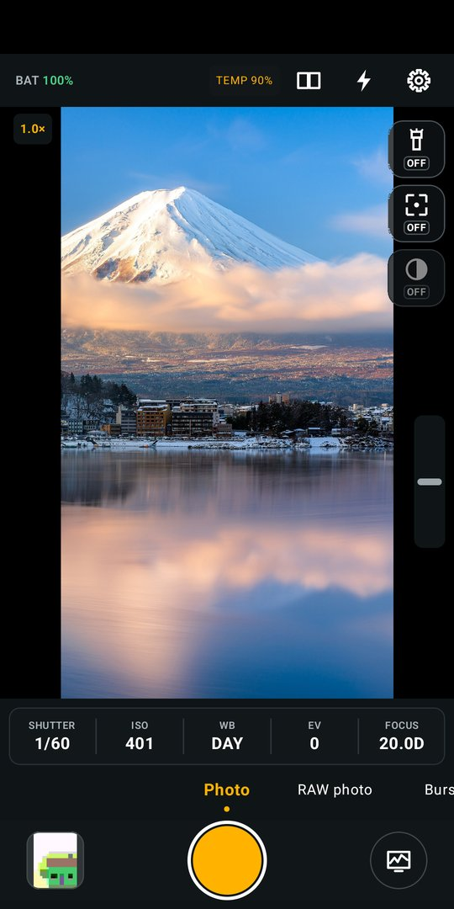
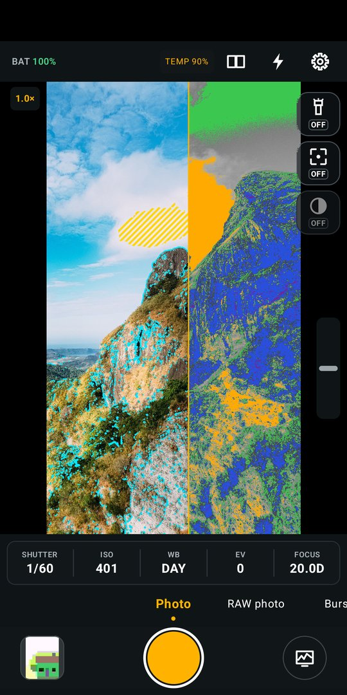
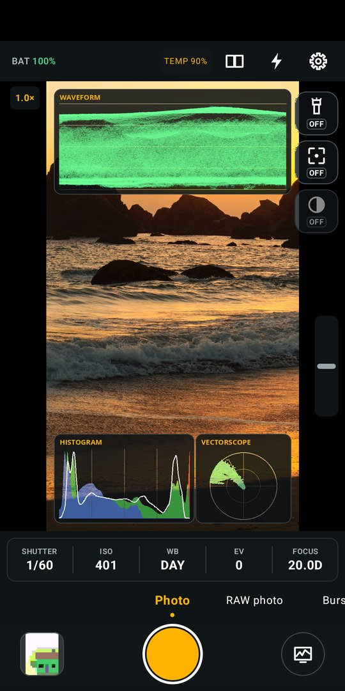
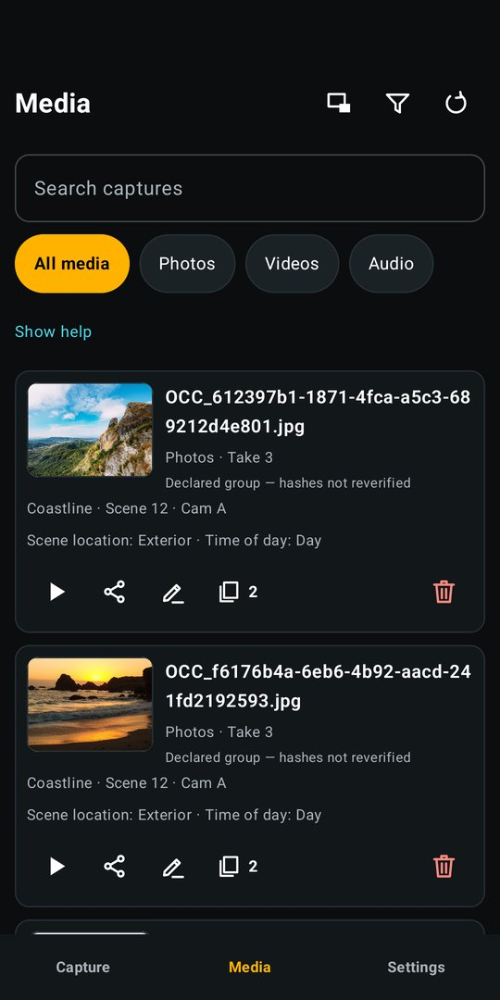
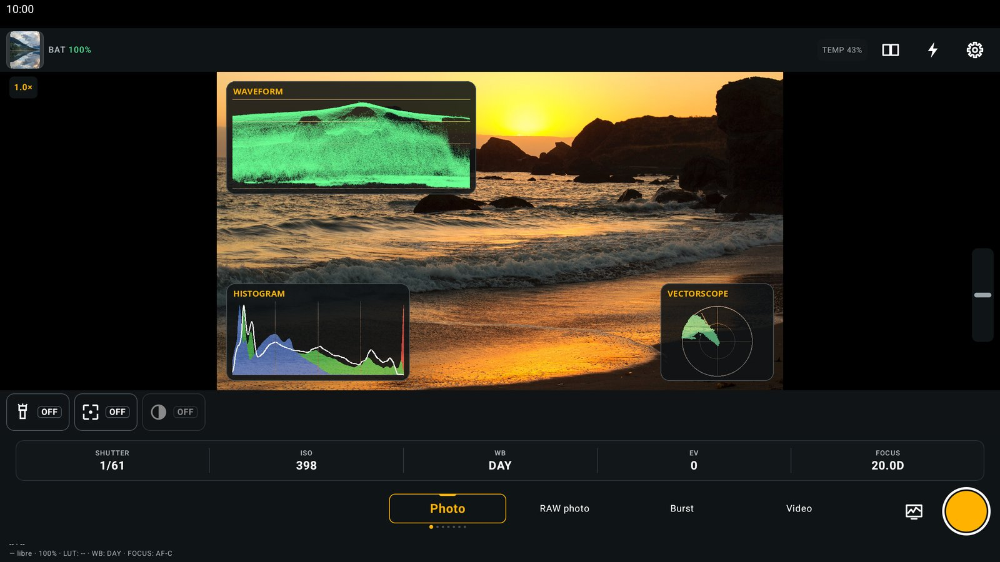

# OpenCineCam

OpenCineCam is a native, open-source cinema camera for Android. It keeps four things apart: what the hardware advertises, what the app requests, what Camera2 reports, and what a recorded file or a controlled test proves. Nothing is presented as supported until the evidence says so.

- **Version:** `1.0.0`, on [Google Play](https://play.google.com/store/apps/details?id=com.librestatic.opencinecam)
- **Package:** `com.librestatic.opencinecam`
- **Requires:** Android 10 (API 29) or later, ARM64
- **License:** [Apache-2.0](LICENSE)
- **Languages:** English, Spanish, French, Portuguese, Italian and German
- **User guide:** [docs/user-guide.md](docs/user-guide.md)

## Screenshots

| Capture | Zebra, peaking, false color | Scopes | Media |
|---|---|---|---|
|  |  |  |  |



Real app screens captured on an emulator, whose camera feed is a flat frame, so the viewfinder photos (CC0 / public domain, see [`store/play/raw/MEDIA_LICENSES.md`](store/play/raw/MEDIA_LICENSES.md)) and the overlays computed from them were composited in afterwards.

## Features

The [user guide](docs/user-guide.md) explains where each feature lives and how to use it.

### Capture

- Photo, burst, bracket, light painting, video, slow motion (real 120/240 fps high-speed takes where the device offers them) and time lapse.
- Gated experimental modes: RAW photo (DNG), LOG (OCLog2, HEVC Main10), HLG, APV and RAW video. They stay hidden unless the device qualifies; APV and RAW video currently take their documented unsupported branch.
- HLG video mode tagged as BT.2020 HLG, with an HDR10 (PQ) option where the camera and a hardware encoder support it.
- Hardware AVC/HEVC video (software AVC only for time lapse, or for regular video under the Adaptive policy).
- **FPS LOCK**: holds the video frame rate in low light by keeping the shutter at 1/fps; on cameras that ignore the exposure priority request, the hold is emulated with manual exposure.
- **Night photo**: the device's night extension for stills (Off, Auto or Always); in Auto a NIGHT quick toggle appears when the scene is dark.
- **Lens calibration**: measures each lens against the main one and corrects colour, exposure and framing in preview and video at the switch points; photo correction is experimental.
- **Lens lock**: keeps a take on one physical lens while you zoom (zoom becomes digital), falling back to a digital crop where the lens cannot be opened directly. **Smooth lens switch** (opt-in) hides the framing jump at an automatic lens switch.
- **Recording policy**: Strict (default on fresh installs) stops a take and says why when storage, heat or frame timing leave the safe range; Adaptive keeps recording, reduces monitoring work and warns.
- Audio as an AAC MP4 track or as separate lossless WAV/FLAC sidecars, with live level meters; USB, Bluetooth and wired microphones with a chosen behaviour when the input disconnects.
- Optional gyro log (`.gcsv`) next to each video, LOG or HLG take, for stabilization in Gyroflow.
- Shared VIDEO/LOG pause, SMPTE timecode, production slate metadata and a canonical `<take>.clip.json` sidecar per video take.
- A take interrupted by a failure is kept and labelled as incomplete, with its reasons, instead of being deleted.

### Monitoring and operation

- Full-screen viewfinder with translucent, compact chrome and side rails for short landscape windows; works in both orientations, on phones, tablets and foldables.
- Focus peaking, zebra, false color, histogram, waveform and vectorscope (with quick toggles in the capture row), grid and horizon level.
- Operator, subject and recording LUTs, LOG view assist, and an always-on thermal load indicator.
- Assignable operator buttons and volume keys, persistent settings and portable presets.
- Hardware keyboard shortcuts: R record, F focus, Z zebra, P peaking, G grid, H scopes, L LOG view, Esc close; Space and arrow keys in playback.
- Configurable haptic feedback by group (capture, controls, focus and exposure, navigation), with ticks muted during a take.
- Predictive back previews, and a one-line summary beside each settings help button.
- Foldable exterior (cover) screen for the subject: status, teleprompter, camera preview, fill light, take review, interview questions and digital slate, optionally split with the rear camera preview; self-recording moves the camera controls to the cover.
- First-run wizard with permission rationale; **Cine** and **Material You** themes.

### Media

- On-device catalog with playback, rename, share and delete; codec and proxy badges and a take inspector.
- Durable queue for on-device editing proxies.
- Optional, off by default: WebDAV transfers of finalized takes, sent by an explicit per-take action or, with **Upload new takes automatically** on, uploaded in the background (WorkManager under a `dataSync` foreground service, Wi-Fi only unless cellular is allowed, paused while recording); and photo/take geotagging.

### Diagnostics

- Camera capabilities page with a report export (redacted by default, or full after explicit consent), the device profile and the quirks it applies, and the latest Main10 file check of an HLG or LOG take.
- Storage benchmark that checks whether a destination sustains the data rate of the current settings.

## Principles

- Public Android APIs and Camera2 only in the portable capture path.
- No accounts, ads, analytics, telemetry, crash reporting or cloud dependency. Network access exists only for the opt-in WebDAV transfers to your own server; automatic upload is a separate opt-in, off by default.
- No silent downgrade of camera, codec, frame rate, RAW, HLG, bit depth or audio state.
- Unknown hardware behavior stays *Unknown*, never false or verified.
- An active recording survives UI recreation through a properly declared foreground service.

See [security and privacy](docs/security-and-privacy.md) and the [privacy policy](docs/privacy/index.md) for details.

## Permissions

| Permission | Used for |
|---|---|
| `CAMERA` | Capture and preview. |
| `RECORD_AUDIO` | Optional audio tracks, sidecars and meters; video still records without it. |
| `POST_NOTIFICATIONS`, `FOREGROUND_SERVICE`, `FOREGROUND_SERVICE_CAMERA`, `FOREGROUND_SERVICE_MICROPHONE` | The visible foreground service that keeps a take alive across UI recreation. |
| `FOREGROUND_SERVICE_DATA_SYNC` | The opt-in automatic WebDAV upload only. It runs only while **Upload new takes automatically** is on. |
| `INTERNET`, `ACCESS_NETWORK_STATE` | Opt-in WebDAV transfers only (PLAN-067 / ADR-0034). Off by default; presets never enable networking. Takes are sent by an explicit action unless automatic upload is turned on, and only to the destination you configure. |
| `ACCESS_COARSE_LOCATION`, `ACCESS_FINE_LOCATION` | Opt-in geotagging only, requested at runtime while the camera screen is open. Off by default. |

No broad storage permission is requested: MediaStore and the Storage Access Framework own destinations. USB microphones need no extra permission or manifest entry; Android's audio input routing handles them.

## Project status

OpenCineCam 1.0.0 is published on the Google Play production track. Earlier builds (0.2.0-beta to 0.5.0-beta) went only to the closed testing track.

Most of the implementation plans are done: the capability/evidence model, Strict/Adaptive policy, Camera2 graph negotiation and lifecycle recovery, encoder selection, muxing and finalization, audio negotiation, the native AHardwareBuffer/OpenGL ES pipeline, thermal hardening, HLG/Main10 qualification, RAW still and RAW10 contracts, crash-safe RAW journaling, desktop recovery tooling, and signed releases.

Still open:

- **OCLog2** is reachable from the launcher and has passed a physical GLES numeric check and cadence-gated 32-second 1080p30 Main10 takes with no dropped frames on the reference device, but stays *experimental* until ISP-derived, OCIO/DCTL/LUT, clipping/range and independent-editor evidence is in ([PLAN-061](docs/plans/PLAN-061-oclog2-specification-interchange-and-device-qualification.md)).
  - Experimental [Lightforge Studio](docs/color/lightforge/README.md) downloads turn OCLog2 into a stock-camera Rec.709 look: [regular takes (HLG)](https://github.com/LibreStatic/opencinecam/raw/main/docs/color/lightforge/OCLog2_HLG_to_Stock709.cube) and [120/240 fps takes (HFR)](https://github.com/LibreStatic/opencinecam/raw/main/docs/color/lightforge/OCLog2_HFR-SDR_to_Stock709.cube). Set Lightforge's input profile to *Standard Rec.709* before applying them.
- **RAW video** stays disabled after failing the 60-second RAW10 throughput gate.
- **F-Droid** is not published yet: the build recipe still has to be accepted and built by F-Droid against an immutable tag, and its artifact compared with the other channels ([PLAN-062](docs/plans/PLAN-062-f-droid-and-google-play-channel-activation.md)).

## Repository layout

| Path | Contents |
|---|---|
| `app/` | Compose UI, capture service, settings, presets, media catalog. |
| `camera/` | Camera2 identity, graph negotiation, lifecycle and high-speed sessions. |
| `media/` | Encoders, muxer, audio and file finalization. |
| `core/model/` | Pure-JVM capability/evidence model and schemas. |
| `native-pipeline/` | NDK AHardwareBuffer and OpenGL ES processing. |
| `desktop-tools/` | Dependency-free desktop RAW recovery tooling. |
| `tools/` | Qualification, release, SBOM and validation scripts. |
| `docs/` | Requirements, ADRs, architecture, plans, formats and release docs. |
| `store/play/` | Google Play listings, declarations and store image scripts. |

Documentation hierarchy: accepted requirements → accepted ADRs → architecture and schemas → implementation plans → code and evidence. Start with the [technical closure](docs/technical-closure.md), the [architecture](docs/architecture.md), the [runtime flows](docs/flows/README.md) and the [plan index](docs/plans/README.md).

## Building and testing

Use JDK 17 and the checked-in Gradle wrapper:

```bash
JAVA_HOME=/usr/lib/jvm/java-17-openjdk ./gradlew --no-daemon --dependency-verification=strict lint test assembleDebug
```

Instrumented tests (local only, need a device or emulator):

```bash
JAVA_HOME=/usr/lib/jvm/java-17-openjdk ./gradlew --no-daemon --dependency-verification=strict connectedDebugAndroidTest
```

Formatting, Python tooling and the plan graph:

```bash
./tools/check_format.sh
python3 -m unittest discover -s tools/tests -p 'test_*.py'
python3 tools/validate_plan_system.py
```

Add `--require-evidence` to the plan validator for release certification (`evidence/` is not part of a clean checkout). `python3 tools/device_gate.py --output evidence/plan-034/device-gate.json` records non-promotional device identity evidence for conditional gates.

## Releases

The same source ships through three channels ([release contract](docs/release/three-channel-release.md)):

- **Google Play:** `tools/build-play-bundle.sh` builds the bundle signed with a separate upload key, and `tools/play-publish.py` publishes it through the Play Developer API (`status`, then `publish --aab … --mapping … --track alpha|production`, with `--rollout` for a staged rollout and `--dry-run` to validate first). See "Publishing to Google Play" in [AGENTS.md](AGENTS.md). Production versions carry no pre-release suffix; closed-testing (`alpha`) builds keep `-beta`.
- **GitHub:** tagged releases with signed ARM64 APKs and checksums.
- **F-Droid:** reproducible build from the tagged source and lockfiles (pending, see above).

The GitHub Actions workflows (Android quality, Play prerelease, Android tagged release) are disabled for now. Releases are gated locally with the same command as CI (see Building and testing) and built locally.

`versionCode` must always increase. With CI off it is the fallback constant in `app/build.gradle.kts`, raised by hand above the last uploaded code before each release; `-Popencinecam.versionCode` overrides it. With CI on, it is the run number plus an offset of 100. Signing keys never enter the repository.

## Contributing

Issues and pull requests are welcome at [LibreStatic/opencinecam](https://github.com/LibreStatic/opencinecam). Run the checks above before opening a pull request, and keep device claims backed by evidence.
