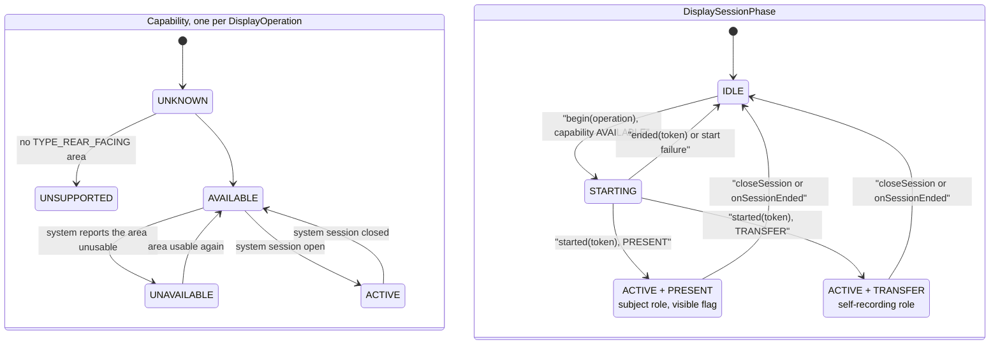
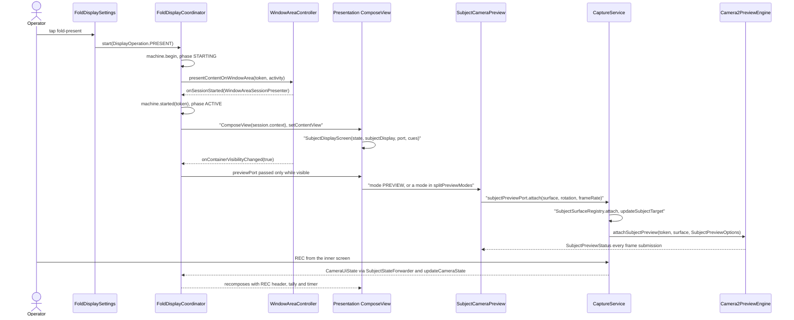
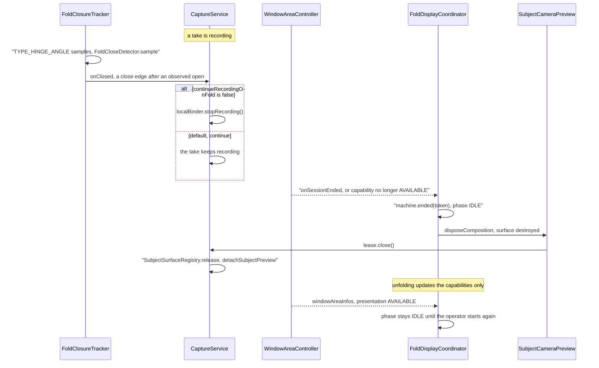
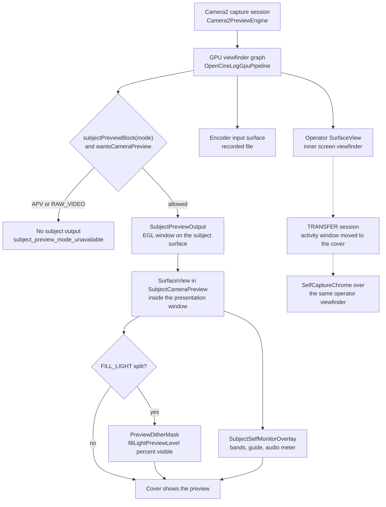

# Fold displays and the cover screen

On a foldable with a rear (cover) display, OpenCineCam can use that display in two ways. In a **presentation** session, the cover shows subject-facing content while the operator keeps using the inner screen. In a **transfer** session, the whole activity moves to the cover so the operator can record themselves with the rear cameras. Both use the public Jetpack `WindowAreaController` API. The activity owns the display sessions, and `CaptureService` keeps sole ownership of the camera and recording. Closing or losing a display session therefore never stops a take. This page covers posture and capability detection, the session state machine, the seven subject modes, the split screen, how camera frames reach each display, brightness, and what happens on fold and unfold. The decisions are in [ADR-0031](../adr/ADR-0031-fold-display-sessions-and-roles.md) and [ADR-0004](../adr/ADR-0004-surfaceview-preview-and-foldable-lifecycle.md). The plans are [PLAN-064](../plans/PLAN-064-fold-display-sessions-and-continuity.md), [PLAN-068](../plans/PLAN-068-exterior-screen-subject-features.md) and [PLAN-028](../plans/PLAN-028-foldable-activity-and-camera-continuity.md).

## Where it lives

All paths are under [`app/src/main/java/com/librestatic/opencinecam/`](../../app/src/main/java/com/librestatic/opencinecam/).

| Concern | Code |
|---|---|
| Session coordinator, posture and capabilities | [`FoldDisplayCoordinator.kt`](../../app/src/main/java/com/librestatic/opencinecam/FoldDisplayCoordinator.kt), created by [`MainActivity.kt`](../../app/src/main/java/com/librestatic/opencinecam/MainActivity.kt) and provided as `LocalFoldDisplayCoordinator` |
| State types, `FoldSessionStateMachine`, `FoldCloseDetector` | [`FoldDisplayState.kt`](../../app/src/main/java/com/librestatic/opencinecam/FoldDisplayState.kt) |
| Hinge-angle close edge in the service | [`service/FoldClosureTracker.kt`](../../app/src/main/java/com/librestatic/opencinecam/service/FoldClosureTracker.kt), [`service/CaptureService.kt`](../../app/src/main/java/com/librestatic/opencinecam/service/CaptureService.kt) |
| Subject content | [`SubjectDisplayScreen.kt`](../../app/src/main/java/com/librestatic/opencinecam/SubjectDisplayScreen.kt), with one file per mode: `SubjectFillLightContent.kt`, `SubjectReviewContent.kt`, `SubjectInterviewContent.kt`, `SubjectSlateContent.kt`. Overlays are in `SubjectOverlayLayer.kt` |
| Camera preview on the cover | [`SubjectCameraPreview.kt`](../../app/src/main/java/com/librestatic/opencinecam/SubjectCameraPreview.kt), [`SubjectPreviewPort.kt`](../../app/src/main/java/com/librestatic/opencinecam/SubjectPreviewPort.kt), [`SubjectPreviewDither.kt`](../../app/src/main/java/com/librestatic/opencinecam/SubjectPreviewDither.kt). The engine side is `attachSubjectPreview` in [`camera/.../Camera2PreviewEngine.kt`](../../camera/src/main/java/com/librestatic/opencinecam/camera/Camera2PreviewEngine.kt) and [`camera/.../OpenCineLogGpuPipeline.kt`](../../camera/src/main/java/com/librestatic/opencinecam/camera/OpenCineLogGpuPipeline.kt) |
| Fill light dimming | [`SubjectFillLightPolicy.kt`](../../app/src/main/java/com/librestatic/opencinecam/SubjectFillLightPolicy.kt) |
| Self capture on the cover | [`SelfCaptureChrome.kt`](../../app/src/main/java/com/librestatic/opencinecam/SelfCaptureChrome.kt) |
| Displays menu | [`FoldDisplaySettings.kt`](../../app/src/main/java/com/librestatic/opencinecam/FoldDisplaySettings.kt). It is shown in the capture pane (`CapturePane.Displays` in [`CameraScreen.kt`](../../app/src/main/java/com/librestatic/opencinecam/CameraScreen.kt)) and in the Settings card `fold-displays` |
| Persisted preferences | `SubjectDisplaySettings`, persisted through [`CameraSettings.kt`](../../app/src/main/java/com/librestatic/opencinecam/CameraSettings.kt) |

## States and roles

`FoldDisplayCoordinator` listens to `WindowAreaController.windowAreaInfos`. It picks the `TYPE_REAR_FACING` area and maps the status of `OPERATION_PRESENT_ON_AREA` and `OPERATION_TRANSFER_ACTIVITY_TO_AREA` into two separate `DisplayCapability` values. `FoldSessionStateMachine` holds the application's own session state: a `DisplaySessionPhase`, the chosen `DisplayOperation`, `visible` and `failure`. Each `begin` increments a generation token. A late `onSessionStarted`, `onSessionEnded` or `onContainerVisibilityChanged` carrying an old token is ignored, and an old session object is closed instead of being revived.

The two roles:

- **Subject role (`PRESENT`).** The cover shows `SubjectDisplayScreen`. It is output-only: no binder, no capture or settings actions, and touch is locked by default.
- **Self-recording role (`TRANSFER`).** Only this role sets `selfRecordingActive`. The coordinator reports it through `updateSelfRoleObserver` to `CaptureService.LocalBinder.setSelfRecordingActive`. Capture requests carry a `CaptureActionTicket`, so the service rejects a stale role.

Posture is tracked separately. `WindowInfoTracker.windowLayoutInfo` gives a `FoldingFeature`, which becomes a `FoldPosture` (`NONE_REPORTED`, `FLAT`, `TABLETOP`, `BOOK` or `SEPARATING`) plus an optional `FoldHinge`. The capture layout uses these, together with `adaptToHinge` and `swapPanes`. A missing `FoldingFeature` is reported as `NONE_REPORTED`. It is never taken to mean "closed".

`LocalFoldDisplayStateWithoutCoordinator` provides the `FoldDisplayState` that `FoldDisplaySettings` shows when there is no coordinator. Only the headless Compose Driver screens set it. The app always has a coordinator.

## Starting a subject mode

Nothing starts a session automatically. Stored preferences never open one; only the operator's tap does. In the capture pane, tapping a mode card opens its page (`FoldModePage`), which has the same open and close action. Every `CameraUiState` the service publishes is forwarded to the subject window unfiltered.

## Folding and unfolding during a take

Two independent mechanisms react to a fold:

- **The recording policy runs in `CaptureService`.** It does not depend on the activity. `FoldClosureTracker` reads `Sensor.TYPE_HINGE_ANGLE` on API 30 and later. `FoldCloseDetector` reports a close edge only at 5° or less, and only after an opening of 15° or more has been seen. Whether a sensor exists is published as `foldClosureSensorAvailable`. `continueRecordingOnFold` defaults to true. The settings merge used during a take keeps its value from when the take started, so changing it mid-take has no effect until the next take.
- **The display session belongs to the system.** The coordinator has no camera, record or stop command. When the system ends the session, `ended` only disposes the subject window. The preview lease is released, and the engine stops feeding the cover surface. The take continues.

## How a frame reaches each display

In a presentation, the cover gets its own output from the GPU viewfinder. No second camera stream is opened. `SubjectCameraPreview` creates a `SurfaceView` inside the presentation's `ComposeView`. It asks the cover to run at the operator display's peak rate when the cover supports it, using `subjectPreviewFrameRate` and `Surface.setFrameRate`. It then attaches the surface through the output-only `SubjectPreviewPort`.

`CaptureService` keeps the lease in a `SubjectSurfaceRegistry`, whose tokens stop a late destroy from detaching a newer surface. It forwards the mirror, view assist and squeeze settings as `SubjectPreviewOptions`. While a subject lease is attached and `wantsCameraPreview` is true, the GPU graph stays alive in photo modes too. A constrained high-speed take keeps its encoder surface direct, and the GPU only fans the preview share out. Compose overlays draw only on the cover window, so the recorded file never contains them.

In a transfer, the activity window itself is on the cover. The ordinary operator viewfinder is therefore what the user sees there. When `selfMinimalControls` is on, `CameraScreen` replaces `AdaptiveCaptureChrome` with `SelfCaptureChrome`.

### Subject modes

`SubjectDisplayMode` has seven values. `splitPreviewModes` lists the modes whose cover is split, with the mode on top and the camera preview below. `PREVIEW` is never in that set.

| Mode | What the cover shows |
|---|---|
| `STATUS` | A large Ready, or REC with the take time, plus the operator's cue |
| `TELEPROMPTER` | `prompterText`, scrolled by frame time at `prompterSpeedDpPerSecond` unless paused |
| `PREVIEW` | The full camera preview, with the self-monitor overlay |
| `FILL_LIGHT` | A full-bleed colour from `fillLightKelvin` and `fillLightTint`. When split, the preview half is covered by `PreviewDitherMask`, a 4x4 Bayer mask that leaves `fillLightPreviewLevel` percent of the pixels visible |
| `REVIEW` | The take or photo the operator picked (`SubjectReviewController`). It is never persisted, and starting a take stops it |
| `INTERVIEW` | The current question from `interviewQuestions`. The operator moves through them with `SubjectSessionCues.interviewIndex`, which resets to 0 when the session ends |
| `SLATE` | Production slate fields and the take timecode, with an optional sync flash and beep (`SubjectSyncMarkerController`) |

`SubjectOverlayLayer` draws above every mode: the tally border, the giant countdown and the out-of-frame warning.

### Cover brightness

`applyBrightness` sets a window brightness only during a transfer. Then the activity's own window is on the cover and receives `subjectDisplay.brightness`. When the transfer ends, the request returns to `BRIGHTNESS_OVERRIDE_NONE`. A presentation gets no request at all, because the cover follows the inner screen's brightness and the system ignores the request (on the Razr, `reason=follower`). For the fill light, `fillLightOutput` scales the pixel colour (`colorScale`) for thermal status and timeout, which dims the light even though the window brightness does not change.

### The Displays pane

`FoldDisplaySettings` shows the same `FoldStatusCard` in both places. The card offers start subject display (`fold-present`), start self-recording (`fold-transfer`) and close or return (`fold-close`). When nothing can be started, it says why: unfold, unsupported, or checking.

- **In the capture chrome** (`inCapturePane = true`, opened from the Displays top action), each mode opens its own page. The inner-screen options are left out. During a transfer, the top action becomes Return.
- **In Settings**, the card shows the chosen mode's settings inline, together with the inner-screen section: continue recording on fold, adapt to hinge, and swap panes.

## Failure and edge cases

- **Self-recording is only started between takes.** `fold-transfer` is disabled while recording.
- **Preview only while visible.** The presentation receives the preview port only while `visible` is true. A hidden container shows no camera image.
- **Modes without a subject preview.** APV and RAW video have their own graphs. The cover shows `subject_preview_mode_unavailable` instead of a picture.
- **Stale or failed frames.** `SubjectFrameBadge` uses a clock to mark the picture stale, so a frozen surface is visible. If the producer is still releasing a previous window, the error is `SubjectPreviewFailure.BUSY`.
- **Layout stream failures.** If the layout stream throws, the coordinator closes the session and subscribes again after `LAYOUT_RETRY_MS` (1 s). If the window-area stream throws, the session is closed.
- **Hinge sensor.** Without a hinge-angle sensor, stop on close cannot work. `foldClosureSensorAvailable` is false, and the Settings card says so.
- **Not modelled headless.** Compose Driver renders the cover screens without real insets, hinge or dual display (see `AGENTS.md`). The emulator has no dual-display fold. Physical cover behaviour needs the Razr.

## Invariants

- The display coordinator never opens the camera, records or stops. Closing, hiding or losing a session never stops a take.
- Sessions start only from an explicit operator action, never from stored preferences.
- Subject content is output-only: it gets state and a `SubjectPreviewPort`, never the capture binder.
- Generation tokens fence every session callback and every subject surface lease.
- Only an active `TRANSFER` session grants the self-recording role.
- Subject overlays never reach the recorded file.

## Related

- [ADR-0031: fold display sessions and roles](../adr/ADR-0031-fold-display-sessions-and-roles.md) and [ADR-0004: SurfaceView preview and foldable lifecycle](../adr/ADR-0004-surfaceview-preview-and-foldable-lifecycle.md)
- [PLAN-064](../plans/PLAN-064-fold-display-sessions-and-continuity.md), [PLAN-068](../plans/PLAN-068-exterior-screen-subject-features.md), [PLAN-028](../plans/PLAN-028-foldable-activity-and-camera-continuity.md)
- [Device validation](../device-validation.md)

### Differences from the ADRs

- ADR-0031 says that brightness is a window request in all cases. In the code, only a transfer sets the window brightness. A presentation follows the inner screen, and the fill light dims by `colorScale`. `FillLightOutput.windowBrightness` is computed but never applied.
- ADR-0031's first text limits presentation content to `STATUS` and `TELEPROMPTER`. Its later amendments and PLAN-068 add `PREVIEW`, `FILL_LIGHT`, `REVIEW`, `INTERVIEW` and `SLATE`, and the code has all seven.
