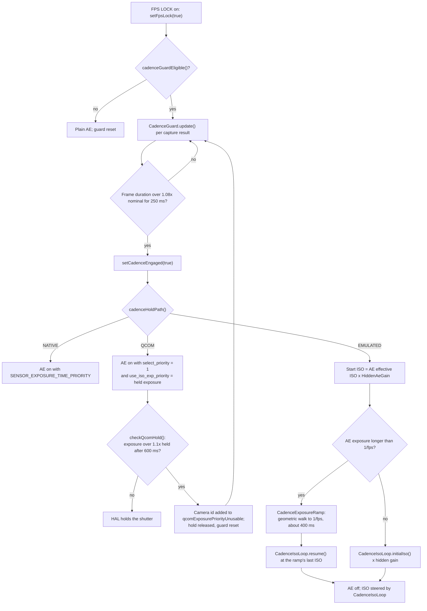
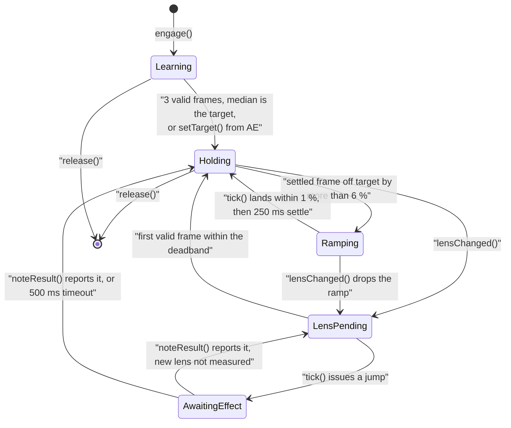
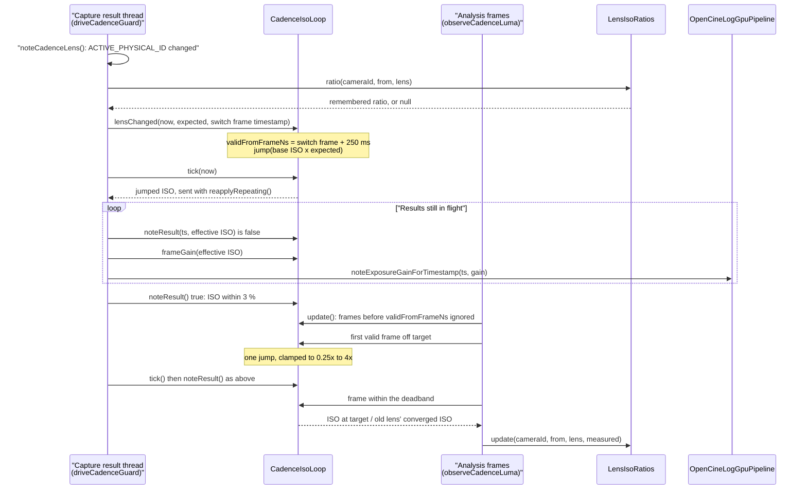

# FPS LOCK: the cadence hold and its emulation

FPS LOCK keeps a video take at its nominal frame rate in the dark. With the gain at its ceiling, automatic exposure on some HALs lets the exposure grow past the frame time, so a 4K60 take silently drops to about 33 fps. When `CadenceGuard` sees that stretch, the engine holds the shutter at 1/fps and lets the image darken instead. Android 16's exposure-time priority or Qualcomm's vendor priority hold the shutter with AE still on. On a HAL with neither, or one that ignores the vendor keys (the Razr Fold), the engine emulates the hold: AE goes off, the exposure is fixed and `CadenceIsoLoop` steers the ISO in software from the analysis frames. This page follows that emulated path, including what happens when the logical camera switches physical lens under it.

## Where it lives

- [`CadenceGuard.kt`](../../camera/src/main/java/com/librestatic/opencinecam/camera/CadenceGuard.kt): times the stretch, engages and releases the hold.
- [`QcomExposurePriority.kt`](../../camera/src/main/java/com/librestatic/opencinecam/camera/QcomExposurePriority.kt): `CadenceHoldPath`, the pure `cadenceHoldPath()` choice and `qcomHoldIgnored()`.
- [`CadenceIsoLoop.kt`](../../camera/src/main/java/com/librestatic/opencinecam/camera/CadenceIsoLoop.kt): `CadenceIsoLoop`, `CadenceExposureRamp`, `HiddenAeGain`, `LensIsoRatios`, `cadenceBurstWanted()` and `cadenceLumaProducerAccepted()`. All of them are pure and host-tested.
- [`Camera2PreviewEngine.kt`](../../camera/src/main/java/com/librestatic/opencinecam/camera/Camera2PreviewEngine.kt): the wiring. `driveCadenceGuard()` runs on each capture result, `setCadenceEngaged()` performs the handoff, `noteCadenceLens()` follows lens switches, `observeCadenceLuma()` reads each analysis frame and `updateAnalysisBurst()` sets the analysis rate.
- [`OpenCineLogGpuPipeline.kt`](../../camera/src/main/java/com/librestatic/opencinecam/camera/OpenCineLogGpuPipeline.kt): `noteExposureGainForTimestamp()` applies the per-frame bridge gain through the lens splice's exposure term.
- Device measurements: the [FPS LOCK section](../device-validation.md#fps-lock-cadence-lock) and the [G3 section](../device-validation.md#g3-zoom-sweep-with-the-saved-calibration-2026-10-27) of `docs/device-validation.md`.

## Hold-path selection and the handoff

The guard only runs when `cadenceGuardEligible()` holds. That requires FPS LOCK on, a video graph, automatic exposure with AE unlocked, the low-light auto frame rate off, no constrained high speed, no timelapse take and no night session. The pure `cadenceHoldPath()` prefers Android's native priority, then the Qualcomm vendor priority if its advertised `exposure_time_range` contains the held exposure, then the emulated hold if the camera has manual sensor control. If the HAL ignores the Qualcomm keys, `checkQcomHold()` marks the camera unusable for the rest of the process. The guard then engages again on the emulated path.

The emulated handoff begins at AE's own exposure and total gain, which is sensor ISO times the post-raw boost, so the first held frames match AE. AE ON applies an ISP gain that AE OFF loses and no metadata reports, so the start ISO is multiplied by `HiddenAeGain`. Its prior is 2.2. The gain is kept per camera and lens in memory and updated from the second manual frame against AE's luma. `CadenceExposureRamp` then walks the exposure down to 1/fps in steps at least 33 ms apart, with the ISO compensating. The UI shows the key as holding only once the ramp lands. The first result that really reports `CONTROL_AE_MODE_OFF` sets the loop's target to the median of AE's last analysed lumas (`setTarget(..., "ae")`). If no AE frame was seen, the loop learns the target itself.

The loop's ISO range is `CadenceIsoLoop.extendedRange()`: the sensor range extended by `CONTROL_POST_RAW_SENSITIVITY_BOOST`, capped at 8x the sensor maximum. `CadenceIsoLoop.split()` turns an effective ISO back into the two request keys.

## The ISO loop

These states are a reading of the loop's fields, not an enum: `hasTarget`, `ramping` (`desiredIso`), `lensPending` (`lensBaseIso`) and `awaitingEffect` (`awaitingIso`).

- **Learning.** After the 200 ms settle window, the first `LEARN_FRAMES` (3) valid frames teach the target luma. The ISO does not move until then. A lens switch while learning only clears the collected frames.
- **Holding.** Each settled frame computes `ratio = target x 2^EV / luma`. Within the ±6 % deadband nothing moves, and the loop records the ISO that held the target (`convergedIso`).
- **Ramping.** A frame off target plans `iso x ratio^2`, clamped to 0.5–2x. `tick()` runs on every capture result and walks the ISO towards the plan, at most 4 % per issue and at least 66 ms apart. Frames are ignored while ramping and for 250 ms after.
- **LensPending.** The new lens has not been measured yet; see the next section.
- **AwaitingEffect.** A jump went out, and no capture result has reported it within 3 % (`EFFECT_TOLERANCE`) yet. After `EFFECT_TIMEOUT_NS` (500 ms) the loop measures by the clock alone and logs that the jump was never reported.

Only one analysis producer feeds the loop: the GPU readback when a GPU pipeline exists, otherwise the YUV reader (`cadenceLumaProducerAccepted()`), because their luma domains differ. `cadenceBurstWanted()` makes analysis run every 33 ms in three cases: while the guard times a stretch, while the loop learns or ramps within 1.5 s of engaging, and while a lens is pending. Burst frames feed only the loop. The UI and the scopes keep their normal rate.

## A lens switch under the emulated hold

With AE off, the HAL gives the new lens the old lens' manual ISO, and on the Razr Fold the lenses differ in sensitivity by more than 10x. `noteCadenceLens()` reads `LOGICAL_MULTI_CAMERA_ACTIVE_PHYSICAL_ID` from each result. On a change it resets `CadenceGuard`'s ISO reference (`CadenceGuard.lensChanged()`) and, once the emulated hold has seen a manual result and the exposure ramp has landed, calls `CadenceIsoLoop.lensChanged()`.

- **Jump.** A remembered ratio makes the loop jump at once from the ISO that held the target on the old lens.
- **Settle.** Frames exposed within `lensContentSettleNs` (250 ms of sensor time) after the switch frame are not measured. During that window the HAL still matches the new lens' brightness to the old one's, so those frames do not follow the ISO.
- **Correction.** The first valid frame steers at most one corrective jump within `lensJumpMin`..`lensJumpMax` (0.25–4x).
- **Waiting for the effect.** After any jump, `noteResult()` waits for the result that reports the jumped ISO. Only frames from that result's timestamp on are measured, because the jump has to pass the HAL's in-flight requests (8 on the Razr, over 130 ms at 60 fps).
- **Bridge.** Meanwhile `frameGain()` tells the GPU pipeline how much to scale each in-flight frame, within 0.25–4x, so it looks as if it had been shot at the incoming ISO.

`LensIsoRatios` learns only between converged ISOs: the old lens' last frame on target (`convergedIso`, kept as `ratioBaseIso`) against the new lens' first frame on target. A first frame that is far off says little about the ratio, so it steers the jump and teaches nothing. A ratio past 4x is learnt once the following ramp lands on target. `LensIsoRatios` folds each measurement into the stored value in log space with weight 0.5, accepting only ratios within 0.125–8x, and stores the inverse for the opposite direction. The engine also discards a measurement if the loop missed a switch during the handoff or the ramp (`cadenceRatioFromLensId`).

Set `debug.opencinecam.cadence.trace` to `1` on a debug build to trace switches. For 1.5 s after each switch the engine then logs every result and every analysed luma under the `CadenceTrace` tag. Release builds ignore the property.

## Failure and edge cases

- **Qualcomm keys ignored.** The Razr 50 Ultra advertises the vendor tags but keeps a 30 ms exposure. After 600 ms the engine marks the camera in `qcomExposurePriorityUnusable` and engages the emulated hold instead.
- **Request refused.** If `reapplyRepeating()` fails, `setCadenceEngaged()` reports the previous state, sets `cadenceFaulted` and stops trying until FPS LOCK is toggled or the session is closed.
- **Analysis suspended.** The thermal governor can suspend analysis. The ISO then stays where it is, and the burst is off.
- **ISO capped.** If the HAL rounds or caps a jumped ISO, it is never reported. After 500 ms the loop falls back to the clock (`EFFECT_TIMEOUT_NS`).
- **Frames without a sensor timestamp.** They use the clock-based `lensSettleNs` (150 ms) instead.
- **Second switch.** If a second switch comes before the new lens holds the target, `ratioBaseIso` is empty, so nothing is learnt for that pair.
- **Hidden gain during a switch.** A switch during the handoff skips the hidden-gain measurement for that engage, so the gain is never learnt from two lenses.
- **Lens lock.** In a lens-locked session `noteCadenceLens()` uses the locked physical id, so the loop never sees a switch.
- **Exposure compensation.** A change while held scales the target by `CadenceIsoLoop.evScale()`. This is approximate, because the luma is gamma-encoded.

## Invariants

- The loop is pure and `@Synchronized`. The engine supplies the clock, the luma and the sensor timestamps.
- Only one luma producer drives the loop for a pipeline's lifetime.
- The ISO never leaves `extendedRange()`.
- Outside a lens switch, the ISO never moves more than 4 % per issue, with issues at least 66 ms apart.
- A lens switch causes at most one jump from the remembered ratio and one corrective jump. Ordinary ramps follow.
- A frame exposed before a jump's effect is reported never counts as a measurement after the jump.
- `HiddenAeGain` and `LensIsoRatios` live in memory for the process only, and are keyed per camera, and per camera and lens.

## Related

- [ADR-0032: professional control intent and reported state](../adr/ADR-0032-professional-control-intent-and-reported-state.md): the reported exposure mode stays AUTO while the hold is engaged.
- [ADR-0016: thermal backpressure](../adr/ADR-0016-thermal-backpressure-and-performance-policy.md): the policy that suspends analysis, and with it the loop.
- [PLAN-070](../plans/PLAN-070-lens-calibration-and-lens-lock.md): its G3 gate drove the lens-switch work in the loop.
- [Lens calibration and lens lock](lens-calibration-and-lock.md): the G3 sweep ran with this hold engaged.
- Tests: `CadenceIsoLoopTest` and `CadenceGuardTest` in [`camera/src/test`](../../camera/src/test/java/com/librestatic/opencinecam/camera/).
