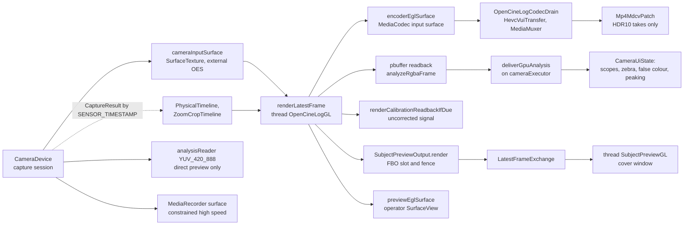
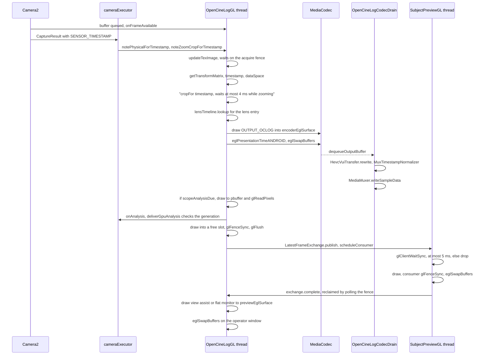

# GPU frame pipeline

This page explains how a camera frame moves through OpenCineCam's GPU path, from the Camera2
output to every consumer: the operator viewfinder, the video encoder, the scope and focus-peaking
analysis, the lens calibration readback and the cover (subject) display. It covers the colour
transforms (OCLog2, HLG, SDR passthrough, the Rec.709 view assist, monitor LUTs), the per-lens
correction and the lens-lock crop, the analysis cadence and thermal suspension, the HDR metadata
fix-ups, and the synchronisation the code relies on. Read it before you change
`OpenCineLogGpuPipeline`, the way `Camera2PreviewEngine` builds its sessions, or any shader.

## Where it lives

| Concern | File |
|---|---|
| GL thread, shaders, encoder, readbacks | [`OpenCineLogGpuPipeline.kt`](../../camera/src/main/java/com/librestatic/opencinecam/camera/OpenCineLogGpuPipeline.kt) |
| Session graphs and pipeline choice | [`Camera2PreviewEngine.kt`](../../camera/src/main/java/com/librestatic/opencinecam/camera/Camera2PreviewEngine.kt) (`startPreview`, `configureGpuPreviewSession`, `configureLogSession`) |
| When the viewfinder goes through the GPU | [`service/CaptureService.kt`](../../app/src/main/java/com/librestatic/opencinecam/service/CaptureService.kt) (`desiredGpuViewfinder`) |
| Shared EGL display | [`GpuEglDisplayLease.kt`](../../camera/src/main/java/com/librestatic/opencinecam/camera/GpuEglDisplayLease.kt) |
| Cover display output | [`SubjectPreviewOutput.kt`](../../camera/src/main/java/com/librestatic/opencinecam/camera/SubjectPreviewOutput.kt), [`LatestFrameExchange.kt`](../../camera/src/main/java/com/librestatic/opencinecam/camera/LatestFrameExchange.kt) |
| Scope maths and thermal governor | [`MonitoringAnalysis.kt`](../../camera/src/main/java/com/librestatic/opencinecam/camera/MonitoringAnalysis.kt), [`AnalysisStream.kt`](../../camera/src/main/java/com/librestatic/opencinecam/camera/AnalysisStream.kt) (`ThermalAnalysisGovernor`), [`CadenceIsoLoop.kt`](../../camera/src/main/java/com/librestatic/opencinecam/camera/CadenceIsoLoop.kt) (`analysisPeriodMs`) |
| View assist and LUTs | [`OpenCineLogViewAssist.kt`](../../camera/src/main/java/com/librestatic/opencinecam/camera/OpenCineLogViewAssist.kt), [`CubeLut.kt`](../../camera/src/main/java/com/librestatic/opencinecam/camera/CubeLut.kt), [`MonitorLut.kt`](../../camera/src/main/java/com/librestatic/opencinecam/camera/MonitorLut.kt) |
| Lens correction and crop | [`calibration/LensCorrectionRuntime.kt`](../../camera/src/main/java/com/librestatic/opencinecam/camera/calibration/LensCorrectionRuntime.kt) (`LensCorrectionTable`, `PhysicalTimeline`), [`LensLock.kt`](../../camera/src/main/java/com/librestatic/opencinecam/camera/LensLock.kt) (`LensLockCrop`), [`ZoomLagCompensator.kt`](../../camera/src/main/java/com/librestatic/opencinecam/camera/ZoomLagCompensator.kt) (`ZoomCropTimeline`) |
| HDR container fix-ups | [`HevcVuiTransfer.kt`](../../camera/src/main/java/com/librestatic/opencinecam/camera/HevcVuiTransfer.kt), [`Mp4MdcvPatch.kt`](../../camera/src/main/java/com/librestatic/opencinecam/camera/Mp4MdcvPatch.kt) |
| Native foundation, not wired in | [`native-pipeline/`](../../native-pipeline/README.md) |

**Code versus ADR-0021.** [ADR-0021](../adr/ADR-0021-deferred-native-code-and-opengl-es-backend.md)
describes an NDK backend that imports `AHardwareBuffer`s through JNI handles. The runtime does
not work that way. `native-pipeline/` (`GpuProcessingPipeline`, `probe_gpu`) builds and tests only
on the host through CMake. It is not a Gradle module (`settings.gradle.kts` includes `:app`,
`:core:model`, `:camera`, `:media` and `:baselineprofile`), and no `System.loadLibrary` or
`external fun` exists. Every frame on a device goes through Kotlin `EGL14`/`GLES30` code. Camera2
writes into a `SurfaceTexture` that is sampled as `GL_TEXTURE_EXTERNAL_OES`, and the platform's
BufferQueue handles the hardware buffers behind it. The ADR's "OpenGL ES 3 first, keep a direct
encoder fallback" does hold. The ADR's 2026-10-28 amendment records this Kotlin path as the shipped
backend.

## Frame graph

`Camera2PreviewEngine.startPreview` creates an `OpenCineLogGpuPipeline` in two cases. For LOG and
HLG (`openCineLog`) it uses the profile's `OpenCineLogSourcePath` (`HLG10_BT2020` or
`SDR_BT709_ISP`) and a 10-bit render config. For `gpuPreview` it uses `passthroughSdr = true`
with `SDR_BT709_ISP`. The service sets `gpuPreview` from `desiredGpuViewfinder`. Since 372ec9c,
`VIDEO`, `LOG`, `HLG` and `TIME_LAPSE` always preview through the GPU, so REC only starts the encoder
on the live graph. Before that, plain video previewed straight from Camera2, and the viewfinder froze
at REC because EGL cannot reconnect to a SurfaceView the camera has just released. PHOTO goes through
the GPU only when it needs to: for the cover preview, a monitor LUT or lens calibration, or the
lens-lock crop. The night extension never does.

The pipeline's `cameraInputSurface` is the camera's single output in `configureGpuPreviewSession`.
On the direct (non-GPU) path, the engine adds a `YUV_420_888` `analysisReader` for the scopes
instead. A constrained high-speed take records straight from Camera2 into `MediaRecorder`
(`recorderOverGpuPreview`), and the pipeline receives only the preview share for the displays.

## One frame's journey

All rendering for one pipeline is serialised on its `OpenCineLogGL` `HandlerThread`. The order
within `renderLatestFrame` is fixed: encoder first, then scopes, calibration readback, cover, and
the operator viewfinder last. The main path creates no explicit fences. `updateTexImage` waits
on the buffer's acquire fence, and `eglSwapBuffers` hands each window's buffer and release fence
to its BufferQueue. `glReadPixels` is synchronous.

Frames are matched to their metadata by sensor timestamp, not by arrival order. The capture
callback records the active physical camera (`LOGICAL_MULTI_CAMERA_ACTIVE_PHYSICAL_ID`) and the
zoom-lag crop under `SENSOR_TIMESTAMP`. The GL thread looks them up by `SurfaceTexture.timestamp`.
`PhysicalTimeline.lookup` falls back to the nearest earlier entry and counts the miss.
`ZoomCropTimeline.cropFor` waits up to `ZOOM_LAG_WAIT_NS` (4 ms) for a late result while the zoom
is moving.

The encoder's presentation time is the sensor timestamp, mapped through `CaptureEpochClock`, or
chosen by `TimelapseTimeline` or `ProjectFrameTimeline`. It is set with
`eglPresentationTimeANDROID`. `MuxTimestampNormalizer` rebases video and audio onto their own
origins and keeps both monotonic.

The cover output is the only place with explicit GL fences, because it crosses threads and EGL
contexts (its context shares objects with the pipeline's). The producer never waits. It
polls returned slots with a zero timeout, drops the frame when no slot is free, and
`SubjectFramePacer` limits its rate. The consumer waits at most `CONSUMER_FENCE_BUDGET_NS` (5 ms)
on its own thread. A stuck cover swap therefore cannot stall the encoder or the viewfinder.

## Colour transforms

Each output picks a program and a `uOutputMode` in `draw`:

- **Encoder.** `OUTPUT_OCLOG`, the OCLog2 encode into an EGL surface tagged
  `EGL_GL_COLORSPACE_BT2020_LINEAR_EXT`. An HLG take uses `hlgSignalProgram` instead, with
  `hlgSurfaceAttributes`, PQ for HDR10. It decodes the HLG10 stream, which the code treats as
  carrying BT.709 primaries despite its BT.2020 tag, moves it to BT.2020, and re-encodes HLG with no
  gain. A recording LUT uses `operatorLutProgram` with no fallback. In passthrough SDR the pixels
  are unchanged.
- **Operator viewfinder and cover.** `OUTPUT_VIEW_ASSIST` (the shader's `viewAssist709`: middle grey
  to 0.18, a luminance shoulder above 0.5, a hue-preserving fit into [0, 1]) or
  `OUTPUT_FLAT_MONITOR`. `OpenCineLogViewAssist` is the CPU twin used for review playback.
- **Monitor LUTs.** A `MonitorLut` wraps a `CubeLut`, a bounded SDR Cube 1.0 subset with trilinear
  interpolation. It is uploaded as a 3D texture and applied only if `monitorLutCompatible` accepts
  its domain. A LUT that fails to compile or upload is reported as `FAILED` through
  `OperatorLutStatus`, and that output falls back to the plain program. It never affects the
  encoder or the scopes.
- **Scopes.** These always read `OUTPUT_OCLOG`, the recorded signal domain (OCLog2, or BT.709 in
  passthrough), never the monitor picture.

`uSceneGain` (the grey reference) is applied to every output. A take freezes its own value. The
YCbCr matrix follows the frame's dataspace (`OpenCineLogYcbcrConversion`), and frames whose dataspace
`OpenCineLogSourcePath.acceptsDataSpace` rejects are counted in the take's evidence.

## Lens correction and the lens-lock crop

`setLensCalibration` builds a `LensCorrectionTable` for the frame aspect. `applyRequestedLens`
relinks the main program as the "spliced" variant (`transformShader(..., spliced)` or
`passthroughShader(spliced)`). For each frame, the entry for the frame's physical lens supplies a
UV alignment matrix (`T * A`, applied before the SurfaceTexture transform), `uLensMatrix`,
`uLensGains` and `uLensEv`. The FPS LOCK exposure gain adds to `uLensEv`. The correction never
changes during a take: `applyRequestedLens` returns while `recording != null`. The engine passes a
null calibration while the lens lock is engaged.

The lens lock's GPU crop route (`setCropZoom`) and the zoom-lag crop multiply into one factor.
`LensLockCrop.uvMatrix` turns that factor into a centred UV scale, `uv' = 0.5 + (uv - 0.5) / factor`,
which is composed into the uploaded `uTextureMatrix`. No shader changes, so the sidecar
`transformSha256` stays the same. The viewfinder, cover, encoder and scope readbacks all see the
crop. The calibration readback does not: it runs its own `calibrationProgram` with the bare
SurfaceTexture matrix, no lens correction and no crop, every `CALIBRATION_PERIOD_MS`.

## Analysis cadence and thermal suspension

`renderScopeAnalysisIfDue` runs when `scopeAnalysisDue` is true: not suspended, and the period has
passed. `analysisPeriodMs` drops to `BURST_PERIOD_MS` (33 ms) while the engine's
`updateAnalysisBurst` asks for a burst, around an emulated FPS LOCK hold. The readback is 160x90,
or 320x180 when focus peaking is on (`PEAKING_ANALYSIS_SCALE`). `analyzeRgbaFrame` turns it into
histogram, waveform, vectorscope, zebra and false-colour data and, with peaking, an edge mask.

`ThermalAnalysisGovernor` suspends analysis at `SEVERE` or worse and resumes only at `NONE` or
`LIGHT`. `MODERATE` and unknown statuses keep the current state, so the scopes do not flap.
`observeThermalStatus` applies the state to both the YUV reader and the active pipeline
(`setAnalysisSuspended`), and the UI shows "Scopes paused: device is too hot". A suspension skips
the readback without resetting the period clock. Viewfinder and encoder are unaffected.

## HDR metadata

Encoders write a transfer into the HEVC SPS anyway; Qualcomm `c2.qti.hevc.encoder` writes PQ for
OCLog2. The drain thread uses `HevcVuiTransfer.rewrite` to rewrite every SPS, in `csd-0` and in
the in-band parameter sets of key frames. OCLog2 is set to H.273 2 (unspecified), and HLG takes get 18, or 16 for HDR10.
`KEY_COLOR_TRANSFER` is set or removed to match, so the `colr` box agrees. After the muxer stops,
`patchHdr10Container` runs `Mp4MdcvPatch`. It corrects the `mdcv` minimum luminance, which
Android's MPEG4Writer scales by 10000 a second time, but only when the box holds exactly the value
that bug produces.

## Failure and edge cases

- **No 10-bit EGL config.** LOG cannot start (`log-gpu-init-failed`). Passthrough needs only 8-bit.
- **GPU init failure on the passthrough path.** It reports `video-preview-gpu-init-failed` as
  recoverable. `GpuPipelineInitializationFailure` carries the retirement future so cleanup
  completes.
- **Preview window lost.** `reportPreviewFailure` and `onPreviewLost` handle it, and recording
  continues. `LocalBinder.attachPreview` reattaches only the EGL window
  (`attachOperatorToActiveGpuPreview`) and leaves the camera graph alone.
- **Lens shader fails to link.** The correction stays off, with a warning.
- **A late timestamp lookup.** The previous crop or the nearest earlier lens is used, and the miss
  is counted.
- **Stale analysis.** `deliverGpuAnalysis` drops samples from an older generation or a retired
  pipeline.
- **Unparseable SPS.** The encoder's tag is kept and logged once.

## Invariants

- The `OpenCineLogGL` thread owns the pipeline's contexts and its encoder, preview and pbuffer
  surfaces; only the cover window lives on `SubjectPreviewGL`. Every EGL user shares one display
  through `GpuEglDisplayLease`, which is reference-counted, so a retired window never outlives
  `eglTerminate`.
- In plain video, LOG, HLG and time-lapse, the viewfinder is a GPU output. REC adds an encoder to the
  live graph and never rebuilds it.
- The encoder is drawn before every optional output, and no optional output can fail a take.
- The scopes measure the recorded signal domain, never the monitor LUT or the view assist.
- Per-frame metadata is joined by sensor timestamp.
- Lens correction and grey-reference gain are frozen for the duration of a take.

## Related

- [ADR-0004: SurfaceView preview and foldable lifecycle](../adr/ADR-0004-surfaceview-preview-and-foldable-lifecycle.md)
- [ADR-0016: Thermal backpressure and performance policy](../adr/ADR-0016-thermal-backpressure-and-performance-policy.md)
- [ADR-0018: SDR HLG10 Main10 and color truth](../adr/ADR-0018-sdr-hlg10-main10-and-color-truth.md)
- [ADR-0021: Deferred native code and OpenGL ES backend](../adr/ADR-0021-deferred-native-code-and-opengl-es-backend.md)
- [ADR-0022: OpenCine Log specification process](../adr/ADR-0022-opencine-log-specification-process.md)
- [ADR-0031: Fold display sessions and roles](../adr/ADR-0031-fold-display-sessions-and-roles.md)
- [ADR-0036: Lens lock by opening reported physical cameras](../adr/ADR-0036-lens-lock-by-opening-reported-physical-cameras.md)
- [PLAN-030](../plans/PLAN-030-analysis-stream-and-performance-governor.md), [PLAN-031](../plans/PLAN-031-histogram-zebra-and-false-color.md), [PLAN-032](../plans/PLAN-032-focus-peaking-and-waveform.md), [PLAN-033](../plans/PLAN-033-vectorscope-and-monitoring-lut-insertion.md): analysis and scopes
- [PLAN-035](../plans/PLAN-035-hdr-preview-monitoring-and-recording.md): HDR preview and recording
- [PLAN-037](../plans/PLAN-037-ndk-jni-and-ahardwarebuffer-foundation.md), [PLAN-038](../plans/PLAN-038-opengl-es-processing-and-encoder-output.md), [PLAN-039](../plans/PLAN-039-native-crash-performance-and-thermal-hardening.md): native and GL foundation
- [PLAN-068](../plans/PLAN-068-exterior-screen-subject-features.md): cover display
- [PLAN-070](../plans/PLAN-070-lens-calibration-and-lens-lock.md): lens calibration and lens lock
- [Startup](startup.md)
