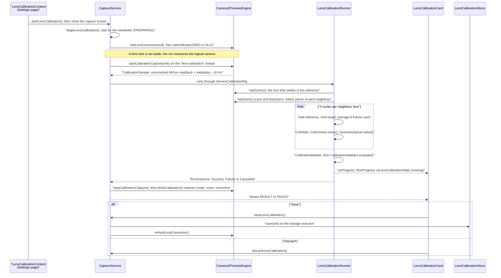
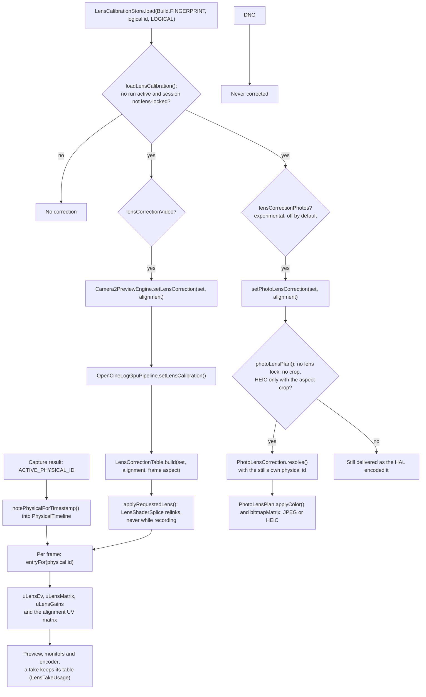
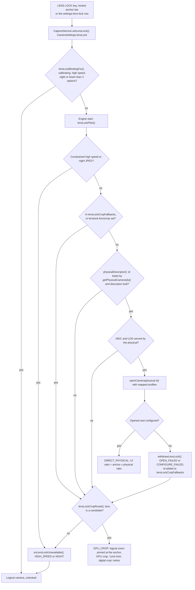

# Lens calibration and lens lock

A logical multi-camera such as the Razr Fold's camera `0` switches between physical lenses as the zoom moves, and each switch shifts colour, exposure and framing a little. PLAN-070 attacks that in two independent ways. **Lens calibration** measures each lens against the reference lens in the operator's own scene and corrects the difference on the GPU for preview and video, and optionally for JPEG and HEIC stills. **Lens lock** keeps one lens for the whole session: the app opens the physical camera directly when the logical camera reports it (ADR-0036), and otherwise falls back to pinning the logical zoom and cropping on the GPU. This page follows both flows from the UI to the pixels.

## Where it lives

- **Calibration UI.** [`LensCalibrationScreen.kt`](../../app/src/main/java/com/librestatic/opencinecam/LensCalibrationScreen.kt) (`LensCalibrationContent`: the Settings page with Start, the saved result and the switches) and [`LensCalibrationCard.kt`](../../app/src/main/java/com/librestatic/opencinecam/LensCalibrationCard.kt) (the card over the viewfinder). The state is in [`LensCalibrationUiState.kt`](../../app/src/main/java/com/librestatic/opencinecam/LensCalibrationUiState.kt).
- **Orchestration.** [`CaptureService.kt`](../../app/src/main/java/com/librestatic/opencinecam/service/CaptureService.kt): `startLensCalibration()`, `beginLensCalibration()`, `runCalibration()`, `finishCalibration()`, `saveLensCalibration()`, `refreshLensCorrection()`, `setLensLock()` and the `onLensLock*` callbacks. [`LensLockGate.kt`](../../app/src/main/java/com/librestatic/opencinecam/service/LensLockGate.kt) holds the pure gates.
- **Measurement and solvers.** [`calibration/`](../../camera/src/main/java/com/librestatic/opencinecam/camera/calibration/): `LensCalibrationRunner`, `CellStats`, `ColorSolver`, `GeometrySolver` (with `PhaseCorrelation`), `CalibrationMedian` and `CalibrationValidator`.
- **Model and storage.** [`LensCalibration.kt`](../../core/model/src/main/kotlin/com/librestatic/opencinecam/core/model/LensCalibration.kt) (`CalibrationSet`, `LensCorrection`, `Similarity`), [`LensCalibrationCodec.kt`](../../core/model/src/main/kotlin/com/librestatic/opencinecam/core/model/LensCalibrationCodec.kt) and [`LensCalibrationStore.kt`](../../app/src/main/java/com/librestatic/opencinecam/LensCalibrationStore.kt).
- **Applying the correction.** [`LensCorrectionRuntime.kt`](../../camera/src/main/java/com/librestatic/opencinecam/camera/calibration/LensCorrectionRuntime.kt) (`LensCorrectionTable`, `PhysicalTimeline`), [`LensAlignment.kt`](../../camera/src/main/java/com/librestatic/opencinecam/camera/calibration/LensAlignment.kt), [`LensShaderSplice.kt`](../../camera/src/main/java/com/librestatic/opencinecam/camera/calibration/LensShaderSplice.kt), [`PhotoLensCorrection.kt`](../../camera/src/main/java/com/librestatic/opencinecam/camera/calibration/PhotoLensCorrection.kt) and [`OpenCineLogGpuPipeline.kt`](../../camera/src/main/java/com/librestatic/opencinecam/camera/OpenCineLogGpuPipeline.kt).
- **Lens lock.** [`LensLock.kt`](../../camera/src/main/java/com/librestatic/opencinecam/camera/LensLock.kt) (`LensLockBinding`, `LensLockCrop`, `LensSwitchDebounce`), `LensLockZoom` and `lensAnchorRatio()` in [`ZoomMath.kt`](../../camera/src/main/java/com/librestatic/opencinecam/camera/ZoomMath.kt), and `lensLockCandidates()`, `lensLockPlan()` and `physicalDescriptor()` in [`Camera2PreviewEngine.kt`](../../camera/src/main/java/com/librestatic/opencinecam/camera/Camera2PreviewEngine.kt). The UI is [`LensLockUi.kt`](../../app/src/main/java/com/librestatic/opencinecam/LensLockUi.kt) and [`LensLockUiState.kt`](../../app/src/main/java/com/librestatic/opencinecam/LensLockUiState.kt).
- **Smooth lens switch.** [`ZoomLagCompensator.kt`](../../camera/src/main/java/com/librestatic/opencinecam/camera/ZoomLagCompensator.kt).

## A calibration run

**Starting.** The Start button on the Settings page calls `startLensCalibration()` and switches to the capture screen in the same gesture. `beginLensCalibration()` waits, showing PREPARING, until the camera is previewing on a valid surface. It refuses with `NO_MULTI_CAMERA` if the camera reports fewer than two lenses, and with `UNSUPPORTED_MODE` if the camera never becomes idle in time. The run always measures the uncorrected signal of the logical camera through the GPU readback, so it turns the correction off, sets aside any lens lock and switches to VIDEO, or stays in HLG.

**Measuring.** `LensCalibrationRunner` is blocking and talks to the camera only through the `CalibrationRig` interface: `setZoom()`, `nextSample()` and `nowMs()`. The reference is the lens active at zoom 1. For each lens next to it in zoom order, the runner finds the switch point from both sides with a coarse scan and three bisections, which exposes the HAL's hysteresis. Each lens is then held at the same ratio where possible. A hold needs 10 consecutive samples from the expected lens at the requested zoom, with AE and AWB converged. Lenses that are not next to the reference are `SKIPPED` and get no correction.

**The card.** `LensCalibrationCard` shows `RunningBody` with Cancel while the phase is PREPARING, FINDING_SWITCH_POINTS, MEASURING or SOLVING. In RESULT, `ResultBody` lists each lens' ΔE and alignment before and after, plus its score and flags, with Save and Discard. In FAILED, `FailedBody` shows the failure and each lens' numbers. The card swallows touches and scrolls inside a height cap, which keeps it below the zoom anchors.

## The solvers

- **Colour.** `ColorSolver` fits `corrected = 2^evOffset × M × (gains × target)` in scene-linear RGB from paired `CellStats` grid cells. The rows of `M` sum to 1, so neutrals are preserved. The fit is a ridge-regularised, Huber-reweighted least squares. It falls back to gains only (`DIAGONAL_FALLBACK`) in three cases: fewer than 16 usable cells, a chroma energy under 0.25 % of the total, or a chroma-system condition number above 1000. The condition is judged on the chroma differences alone; judging the full RGB system was the G4 defect.
- **Exposure.** `evOffset` is the stop difference left after the gains are normalised to unit luminance.
- **Alignment.** `GeometrySolver` phase-correlates textured patches on a 6×4 grid and fits a similarity (shift, scale, rotation), clamped to ±3 % shift, 0.97–1.03 scale and ±1.5°. Too few agreeing patches set `parallaxSuspect`. The runner removes the scale caused by holding the two lenses at different zoom ratios.
- **Combining.** The three cycles are median-combined. `CalibrationValidator` turns `LOW_TEXTURE`, `LOW_CHROMA`, `CLIPPED`, `UNSTABLE_AE`, `PARALLAX_SUSPECT` and `DIAGONAL_FALLBACK` into penalties on a 0–1 score. A lens under 0.4 fails as `LOW_QUALITY`.

## Storage and codec

A successful run builds a `CalibrationSet` (schema 1). It holds the build fingerprint, the logical id, `CalibrationSessionKind.LOGICAL`, the reference id, the source path (SDR or HLG), an `IlluminantHint` from the AWB gains and one `LensCorrection` per lens, with the reference as identity. The set waits in memory (`calibrationPending`) until Save. `LensCalibrationStore` writes one JSON file per fingerprint, logical camera and session kind under `files/lens-calibration/`. It writes a temporary file and then renames it. `LensCalibrationCodec.decode()` validates the schema, the matrix row sums and the EV range. A missing or invalid file reads as "not calibrated". A new OS build therefore starts uncalibrated, and the same build overwrites the previous set.

## From the saved calibration to the pixels

The service's `refreshLensCorrection()` runs when a camera opens and when the switches change. It passes the set to two gates: `lensCalibrationFor()` checks the video switch and `photoLensCalibrationFor()` the photo switch. In the GPU pipeline the correction is a textual splice: `LensShaderSplice` inserts `lensCorrect()` at the camera sample of the fragment shader. That function decodes the signal with the SDR or HLG curve, applies the matrix, gains and EV in linear light, and re-encodes. Without a correction the shaders stay byte-identical, so their pinned hashes do not move. Each frame looks up its physical lens by sensor timestamp in `PhysicalTimeline`, and an unknown lens gets the identity colour. A take freezes the table it started with and records it in its evidence (`LensTakeUsage`). Constrained high-speed recording has no GPU stage and is never corrected.

**The alignment switch** (`lensCorrectionAlignment`, on by default) adds the geometry. `LensAlignment.applied()` keeps only the scale of a logical set. It drops the rotation, which on a room-scale scene is parallax, and it drops the shift when the lens is flagged `PARALLAX_SUSPECT`. All lenses, the reference and unknown lenses included, then share one `sessionZoom`, the largest magnification any lens needs to keep its edges inside the frame. A lens switch therefore never changes the framing. With the switch off, only colour and exposure are corrected.

**Stills.** These are experimental and off by default, because G5 showed that the HAL processes stills differently per lens: a preview-measured correction widens the gap on JPEGs. `PhotoLensCorrection.resolve()` never guesses a lens. A still whose result names no physical id, or names a lens missing from the set, is left alone. A set measured on HLG is applied to stills with the SDR curve, with a warning. RAW (DNG) pixels are never touched, and neither are lens-locked stills or night-extension stills.

## Smooth lens switch

For about three frames around a switch, the Razr's HAL keeps reporting the old zoom. The new lens then lands on the latest request, so the framing jumps. `ZoomLagCompensator` is enabled by `CameraSettings.smoothLensSwitch` (the `settings-smooth-lens-switch` row, off by default) and applied through `setSmoothLensSwitch()`. On every capture result it compares the requested ratio with the `CONTROL_ZOOM_RATIO` the HAL reports and hands the pipeline a GPU crop of at least 1 (`noteZoomCropForTimestamp()`). When zooming in, the crop supplies the missing magnification. When zooming out, a crop cannot widen the frame, so the new lens starts on a matching crop that relaxes at the pinch's speed. It is off below API 30, in lens-locked sessions and in high-speed sessions. It needs no session restart. G3 did not show a measurable gain on a scripted rocker sweep.

## Opening a locked lens

**Candidates.** `lensLockCandidates()` lists the ids from the logical camera's `getPhysicalCameraIds()` that face the same way and have a computable field of view. Each candidate's anchor is `lensAnchorRatio()`, the logical field-of-view width over the physical one (0.55, 1 and 3.0 on the Razr). The focal ratio would put the tele at 2x, which is wrong. The anchors label the LENS LOCK key (`capture-lens-lock`), the locked anchor bar (`zoom-anchor-bar-locked`) and the pills of the Settings row (`settings-lens-lock`). Changing the lock restarts the session, so it is refused during a take, while the controls are held and during a calibration run.

**The direct route.** `physicalDescriptor()` opens nothing that `lensLockCandidates()` did not list; this is ADR-0036's rule. It builds a `Camera2CameraDescriptor` from the physical camera's own characteristics and tags it with the `LensLockBinding`. `LensLockMapping` then maps the requested video profile, LOG profile and still size onto what the physical camera offers. The app keeps the logical zoom scale: `LensLockZoom.toPhysical()` divides the UI ratio by the anchor, and `uiRange()` publishes the physical range times the anchor, for example 3–24x for the tele. The locked anchor bar lists the lock options instead of the optical anchors, and the zoom has no anchors to snap to (`zoomSectorAnchors()`), because every ratio is digital.

**The GPU-crop route.** If the physical camera cannot serve the session, the logical camera runs with its HAL zoom pinned at `LensLockCrop.pinnedRatio()`, so SAT selects that lens. Further zoom is a centred crop on the GPU and in the stills (`LensLockCrop.cropFactor()`). A photo mode is reopened on the GPU viewfinder. `LensSwitchDebounce` raises the "switched lens" warning if the HAL changes lens anyway for 15 consecutive results, for example in its low-light fallback. A lens that failed to open is remembered for the process, so later starts go straight to the crop.

**Exclusions.** Constrained high speed and the night extension always run on the logical camera. A calibration run sets the lock aside and restores it afterwards. The logical calibration is never applied to a locked session, whichever route serves it, because it describes the HAL's switching.

## Failure and edge cases

- **Run aborted.** If the camera is lost or reopened during a run, the run ends as `CAMERA_LOST`. If the GPU readback is unavailable, it ends as `INTERNAL`.
- **No neighbour corrected.** The failure is `SCENE_UNSTABLE` if a hold timed out and `LOW_QUALITY` if every lens failed validation.
- **Parallax.** A scene with near objects fails correctly as `PARALLAX_SUSPECT` with `LOW_TEXTURE`, as in G4's poster scene. Alignment from a parallax-flagged run holds only at the distance it was measured.
- **Illuminant drift.** When the live red/blue AWB ratio drifts from the saved `IlluminantHint`, `illuminantMismatch` is set and the page warns.
- **Wrong source path.** A set solved on SDR and applied on the HLG route, or the reverse, still applies, with a log warning.
- **Shader link failure.** If the spliced shader fails to link, the correction stays off and the pipeline keeps running.
- **Withdrawn lock.** A lock that cannot be served on either route is withdrawn with a transient message. The saved lock is kept and tried again at the next start, and the logical calibration applies again meanwhile.

## Invariants

- Only physical ids reported by the logical camera are ever opened (ADR-0036). No vendor key is used.
- A calibration run measures only the uncorrected logical camera, and nothing is applied while it runs.
- A calibration applies only to the build fingerprint and logical camera it was measured on.
- The correction table changes only between takes. A take's table is fixed and recorded.
- With alignment on, every lens shares one session zoom, so lens switches never change the framing.
- RAW pixels are never corrected. Stills are corrected only by the lens their own result names.
- On the lens-lock routes the UI zoom scale is the logical scale.

## Related

- [ADR-0036: lens lock by opening reported physical cameras](../adr/ADR-0036-lens-lock-by-opening-reported-physical-cameras.md)
- [ADR-0035: full-FOV still from public physical streams](../adr/ADR-0035-full-fov-still-from-public-physical-streams.md)
- [PLAN-070: per-lens software calibration and lens lock](../plans/PLAN-070-lens-calibration-and-lens-lock.md)
- [Device validation, PLAN-070 G0 to G5](../device-validation.md#lens-calibration-and-lens-lock-plan-070-g0)
- [FPS LOCK cadence hold](fps-lock-cadence-hold.md): the ISO jump at a lens switch that dominated G3's transients.
