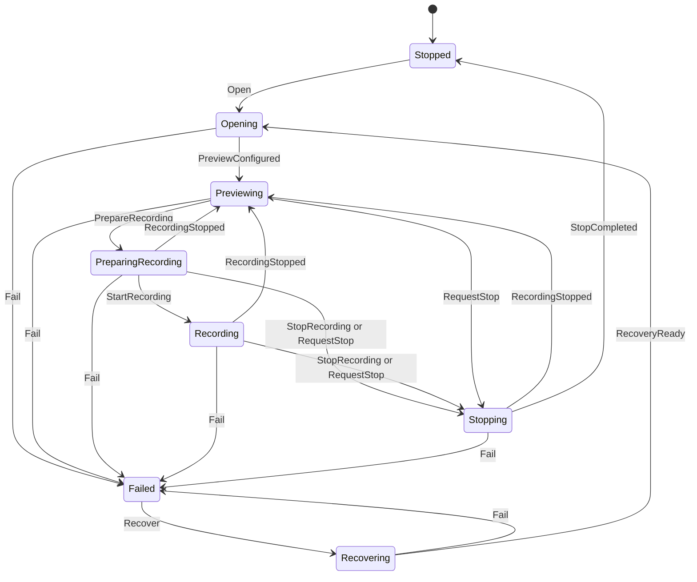
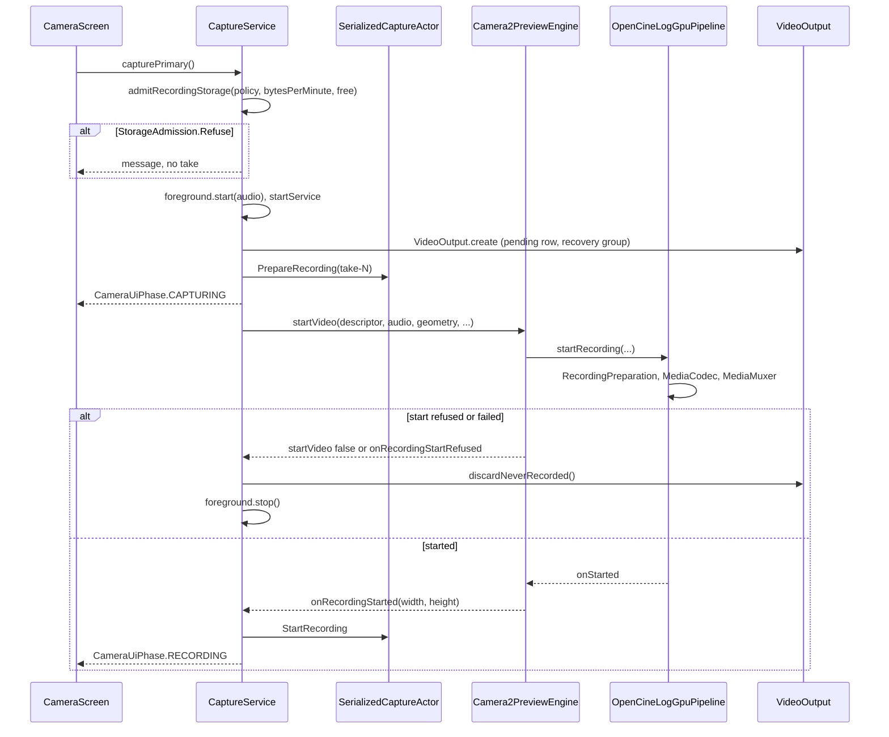
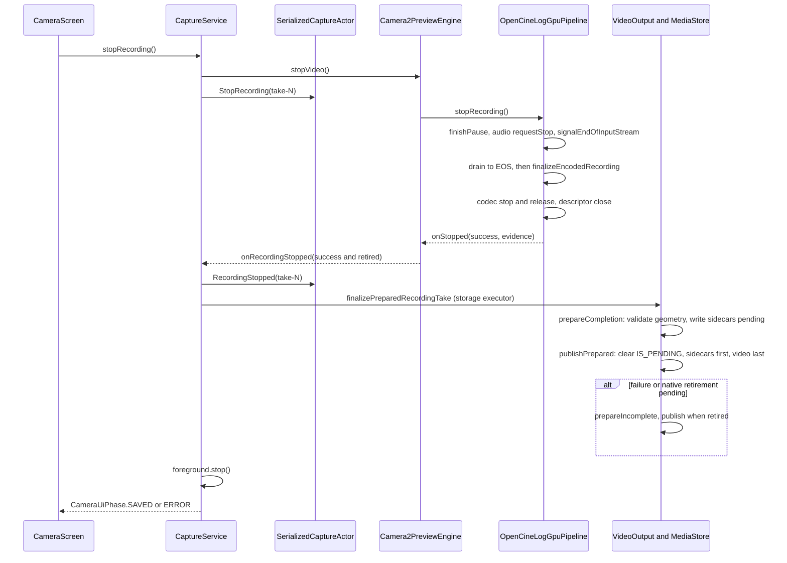

# Recording lifecycle

This page follows one video take from the record press to a published file. It covers who owns the camera and the encoder, how the serialized state machine reports the take, how the encoder and muxer start, pause and stop, and how the files reach MediaStore. It also covers what happens when the UI goes away, when the device gets hot or full, and when anything fails. It describes the code as it is; where an ADR says something different, the difference is noted at the end.

## Where it lives

- [CaptureService.kt](../../app/src/main/java/com/librestatic/opencinecam/service/CaptureService.kt): the bound and started service that owns a take. `LocalBinder.capturePrimary`, `stopRecording`, `setRecordingPaused`, `recoverPreview`, and the engine callbacks `onRecordingStarted`, `onRecordingStopped` and `onFailure`.
- [CaptureStateMachine.kt](../../core/model/src/main/kotlin/com/librestatic/opencinecam/core/model/CaptureStateMachine.kt): `CaptureState`, `CaptureCommand`, `CaptureStateMachine`, `HardwareOwnership` and `SerializedCaptureActor`.
- [CaptureStateCommands.kt](../../app/src/main/java/com/librestatic/opencinecam/service/CaptureStateCommands.kt): maps service events to commands. [DispatchedTakeAdmission.kt](../../app/src/main/java/com/librestatic/opencinecam/service/DispatchedTakeAdmission.kt): releases a take's reservation exactly once.
- [RecordingForegroundController.kt](../../app/src/main/java/com/librestatic/opencinecam/service/RecordingForegroundController.kt): the camera and microphone foreground service and its notification.
- [RuntimePolicyDecision.kt](../../app/src/main/java/com/librestatic/opencinecam/service/RuntimePolicyDecision.kt) and [RecordingStoragePlan.kt](../../app/src/main/java/com/librestatic/opencinecam/service/RecordingStoragePlan.kt): the Strict/Adaptive checks.
- [CaptureOwnerAdmission.kt](../../camera/src/main/java/com/librestatic/opencinecam/camera/CaptureOwnerAdmission.kt), [OwnedRetirement.kt](../../camera/src/main/java/com/librestatic/opencinecam/camera/OwnedRetirement.kt) and [RecordingPreparation.kt](../../camera/src/main/java/com/librestatic/opencinecam/camera/RecordingPreparation.kt): native ownership and retirement.
- [Camera2PreviewEngine.kt](../../camera/src/main/java/com/librestatic/opencinecam/camera/Camera2PreviewEngine.kt): `startVideo`, `stopVideo`, `setTimelapsePaused`, `recordingOutputRetirement`, `closeAsync`.
- [OpenCineLogGpuPipeline.kt](../../camera/src/main/java/com/librestatic/opencinecam/camera/OpenCineLogGpuPipeline.kt): the GPU encoder route, `startRecording`, `stopRecording` and the drain thread that owns the `MediaMuxer`.
- [EncodedRecordingFinalization.kt](../../camera/src/main/java/com/librestatic/opencinecam/camera/EncodedRecordingFinalization.kt), [SharedCapturePause.kt](../../camera/src/main/java/com/librestatic/opencinecam/camera/SharedCapturePause.kt) and [CaptureEpochClock.kt](../../camera/src/main/java/com/librestatic/opencinecam/camera/CaptureEpochClock.kt).
- [VideoOutput.kt](../../app/src/main/java/com/librestatic/opencinecam/storage/VideoOutput.kt), [RecordingTakeFinalization.kt](../../app/src/main/java/com/librestatic/opencinecam/storage/RecordingTakeFinalization.kt), [RecordingCaptureRecovery.kt](../../app/src/main/java/com/librestatic/opencinecam/storage/RecordingCaptureRecovery.kt), [IncompleteTake.kt](../../app/src/main/java/com/librestatic/opencinecam/storage/IncompleteTake.kt) and [ClipSidecarBuilder.kt](../../app/src/main/java/com/librestatic/opencinecam/storage/ClipSidecarBuilder.kt).

## Ownership and the foreground service

`CaptureService` is a same-process service. `CameraScreen` binds it with `BIND_AUTO_CREATE`. The engine is adopted from `CaptureStartup.adoptEngine`, so a camera that `MainActivity` pre-opened is handed over, not shared (ADR-0003 amendment).

Native camera and EGL ownership is serialized by `CaptureOwnerAdmission.processGlobal`. The engine calls `acquire()` in `acquireOwnerIfNeeded` and opens nothing until `Lease.ready()` completes. `closeAsync` registers `releaseAfter(nativeRetirement)`, so a successor starts only after the previous owner has really retired. A failed retirement poisons admission. There is no force-release.

At record start the service calls `RecordingForegroundController.start(audioEnabled)`. It checks permissions, then calls `startForeground` with `FOREGROUND_SERVICE_TYPE_CAMERA`, plus `FOREGROUND_SERVICE_TYPE_MICROPHONE` when the take records audio. The service then calls `startService` on itself, so it outlives an unbind. The notification has a Stop action that sends `ACTION_STOP_RECORDING`. `stop()` removes the notification and calls `stopSelf()`; a client that is still bound keeps the service alive.

## The serialized state machine

- `CaptureStateMachine.dispatch` is a pure transition table. An illegal command returns a `CaptureTransition` with a `StableFailure` (`INVALID_COMMAND`) and leaves the state unchanged.
- `SerializedCaptureActor` runs it on one thread. In the service that thread is a `ThreadPoolExecutor` with one worker, a queue of 32 and `AbortPolicy`.
- `Open` and `Recover` take `HardwareOwnership`; a second owner gets `DUPLICATE_COMMAND`. `StopCompleted` and `Fail` release it.
- `Fail` is accepted from every state, including `Stopped` and `Failed`.
- `CaptureStateCommands` turns events into commands. A preview open sends `Recover`, `RecoveryReady` and `Open` together; the machine accepts whichever fits. Each take gets an id (`take-1`, `take-2`, …), and `StopRecording` and `RecordingStopped` name it, so a late callback cannot end a newer take.
- The actor only reports. `submitCaptureState` drops a command when the queue is full, and capture goes on. The controls follow `CameraUiState.phase` (`CameraUiPhase`): `CAPTURING` while a take is prepared, `RECORDING`, then `SAVED` or `ERROR`.

## Record: start

1. The service checks storage with `admitRecordingStorage` against the projected bytes per minute. Then it starts the foreground service and creates the pending MediaStore row through `VideoOutput.create`, which also opens a `RecordingRecoveryGroup` in the recovery journal.
2. `dispatchTransferCapture` records the take in `DispatchedTakeAdmission` and sends `PrepareRecording`.
3. `startVideo` picks the route. Plain VIDEO and time-lapse go to `startGpuVideo`, and LOG and HLG go to `startOpenCineLogVideo`; both record through `OpenCineLogGpuPipeline`. A constrained high-speed take with no LUT, sidecar audio, gain or squeeze reaches the encoder surface directly through `MediaRecorder`.
4. In the pipeline, `RecordingPreparation` makes one terminal decision: commit or cancel. The drain thread (`OpenCineLogCodecDrain`) touches no native resource until the owner commits.
5. `onRecordingStarted` latches `activeRecordingPolicy`, arms the cadence guard with `setRecordingCadencePolicy`, and starts the 500 ms `recordingTicker`.

## Pause and resume

`LocalBinder.setRecordingPaused` works only in `RECORDING`, when no stop is pending and no pause request is in flight. It calls `Camera2PreviewEngine.setTimelapsePaused`, which posts to the pipeline's GL thread. VIDEO, LOG and HLG share this one path.

- A time-lapse take pauses its `TimelapseTimeline`.
- Any other take pauses through `CaptureEpochClock.requestPaused`, which opens or closes a window in `SharedCapturePause`. Window boundaries sit on the PCM frame grid, not on codec PTS. Video frames inside a window are dropped and later frames are shifted back. The PCM spans outside the windows are kept by `compactPcm16` and `compactPcmFrames`.
- The pause needs the GPU route, a realtime camera clock and an `AudioTimestamp`-backed PCM anchor. A take with no audio is rejected with `UNSUPPORTED_CLOCK`. The other `CapturePauseRejection` values are `NOT_RECORDING`, `STOPPED`, `UNCHANGED`, `WINDOW_LIMIT` (10 000 windows), `ANCHORS_PENDING` and `ESTIMATED_AUDIO_ANCHOR`.
- The `MediaRecorder` route has no pause.
- The windows go into the sidecar as `sharedPause`. A paused take keeps no motion log, because sensor time no longer maps to file time.

## Stop and finalize

1. `stopRecording` sets `recordingFinalizing` before it calls `stopVideo`, so a fast callback cannot be overwritten.
2. On the GPU route, `stopRecording` stops accepting frames and signals end of stream. The drain thread is the only thread that calls the `MediaMuxer` (`addTrack`, `start`, `writeSampleData`, `stop`, `release`).
3. `finalizeEncodedRecording` runs the container stages in order. It stops the muxer if it started, always releases it, and runs the timeline finalizer (`finalizeProjectMp4Timing` or `finalizeAacSourceWindow`) only when nothing failed.
4. `awaitOwnedCompletion` treats a missed deadline as "slow", never as permission to release resources early. `joinOwnedWorker` waits for real thread exit.
5. `reportRecordingStopped` passes `success` only when the file receipt (`RecordingFileRetirement`) has completed. The service checks the same receipt through `stoppedRecordingOutputRetirement`.
6. On the `MediaRecorder` route, `stopVideo` stops the repeating request, waits for the session to drain (up to 500 ms), calls `MediaRecorder.stop`, then rebuilds the preview session.
7. Publication runs on the storage executor. `VideoOutput.prepareOwned` validates the file geometry with `VideoFileGeometryValidator`, writes the metadata sidecar and the `<videoStem>.clip.json` sidecar while they are pending, and records the artifacts in the journal. `publishOwned` clears `IS_PENDING` on the motion log, the sidecar and the clip sidecar, and on the video last. A gallery never sees the video without its sidecars.
8. A published LOG or HLG take is queued for `Main10FileCheckScheduler`.

## Failure and edge cases

- **Start refused.** `startVideo` returns false, or Strict refuses a software AVC encoder (`onRecordingStartRefused`). `discardNeverRecorded` deletes even a bare container header, and the foreground service stops. `releaseFailedTakeStart` frees the reservation only after the engine proves retirement.
- **Engine failure mid-take** (`onFailure`: camera disconnect, camera error, session loss). The service sends `Fail` and the machine goes to `Failed`. The service detaches the take and calls `salvageInterruptedTake`, which seals the audio at once and publishes what was recorded as incomplete once retirement is proven. Then it calls `stopSelf()`.
- **Native writer not retired.** Nothing is published and nothing is deleted. The rows stay pending and journalled until `salvageAfterRetirement` sees the receipt.
- **Publication throws.** `beginSalvage`, then `fail("video-save-failed")`. Rows with bytes stay pending for recovery.
- **Process death.** `CaptureService.onCreate` runs `RecordingCaptureRecovery.recover()`. It publishes rows that hold bytes as incomplete and discards empty ones.
- **Incomplete marker.** `IncompleteTake.mark` adds `takeStatus: "incomplete"` and `failureReasons` (for example `recording-interrupted`, `muxer-not-finalized`, `native-retirement-pending`). Only zero-length outputs are deleted (`deleteOwned`).
- **Clip sidecar.** It is best effort. If building or writing it fails, the take publishes without it.
- **Thermal.** `evaluateRuntimePolicy` reads `PowerManager.currentThermalStatus` on every tick. Scope analysis may be suspended for heat (`onAnalysisSuspended`); that never stops the take.
- **Storage full.** The tick compares free space with the projected reserve. A single unreadable sample reuses the last good one.
- **Audio input lost.** `audioInputLostFailure` stops the take; the file is still finalized.
- **Fold closed.** `FoldClosureTracker` calls `stopRecording` unless `subjectDisplay.continueRecordingOnFold` is set.

### What survives UI recreation

- `MainActivity` declares `configChanges` for orientation, screen size, density, `uiMode` and more, so rotation and fold changes usually reflow the UI without recreating the Activity.
- When the viewfinder surface goes away during a take, `detachPreview` calls `detachPreviewWhileRecording`. The GPU route drops only its EGL window, and the encoder keeps running. The `MediaRecorder` route rebuilds a session without the preview. A new surface goes to `attachPreviewWhileRecording`.
- `onUnbind` does not stop the service while `structuralSettingsFrozen` is true or the phase is `CAPTURING`. A new binding reads the live take from `LocalBinder.states` and the `CameraUiState` flow.
- If the service itself is destroyed mid-take, `onDestroy` salvages the take and calls `closeAsync`. The rows stay journalled for recovery.

### Strict and Adaptive

The policy comes from `settings.recordingPolicy` and is latched at `onRecordingStarted`. A change during the take applies to the next take.

| Check | Strict | Adaptive |
|---|---|---|
| Free space unknown at start (`admitRecordingStorage`) | refuse (`STORAGE_UNKNOWN`) | `AdmitUnread`, with a warning |
| Too little space at start | refuse | refuse |
| Only a software AVC encoder fits (`decideSdrAvcEncoder`) | refuse the start | record and disclose (`onSoftwareVideoEncoder`) |
| Critical heat, under a minute of space, or unreadable state | stop the take | keep recording with a `RuntimeNotice` |
| Sustained cadence loss (`SustainedCadenceGuard`, `cadenceLossAction`) | stop | `CADENCE` notice |
| A/V drift on separate WAV/FLAC audio (`avDriftVerdict`) | stop | `AV_DRIFT` notice |
| Professional controls out of range (`setControlPolicy`) | reject | clamp and disclose |

A policy stop goes through `stopRecording(reason)`. The take is still finalized and saved, and the final message names the `TakeStopReason`.

## Invariants

- One native camera owner at a time; a successor waits for real retirement.
- Only the drain thread calls the `MediaMuxer`.
- The muxer is always released, even after a failure. The timeline is never retimed after a failure.
- Nothing that holds bytes is deleted. A take that recorded is published complete or incomplete, now or after recovery.
- Sidecars leave the pending state before the video.
- A take-scoped command names its take; a stale callback never ends a newer take or the preview.
- Exactly one terminal owner releases a dispatched take reservation.

## Related

- ADRs: [ADR-0003](../adr/ADR-0003-capture-service-ownership-and-serialized-state-machine.md), [ADR-0011](../adr/ADR-0011-single-owner-muxer-and-file-finalization.md), [ADR-0013](../adr/ADR-0013-mediastore-saf-and-throughput-qualification.md), [ADR-0015](../adr/ADR-0015-strict-default-and-bounded-adaptive-fallbacks.md), [ADR-0016](../adr/ADR-0016-thermal-backpressure-and-performance-policy.md), [ADR-0033](../adr/ADR-0033-capture-and-project-timelines.md).
- Plans: [PLAN-013](../plans/PLAN-013-captureservice-actor-and-state-machine.md), [PLAN-016](../plans/PLAN-016-lifecycle-recreation-disconnection-recovery.md), [PLAN-018](../plans/PLAN-018-asynchronous-drain-and-single-owner-muxer.md), [PLAN-019](../plans/PLAN-019-mediastore-saf-finalization-and-clip-sidecars.md), [PLAN-027](../plans/PLAN-027-recording-foreground-service-and-notification.md), [PLAN-029](../plans/PLAN-029-thermal-storage-fault-and-soak-hardening.md).
- Requirements: OCC-CAM-002, OCC-LIFE-001 to OCC-LIFE-006 and OCC-STORAGE-001 to OCC-STORAGE-003 in [requirements.md](../requirements.md).

### Where the code differs from the ADRs

- **ADR-0003** says the serialized actor uniquely owns Camera2 and media resources. In the code the actor only reports state; `submitCaptureState` never blocks capture. Ownership is enforced by `CaptureOwnerAdmission` and by the engine's camera executor.
- **ADR-0011 and [architecture.md](../architecture.md)** describe one muxer actor for every take. The direct constrained high-speed route records through `MediaRecorder`, which owns its own muxer. Architecture.md also says unfinalizable entries are deleted; the code keeps any output with bytes and publishes it as incomplete.
- **ADR-0015**, as amended on 2026-10-28, allows the HEVC→H.264 fallback under both policies when a hardware HEVC encoder refuses the format, because it is disclosed: the engine calls `onVideoCodecFallback` and the recording warning under the REC strip says the take records H.264. It asks for no confirmation.
