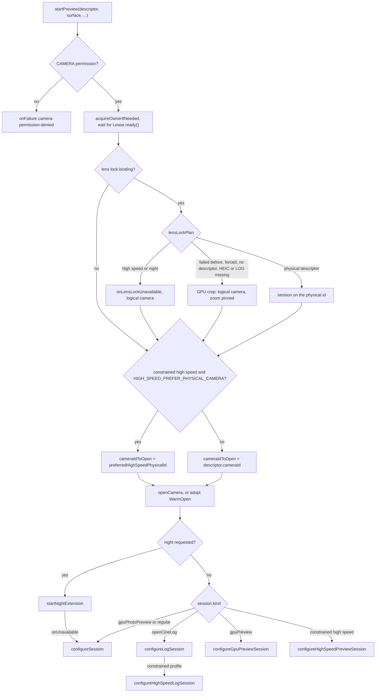
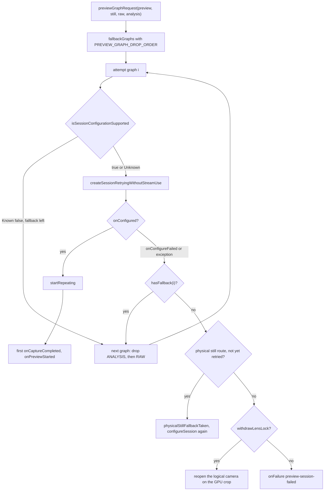
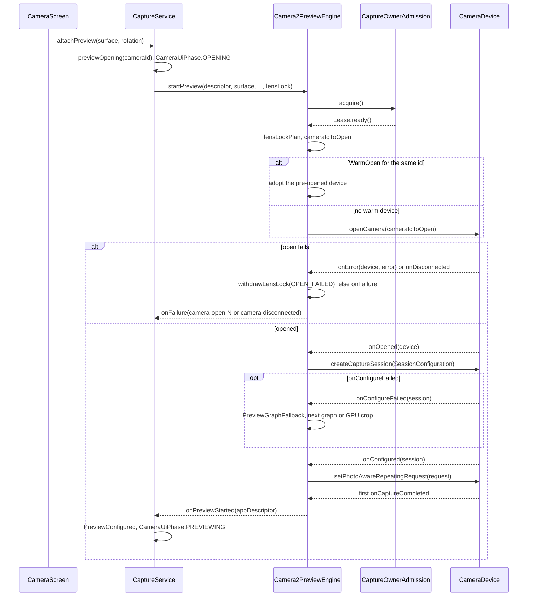

# Session negotiation

This page explains how the engine picks a camera, decides which streams to ask for, opens the device and reaches the first preview frame. It covers the special sessions (constrained high speed, the night extension and the lens lock) and what happens when an open or a configuration fails. It describes the code as it is; where an ADR says something different, the difference is noted at the end.

## Where it lives

- [Camera2PreviewEngine.kt](../../camera/src/main/java/com/librestatic/opencinecam/camera/Camera2PreviewEngine.kt): `descriptors`, `startPreview`, `lensLockPlan`, `preferredHighSpeedPhysicalId`, `startNightExtension`, the `configure*Session` functions, `startRepeating`, `previewCaptureCallback` and `auditCaptureResult`. The file is large; search for these names.
- [GraphNegotiation.kt](../../camera/src/main/java/com/librestatic/opencinecam/camera/GraphNegotiation.kt): `previewGraphRequest`, `GraphNegotiator.fallbackGraphs`, `PREVIEW_GRAPH_DROP_ORDER` and `PreviewGraphFallback`.
- [StreamProbe.kt](../../camera/src/main/java/com/librestatic/opencinecam/camera/StreamProbe.kt) (`StreamCapabilityProbe`, `sessionConfigurationSupport`, `skipBySessionPreCheck`) and [StreamUseCases.kt](../../camera/src/main/java/com/librestatic/opencinecam/camera/StreamUseCases.kt).
- [LensLock.kt](../../camera/src/main/java/com/librestatic/opencinecam/camera/LensLock.kt): `LensLockBinding`, `LensLockCandidate`, `LensLockUnavailable`, `LensLockMapping`, `LensLockCrop` and `LensSwitchDebounce`.
- [HighSpeedQuirks.kt](../../camera/src/main/java/com/librestatic/opencinecam/camera/HighSpeedQuirks.kt) (`MotorolaHighSpeed`) and [NightExtensionSession.kt](../../camera/src/main/java/com/librestatic/opencinecam/camera/NightExtensionSession.kt).
- [CaptureRequestComposition.kt](../../camera/src/main/java/com/librestatic/opencinecam/camera/CaptureRequestComposition.kt) (`EngineRequestMode`, `composeEngineRequest`) and [CaptureResultAuditing.kt](../../camera/src/main/java/com/librestatic/opencinecam/camera/CaptureResultAuditing.kt) (`CaptureResultAuditor`).
- [CaptureOwnerAdmission.kt](../../camera/src/main/java/com/librestatic/opencinecam/camera/CaptureOwnerAdmission.kt): one native owner at a time.
- [CaptureService.kt](../../app/src/main/java/com/librestatic/opencinecam/service/CaptureService.kt) (`prepare`, `attachPreview`, `detachPreview`, `recoverPreview`, `desiredGpuViewfinder`), [CaptureStartup.kt](../../app/src/main/java/com/librestatic/opencinecam/service/CaptureStartup.kt) and [LensLockGate.kt](../../app/src/main/java/com/librestatic/opencinecam/service/LensLockGate.kt).
- [CaptureRecovery.kt](../../app/src/main/java/com/librestatic/opencinecam/CaptureRecovery.kt): `KnownGoodCapture`, the last configuration that reached a live preview.

## Enumeration and routing

`descriptors(width, height)` lists `CameraManager.cameraIdList` only, builds one `Camera2CameraDescriptor` per public id, and sorts them by lens facing, then by id. `CaptureStartup.descriptors` reuses the list the Activity started early. `LocalBinder.prepare` keeps the selected camera if it is still listed, otherwise it takes the first one, and it sets the mode gates.

A physical camera is reached only through the logical camera's `getPhysicalCameraIds()`:

- **Still routing (ADR-0035).** `compressedStillPlan` may route the JPEG/HEIC output with `OutputConfiguration.setPhysicalCameraId`. `onPhysicalRoute` reports the requested id, and `stillRouteReportedId` reports what the results say.
- **Lens lock (ADR-0036).** `lensLockCandidates` lists the reported physical ids that face the same way and have a computable field of view. `physicalDescriptor` refuses any other id.
- **High speed.** `preferredHighSpeedPhysicalId` picks, among the reported ids, the one that supports the profile and whose focal length is closest (`MotorolaHighSpeed.closestFocalPhysicalId`).

Vendor tags are used only through `VendorKeys`/`resolveVendorKey` (ADR-0006 amendment).

## Choosing the session

1. Every `startPreview` bumps `generation`. A callback from an older generation closes what it receives and returns.
2. The lens lock is resolved once per start. High speed and night refuse it. A physical camera that cannot serve the session gets the GPU-crop route instead: the logical camera opens with `CONTROL_ZOOM_RATIO` held at `LensLockCrop.pinnedRatio`, and the zoom becomes a GPU crop. The service already leaves the lock off for calibration, high speed and night (`lensLockBindingFor`).
3. With the lock applied, the session runs on the physical descriptor. Profiles and still sizes are mapped with `LensLockMapping`. `appDescriptor` still reports the logical descriptor to the app.
4. The HFR quirk path only changes `cameraIdToOpen`. It keeps the logical descriptor.
5. Night applies to JPEG photo only. Its session renders straight into the viewfinder surface, never through the GPU.
6. The service sends VIDEO, LOG, HLG and time-lapse through the GPU viewfinder (`desiredGpuViewfinder`). A GPU preview with a constrained profile uses `SESSION_HIGH_SPEED`. `configureHighSpeedPreviewSession` is the direct route used by slow motion.

## Regular graph negotiation and fallback

- `configureSession` builds the preview output, the still output (photo only), an optional RAW reader and an optional YUV analysis reader. `previewGraphRequest` marks RAW and ANALYSIS as `required = false`.
- `fallbackGraphs` returns the full graph first, then drops optional outputs in `PREVIEW_GRAPH_DROP_ORDER`: scopes first, then DNG. A candidate is skipped only when the probe positively excludes one of its sizes. Unknown allows it.
- If `isSessionConfigurationSupported` rejects a graph with stream use cases, the engine clears them, remembers the camera in `StreamUseCaseRejections`, and asks again on DEFAULT.
- The other session builders (`configureLogSession`, `configureGpuPreviewSession`, the high-speed ones) have one graph and no fallback. Their failures go to `withdrawLensLock`, or to `onFailure`.

## Open, configure, first frame

- **Ownership.** `acquireOwnerIfNeeded` waits for the previous owner's retirement. If that retirement failed, the engine reports `camera-owner-retirement-failed` as not recoverable.
- **Early open.** `CaptureStartup.begin` lets `MainActivity` call `preopen`. A `WarmOpen` for another id is retired first (`retireWarm`), and then the start runs again.
- **Requests (ADR-0008).** `applyEngineRequest` writes the `composeEngineRequest` base block for the `EngineRequestMode` (`PREVIEW`, `VIDEO_RECORD`, `LOG_RECORD`, `HIGH_SPEED_PREVIEW` and so on). Stateful appliers follow: `applyTargetFps`, `applyManualControls` and `applyHighSpeedControls`. Professional controls follow `setControlPolicy`: Strict rejects (`onControlRejected`), Adaptive clamps (`onControlAdapted`).
- **High-speed session.** It uses `SESSION_HIGH_SPEED` and `TEMPLATE_RECORD`, passes `CONTROL_AE_TARGET_FPS_RANGE` as a session parameter, and sends `createHighSpeedRequestList` bursts. With `QuirkEffect.MOTO_HIGH_SPEED_SESSION_KEYS`, `MotorolaHighSpeed.sessionValues` adds the vendor session keys.
- **First frame.** A regular session arms a `PreviewStartedReceipt`. `onPreviewStarted` fires at the first `onCaptureCompleted` of that session. The high-speed preview reports it when the burst is submitted. The night session reports it from `NightExtensionSession`.
- **Hardware truth (ADR-0009).** Each result goes to `auditCaptureResult`. A `CaptureResultAuditor` in `CaptureAuditPolicy.DIAGNOSTIC` mode collects cadence, dropped frames and AE/AF state for each session. `reportActiveLens` reads `LOGICAL_MULTI_CAMERA_ACTIVE_PHYSICAL_ID`. On the GPU-crop route, `reportLensLockSwitch` warns through `LensSwitchDebounce` when the HAL serves another lens. During a take, `SustainedCadenceGuard` decides Strict stop or Adaptive warning.

## Failure and edge cases

- **Camera error or disconnect.** `onError` and `onDisconnected` close the device, clear `camera`, and call `onFailure` with `camera-open-<error>` or `camera-disconnected`. Only `onError` first offers the failure to `withdrawLensLock`. The service sends `Fail`, sets `CameraUiPhase.ERROR`, salvages any take (see [recording-lifecycle.md](recording-lifecycle.md)) and calls `stopSelf()`.
- **Recovery.** The error sheet calls `recoverPreview`. It stops the preview, sends `takeEnded` and `previewStopped`, runs `prepare` again (a fresh enumeration), and calls `attachPreview`, which sends `Recover`, `RecoveryReady` and `Open`. If no preview arrives within 4 s, it fails with `preview-recovery-timeout`. The sheet can also restore the persisted `KnownGoodCapture`.
- **Watchdog.** `previewStartWatchdog` fails a start that stays `OPENING` or `READY` with a valid surface for 12 s (`preview-start-timeout`).
- **Lens lock fallback.** `withdrawLensLock` runs once per plan. It adds the physical id to `lensLockCropFallbacks`, closes resources, and reruns the start on the logical camera in the same generation. Later starts of that lock go straight to the crop until the engine closes. Without a crop route, `onLensLockUnavailable` is sent and the logical camera opens unlocked.
- **Night fallback.** `NightExtensionSession` calls `onUnavailable` at most once, and only before its first preview. The engine then builds the regular session on the same open device. Later night failures are ordinary `onFailure` calls.
- **High speed.** A rejected constrained session has no fallback graph: `high-speed-preview-session-failed`.
- **Foldable posture and surface changes.** `MainActivity` handles size and density changes itself, so a fold reflows the UI. When the `SurfaceView` surface is replaced, `detachPreview` calls `stopPreview`, unless a take or a subject lease keeps the graph. The new surface either swaps only the EGL window (`attachOperatorToActiveGpuPreview`, same `previewKey`) or runs `startPreview` in a new generation. During a take the session is kept (`detachPreviewWhileRecording`). Hinge closure during a take is handled by `FoldClosureTracker`.
- **Reopen.** A mode, camera or format change runs `startPreview` again. `closeResources` keeps a warm device that is being adopted, and closes everything else first.

## Invariants

- Only public ids from `cameraIdList` are listed. A physical id is opened only if its logical camera reports it.
- A lens-locked session uses the physical camera's own characteristics. The app keeps addressing the logical id.
- The lens lock never applies to constrained high speed or the night extension.
- Optional outputs are dropped before the viewfinder or the still output; the viewfinder is never dropped.
- No native open starts before the previous owner has retired.
- A callback from an older generation never changes the current session.

## Related

- ADRs: [ADR-0004](../adr/ADR-0004-surfaceview-preview-and-foldable-lifecycle.md), [ADR-0006](../adr/ADR-0006-public-camera-enumeration-and-physical-routing.md), [ADR-0007](../adr/ADR-0007-complete-stream-graph-negotiation.md), [ADR-0008](../adr/ADR-0008-deterministic-capture-request-composition.md), [ADR-0009](../adr/ADR-0009-captureresult-auditing-and-hardware-truth.md), [ADR-0015](../adr/ADR-0015-strict-default-and-bounded-adaptive-fallbacks.md), [ADR-0024](../adr/ADR-0024-device-profile-quirk-trust-and-invalidation.md), [ADR-0031](../adr/ADR-0031-fold-display-sessions-and-roles.md), [ADR-0035](../adr/ADR-0035-full-fov-still-from-public-physical-streams.md), [ADR-0036](../adr/ADR-0036-lens-lock-by-opening-reported-physical-cameras.md).
- Plans: [PLAN-007](../plans/PLAN-007-camera-enumeration-and-characteristics-probe.md), [PLAN-015](../plans/PLAN-015-logical-physical-routing-and-graph-negotiation.md), [PLAN-016](../plans/PLAN-016-lifecycle-recreation-disconnection-recovery.md), [PLAN-024](../plans/PLAN-024-deterministic-capturerequest-composition.md), [PLAN-025](../plans/PLAN-025-captureresult-auditing-and-evidence-events.md), [PLAN-028](../plans/PLAN-028-foldable-activity-and-camera-continuity.md), [PLAN-069](../plans/PLAN-069-full-fov-still-from-public-physical-cameras.md), [PLAN-070](../plans/PLAN-070-lens-calibration-and-lens-lock.md).
- Requirements: OCC-CAM-001 to OCC-CAM-004 and OCC-LIFE-006 in [requirements.md](../requirements.md).

### Where the code differs from the ADRs

- **ADR-0007** describes one candidate graph promoted by session, first-frame, sustained and file gates. `GraphSessionController` and `GraphNegotiator.negotiate` implement the full check and the physical-route audit, but production code does not call them. The engine uses only `fallbackGraphs` and `PreviewGraphFallback` for the regular graph. The first-frame gate is the `PreviewStartedReceipt`; the sustained gate is the take's `SustainedCadenceGuard`; the file gate is `VideoFileGeometryValidator` and the Main10 file check.
- **ADR-0015** ties fallbacks to Adaptive. Dropping ANALYSIS and RAW from the preview graph, retrying without stream use cases, and the logical-only still retry all happen under Strict too. `GraphNegotiationPolicy` is used only by the unused `GraphSessionController`.
- **ADR-0008** describes intent composition with Strict rejection and Adaptive clamping. `CaptureRequestComposer.compose(CaptureIntent, …)` is not called in production. The engine applies the fixed `composeEngineRequest` blocks and enforces the policy in its own appliers (`setControlPolicy`).
- **ADR-0009** correlates requests and results by frame number. The engine never calls `CaptureResultAuditor.submitRequest`; it runs the auditor in `DIAGNOSTIC` mode, because STRICT would stop takes on a single outlier.
- **ADR-0036** excludes the lens lock from direct high-speed sessions. The code refuses it for every constrained high-speed profile, including the GPU high-speed preview.
