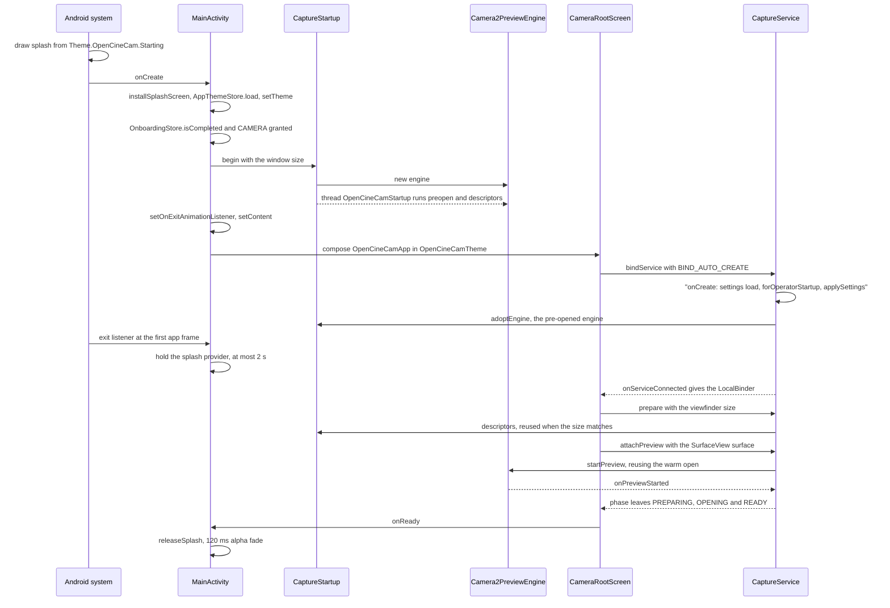
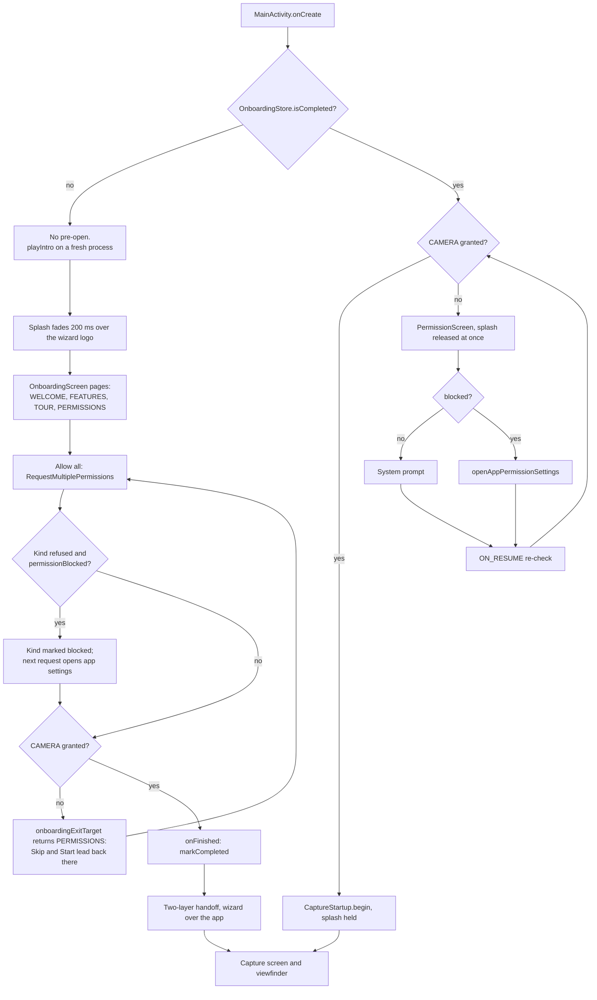

# Startup: from launcher tap to the first viewfinder frame

This page follows a cold start of OpenCineCam from the launcher icon to the first live viewfinder
frame. It covers the system splash and how the app holds it, the camera pre-open that runs while
Compose builds the first frame, theme selection, the first-run wizard and its permission
branches, the capture service binding, the restore of settings and presets, and what the baseline
profile does for all of this. Read it before you touch `MainActivity`, `CameraRootScreen`,
`CaptureStartup` or the onboarding wizard: most of the ordering below is deliberate and easy to
break.

## Where it lives

| Concern | File |
|---|---|
| Activity entry, splash hold and release | [`MainActivity.kt`](../../app/src/main/java/com/librestatic/opencinecam/MainActivity.kt) |
| Camera pre-open and engine hand-over | [`service/CaptureStartup.kt`](../../app/src/main/java/com/librestatic/opencinecam/service/CaptureStartup.kt) |
| Root screen, service binding, wizard-to-app handoff | [`CameraScreen.kt`](../../app/src/main/java/com/librestatic/opencinecam/CameraScreen.kt) (`CameraRootScreen`, `rememberCaptureServiceBinder`, `PermissionScreen`) |
| First-run wizard and its permission page | [`OnboardingScreen.kt`](../../app/src/main/java/com/librestatic/opencinecam/OnboardingScreen.kt) (`OnboardingStore`, `OnboardingPage`, `onboardingExitTarget`) |
| Runtime permission state and "blocked" detection | [`PermissionAccess.kt`](../../app/src/main/java/com/librestatic/opencinecam/PermissionAccess.kt) |
| Theme choice and colour schemes | [`ui/theme/OpenCineCamTheme.kt`](../../app/src/main/java/com/librestatic/opencinecam/ui/theme/OpenCineCamTheme.kt) (`AppTheme`, `AppThemeStore`, `rememberAppTheme`, `CaptureTheme`) |
| Splash themes | [`res/values/themes.xml`](../../app/src/main/res/values/themes.xml) (`Theme.OpenCineCam.Starting`, `Theme.OpenCineCam.Starting.You`) |
| Capture service start-up | [`service/CaptureService.kt`](../../app/src/main/java/com/librestatic/opencinecam/service/CaptureService.kt) (`onCreate`, `LocalBinder.prepare`, `LocalBinder.attachPreview`) |
| Settings and presets | [`SettingsRepository.kt`](../../app/src/main/java/com/librestatic/opencinecam/SettingsRepository.kt), [`CameraSettings.kt`](../../app/src/main/java/com/librestatic/opencinecam/CameraSettings.kt) (`CameraSettingsStore`), [`OperatorPreferences.kt`](../../app/src/main/java/com/librestatic/opencinecam/OperatorPreferences.kt) (`forOperatorStartup`), [`PresetRepository.kt`](../../app/src/main/java/com/librestatic/opencinecam/PresetRepository.kt) |
| Baseline profile | [`app/src/main/generated/baselineProfiles/`](../../app/src/main/generated/baselineProfiles/), [`baselineprofile/`](../../baselineprofile/src/main/java/com/librestatic/opencinecam/baselineprofile/) |

## Cold start with permissions granted

`MainActivity.onCreate` reads the stored theme and the onboarding flag before
`super.onCreate`. If the wizard is done and the camera permission is already granted, it
calls `CaptureStartup.begin` with the full window size, cutout included. That starts the
`OpenCineCamStartup` thread, which calls `likelyPreferredCameraId` and `preopen` on a fresh
`Camera2PreviewEngine`, then enumerates `descriptors` for that size. This happens while the
splash is up and Compose is still building its first frame.

The capture service is bound from `CameraRootScreen` through `rememberCaptureServiceBinder`. Its
`previewEngine` is `lazy { CaptureStartup.adoptEngine(this) }`, so the service takes the engine the
activity started instead of creating a second one. `LocalBinder.prepare` asks
`CaptureStartup.descriptors` first. The cached enumeration is reused only when the viewfinder size
matches the predicted one; otherwise the engine enumerates again. If the pre-opened camera is not
the one the preview needs, `startPreview` retires the warm open and opens the right camera.

The splash is the platform `SplashScreen`, not a Compose layer. On a normal start the exit
listener keeps the `SplashScreenViewProvider` on screen while the window keeps drawing
underneath. A keep-on-screen condition would stop that drawing, which is why it is not used.
`CameraRootScreen` calls `onReady` once `readyForSplash` is true: the phase has left
`PREPARING`, `OPENING` and `READY` (the viewfinder is previewing or the camera failed), or there
is another screen to show first. `releaseSplash` then fades the provider's view out over
`SplashReleaseFadeMillis` (120 ms). The `KeepSplashMaxMillis` timeout (2 s) lifts the splash anyway,
so a slow or failing camera cannot trap the user. `CaptureStartup.previewStarted` logs once per
process how long the first preview took after process start.

## First run and permission branches

The wizard runs only while `OnboardingStore.isCompleted()` is false (key `onboarding-version` in the
`camera-settings` preferences). On that path `onCreate` does not pre-open the camera, and
`MainActivity` sets `playIntro` on a start from scratch. The exit listener then reads the splash
icon bounds, fades the splash out over 200 ms after a 34 ms delay, and the wizard draws the same
logo in the same place before its own 1.9 s intro.

The camera is the only permission the app cannot run without. `onboardingExitTarget` sends Skip
and the final button back to the `PERMISSIONS` page until the camera is granted. Microphone,
location and notifications (API 33+) are optional, so Continue appears as soon as the camera is
granted.

"Blocked" means Android will no longer show the prompt. `isPermissionBlocked` needs three facts:
the permission is not granted, `shouldShowRequestPermissionRationale` is false, and the
`rationale_seen:<permission>` flag in the `permission_access` preferences is set. The flag is
written whenever the system reports a rationale, including just before each prompt. Without it, a
prompt dismissed with Back would look the same as a permanent denial. When the only kind still needed
is blocked, the wizard's request opens the app's system settings page instead; with several
kinds it prompts for the ones that are not blocked. The Grant button on `PermissionScreen`
behaves the same way for the camera alone. Both screens re-read grants on `ON_RESUME`, because the user may
change them there.

When the wizard finishes, `CameraRootScreen` keeps two layers in one `Box`: the app
(`MainContent`), and the wizard on top. It does not use `AnimatedContent`. The app layer composes
underneath at alpha 0. The handoff waits until the camera settles (at most `HandoffWaitMillis`,
1.5 s) and `awaitSmoothFrames` sees three on-time frames. It then runs a 720 ms `Animatable`: the
wizard fades out within its first 300 ms, and the app fades in and scales from 0.94 to 1. With
reduced motion it snaps. The service is bound as soon as the camera permission is granted, even
while the wizard is still showing.

## Theme selection

`AppTheme` is `CINE` (default) or `YOU`. `AppThemeStore` keeps it under `app-theme` in the
`camera-settings` preferences, apart from `CameraSettings`, so presets never change it.
`onCreate` applies `windowThemeFor(theme)` before `super.onCreate`. On API 33+,
`applySplashTheme` tells the platform which splash to draw on the *next* launch
(`Theme.OpenCineCam.Starting` or `Theme.OpenCineCam.Starting.You`), because the platform draws
the splash before any app code runs. Older versions always show the Cine splash. Inside Compose,
`rememberAppTheme` feeds `OpenCineCamTheme`. Cine is a fixed dark scheme. You uses dynamic colour
on API 31+ and follows the system night mode. The capture chrome is always wrapped in
`CaptureTheme`, which forces dark.

## Settings and presets restore

`SettingsRepositories.get` builds one process-wide `SettingsRepository` from `CameraSettingsStore`.
Its `load()` settles the recording policy migration first and then reads every stored key. In
`CaptureService.onCreate` the repository applies `forOperatorStartup`, which drops torch, exposure
and white balance unless the operator preferences ask to restore them. It then calls `applySettings`
once and keeps collecting `states`. The LUT library loads on `Dispatchers.IO` in the same
`onCreate`, and its selections reach the engine through `setOperatorLut` and `setSubjectLut`.
`PresetRepositories.get` loads the preset library (`camera-presets`, key `library`) lazily, the
first time `rememberOperatorActions` or the preset settings need it. A library that fails
validation loads as an empty library with `error` set, and the stored data is kept.

## Baseline profile

Compose is unbundled, so on a fresh install the app runs interpreted until ART compiles it. The
generated `baseline-prof.txt` and `startup-prof.txt` under
`app/src/main/generated/baselineProfiles/` are merged into `:app` (`mergeIntoMain = true`) and
installed by `androidx.profileinstaller`. They precompile the code on the path above: startup, the
capture chrome, the mode sheet and the gallery. `startup-prof.txt` also shapes the dex layout for
startup. `:baselineprofile` generates both files on a device (`:app:generateBaselineProfile`), and
`StartupBenchmarks` measures cold start with and without them. `adb install` and Android Studio skip
profiles, and debug builds are never representative. See `AGENTS.md`, "Baseline profile and
startup benchmarks".

## Failure and edge cases

- **Pre-open for the wrong camera or size.** The guess from `likelyPreferredCameraId` may be wrong,
  and the viewfinder may differ from the window size. `startPreview` closes a mismatched warm
  open, and `CaptureStartup.descriptors` returns null on a size mismatch, which forces a new
  enumeration.
- **Activity leaves before the service adopts the engine.** `onStop` calls `CaptureStartup.stopped`,
  which drops the pre-open, so no camera stays open behind the app. A later `begin` closes a stale
  pending engine first.
- **Service already owns an engine.** `begin` returns at once while `liveEngine` is set (for
  example, after an activity recreation during a take).
- **Camera fails or is slow.** `readyForSplash` also becomes true in `ERROR`, and the 2 s timeout
  lifts the splash regardless.
- **Icon-less splash.** If the provider hands back a detached or zero-sized icon, the intro uses
  null bounds and the wizard centres the logo itself.
- **`onReady` before the exit listener.** `contentReady` is recorded, and the listener releases at
  once when it arrives.
- **Permission revoked after onboarding.** No pre-open; `PermissionScreen` shows, and the splash
  is released immediately.
- **Tour replayed from About.** `onboardingStore.reset()` brings the wizard back at full strength.
  Back on its first page leaves the tour.

## Invariants

- The camera is never opened before both onboarding is complete and `CAMERA` is granted.
- There is one engine per process: the service adopts the startup engine or creates one, and
  `released` clears it.
- The splash never stays up longer than `KeepSplashMaxMillis` on a normal start.
- The wizard cannot complete without the camera permission.
- A permission counts as blocked only after a real denial (`rationale_seen`), never after a prompt
  dismissed with Back.
- The theme lives outside `CameraSettings`, and the capture chrome is always dark.

## Related

- [ADR-0003: Capture service ownership and serialized state machine](../adr/ADR-0003-capture-service-ownership-and-serialized-state-machine.md)
- [ADR-0004: SurfaceView preview and foldable lifecycle](../adr/ADR-0004-surfaceview-preview-and-foldable-lifecycle.md)
- [ADR-0017: Original accessible UI architecture](../adr/ADR-0017-original-accessible-ui-architecture.md)
- [ADR-0027: Portable security and privacy permissions](../adr/ADR-0027-portable-security-and-privacy-permissions.md)
- [ADR-0030: Shared settings and session-owned torch](../adr/ADR-0030-shared-settings-and-session-torch.md)
- [PLAN-013: CaptureService actor and state machine](../plans/PLAN-013-captureservice-actor-and-state-machine.md)
- [PLAN-014: SurfaceView preview transforms and overlays](../plans/PLAN-014-surfaceview-preview-transforms-and-overlays.md)
- [PLAN-016: Lifecycle, recreation and disconnection recovery](../plans/PLAN-016-lifecycle-recreation-disconnection-recovery.md)
- [GPU frame pipeline](gpu-frame-pipeline.md)
