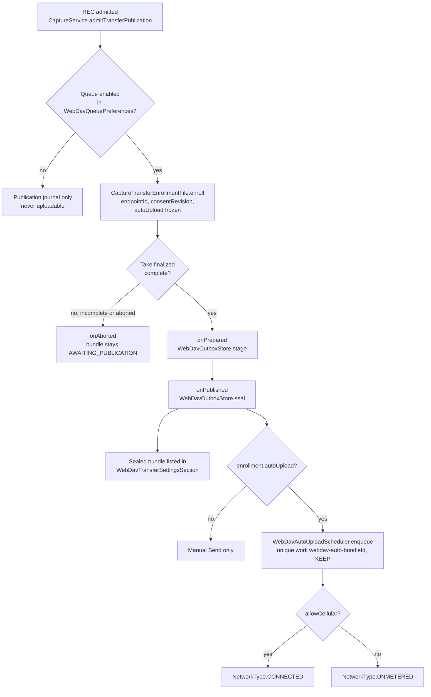
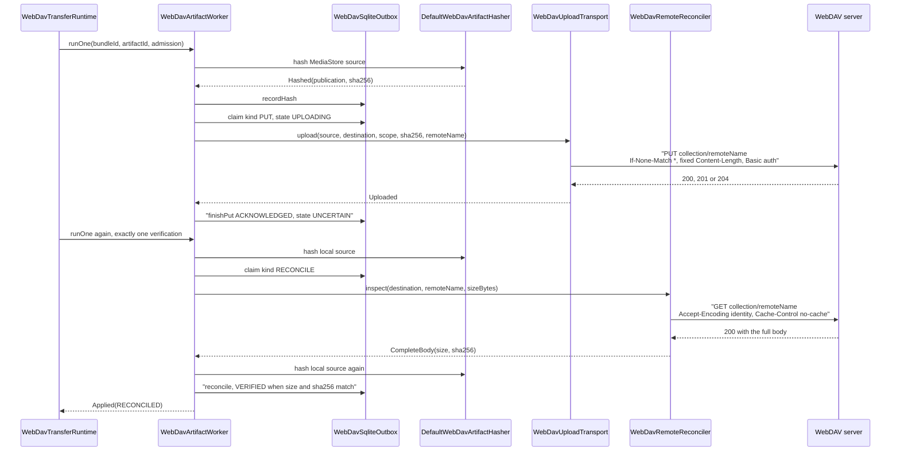
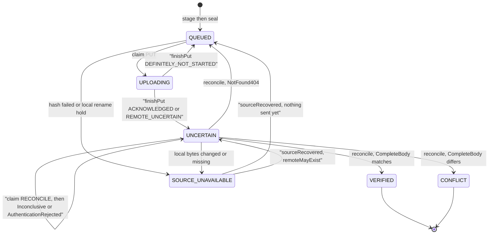

# WebDAV transfers

OpenCineCam can copy finished video takes to a WebDAV collection the user configures. The feature is opt-in and off by default. A take is only ever eligible if the transfer queue was enabled when its recording started. From there it can be sent by hand from Settings, or, with the separate "Upload new takes automatically" switch, by a WorkManager job. Every upload is a conditional HTTPS `PUT` of each artifact, followed by a full `GET` read-back whose SHA-256 must match the local file before the artifact counts as verified. This page covers the configuration, the durable outbox, scheduling, the HTTP exchange and the failure rules. The decisions behind it are in [ADR-0034](../adr/ADR-0034-opt-in-transfer-ownership.md), including its 2026-10-19 and 2026-10-22 amendments, and in [PLAN-067](../plans/PLAN-067-opt-in-webdav-transfers.md). The privacy requirement OCC-PRIV-001, amended 2026-10-19, is in [requirements.md](../requirements.md).

## Where it lives

All paths are under [`app/src/main/java/com/librestatic/opencinecam/`](../../app/src/main/java/com/librestatic/opencinecam/).

| Concern | Code |
|---|---|
| Queue settings: endpoints, enabled, cellular, auto upload | [`transfers/WebDavQueuePreferences.kt`](../../app/src/main/java/com/librestatic/opencinecam/transfers/WebDavQueuePreferences.kt), [`transfers/WebDavQueueSettings.kt`](../../app/src/main/java/com/librestatic/opencinecam/transfers/WebDavQueueSettings.kt), UI in [`WebDavQueueSettingsSection.kt`](../../app/src/main/java/com/librestatic/opencinecam/WebDavQueueSettingsSection.kt) |
| Credentials | [`transfers/WebDavCredentialStore.kt`](../../app/src/main/java/com/librestatic/opencinecam/transfers/WebDavCredentialStore.kt), [`transfers/WebDavCredentialCodec.kt`](../../app/src/main/java/com/librestatic/opencinecam/transfers/WebDavCredentialCodec.kt), UI in [`WebDavCredentialSettingsSection.kt`](../../app/src/main/java/com/librestatic/opencinecam/WebDavCredentialSettingsSection.kt) |
| Enrollment when recording starts | [`transfers/CaptureTransferPublication.kt`](../../app/src/main/java/com/librestatic/opencinecam/transfers/CaptureTransferPublication.kt), [`transfers/CaptureTransferEnrollment.kt`](../../app/src/main/java/com/librestatic/opencinecam/transfers/CaptureTransferEnrollment.kt) |
| Staging and sealing a bundle | [`transfers/CapturePublicationOutboxBridge.kt`](../../app/src/main/java/com/librestatic/opencinecam/transfers/CapturePublicationOutboxBridge.kt) |
| Durable outbox | [`transfers/WebDavOutboxModel.kt`](../../app/src/main/java/com/librestatic/opencinecam/transfers/WebDavOutboxModel.kt) (states and pure transitions), [`transfers/WebDavOutboxStore.kt`](../../app/src/main/java/com/librestatic/opencinecam/transfers/WebDavOutboxStore.kt), [`transfers/WebDavSqliteOutbox.kt`](../../app/src/main/java/com/librestatic/opencinecam/transfers/WebDavSqliteOutbox.kt) (`webdav-outbox.db`) |
| Batch runtime and recording fence | [`transfers/WebDavTransferRuntime.kt`](../../app/src/main/java/com/librestatic/opencinecam/transfers/WebDavTransferRuntime.kt), [`transfers/WebDavUploadPolicy.kt`](../../app/src/main/java/com/librestatic/opencinecam/transfers/WebDavUploadPolicy.kt) |
| One artifact step | [`transfers/WebDavArtifactWorker.kt`](../../app/src/main/java/com/librestatic/opencinecam/transfers/WebDavArtifactWorker.kt), [`transfers/WebDavArtifactHasher.kt`](../../app/src/main/java/com/librestatic/opencinecam/transfers/WebDavArtifactHasher.kt) |
| HTTP | [`transfers/WebDavUploadTransport.kt`](../../app/src/main/java/com/librestatic/opencinecam/transfers/WebDavUploadTransport.kt) (`PUT`), [`transfers/WebDavRemoteReconciler.kt`](../../app/src/main/java/com/librestatic/opencinecam/transfers/WebDavRemoteReconciler.kt) (`GET`), [`transfers/WebDavLanTls.kt`](../../app/src/main/java/com/librestatic/opencinecam/transfers/WebDavLanTls.kt) |
| Automatic upload | [`transfers/WebDavAutoUploadScheduler.kt`](../../app/src/main/java/com/librestatic/opencinecam/transfers/WebDavAutoUploadScheduler.kt), [`transfers/WebDavAutoUploadWorker.kt`](../../app/src/main/java/com/librestatic/opencinecam/transfers/WebDavAutoUploadWorker.kt) |
| Manual send UI | [`WebDavTransferSettingsSection.kt`](../../app/src/main/java/com/librestatic/opencinecam/WebDavTransferSettingsSection.kt) |
| Recording fence in the service | [`service/CaptureService.kt`](../../app/src/main/java/com/librestatic/opencinecam/service/CaptureService.kt) (`admitTransferPublication`, `reserveCapture`) |
| Manifest | [`AndroidManifest.xml`](../../app/src/main/AndroidManifest.xml): `FOREGROUND_SERVICE_DATA_SYNC` and WorkManager's `SystemForegroundService` with `foregroundServiceType="dataSync"` |

### Configuration and credentials

- `WebDavQueuePreferences` is stored by `WebDavQueueSettings` as `webdav-queue-settings.json` in `noBackupFilesDir`. It is written with `AtomicFile`, read back after every save, and uses schema version 3. It holds `enabled`, `allowCellular`, `autoUpload`, `activeEndpointId` and up to 32 `WebDavQueueEndpoint`s, each with an `id`, a `url` and `ignoreTlsErrors`. The file is device-local and is never part of a preset.
- `normalizeQueueEndpoint` accepts only `https` URLs with no user info, query or fragment. An endpoint's URL never changes: a different URL gets a new UUID.
- `autoUpload` requires `enabled`. Turning the queue off also turns automatic upload off.
- Credentials are kept by `WebDavCredentialStore` in `noBackupFilesDir/webdav-credentials`. Each endpoint UUID has its own AES-GCM key in the AndroidKeyStore, with the endpoint identity as associated data. Credentials are never stored in the outbox, the enrollment, the queue settings or the logs. A damaged record or a lost key is reported as `UNAVAILABLE` until the user clears it. The store never falls back to sending without credentials.

## How a take becomes eligible

`CaptureTransferPublication.admit` runs before the encoder starts. It reads the queue settings with `snapshotForAdmission()`. If the queue is off, the take gets only the publication journal and can never be transferred, not even by hand: the app never enrolls a historical take. If the queue is on, the enrollment freezes the active endpoint, the settings revision and the current `autoUpload` value. Changing the settings during a take affects only later takes.

`CapturePublicationOutboxBridge` stages a `WebDavBundlePlan` while the MediaStore rows are still pending. It seals the bundle only after the paired finalizer has published every row. An incomplete take, as defined by [ADR-0011](../adr/ADR-0011-single-owner-muxer-and-file-finalization.md), goes through `onAborted`, so its bundle is never sealed and never sent. Only a newly sealed bundle whose enrollment has `autoUpload` calls `onAutoUploadRegistered`, which schedules the upload. A failure while scheduling is logged and does not affect publication.

### Artifacts per take

A bundle holds one to five artifacts, each with a distinct `WebDavArtifactRole`. It must include `VIDEO`, and `AUDIO_METADATA` requires `AUDIO`.

| Role | What it is | Written by |
|---|---|---|
| `VIDEO` | The video file | `storage/VideoOutput.kt` |
| `VIDEO_METADATA` | The recording sidecar JSON (`opencinecam.recording.v1`) | `storage/VideoOutput.kt` |
| `CLIP_METADATA` | The `<videoStem>.clip.json` sidecar (ADR-0034 amendment 2026-10-22) | `storage/VideoOutput.kt` |
| `AUDIO` | The separate WAV or FLAC audio file | `storage/WavAudioSidecarRecorder.kt`, `storage/FlacAudioSidecarRecorder.kt` |
| `AUDIO_METADATA` | The audio sidecar JSON | the same recorders |

Each artifact is uploaded under its `remoteName`, which defaults to the MediaStore display name, directly inside the configured collection. Artifact IDs are deterministic: `artifactId` takes a name-based UUID of the bundle ID and the role.

## HTTP exchange for one artifact

The runtime handles one bundle per batch and one artifact at a time, in the bundle's order. The protocol uses only `PUT` and `GET`. There is no `MKCOL`, `PROPFIND`, `HEAD`, `MOVE`, `DELETE` or `Range` request.

- **The collection must already exist.** `WebDavDestination` requires a normalised HTTPS URL whose path ends in `/`, and nothing creates it. The remote name is percent-encoded as one path segment by `clipUri`.
- **No overwrite.** `If-None-Match: *` makes the server refuse an existing name, usually with a 412. Any non-2xx or 3xx status after the request started leaves `remoteMayExist` set, so the artifact becomes `UNCERTAIN` and is checked by `GET` next time. It is never sent again blindly.
- **No redirects.** `instanceFollowRedirects = false`. A 3xx is `REDIRECT_REJECTED`.
- **Streaming.** The body is streamed in 64 KiB chunks with `setFixedLengthStreamingMode`, and SHA-256 is computed during the upload. If the source's snapshot, length or hash changes, the upload fails with `SOURCE_CHANGED`.
- **Verification.** An acknowledged `PUT` is not proof. `WebDavRemoteReconciler` reads the whole body within a 120 s deadline and rejects `Content-Encoding`, `Content-Range` and oversize bodies. The local file is hashed again before `reconcile` runs. The outcomes are:
  - matching bytes give `VERIFIED`;
  - different bytes give `CONFLICT`;
  - a 404 gives `QUEUED`;
  - 401 or 403 gives `AuthenticationRejected`, and the artifact stays `UNCERTAIN`;
  - anything else is `Inconclusive`, and the artifact stays `UNCERTAIN`.
- **No resume.** Each `PUT` sends the whole file again. ADR-0034 leaves resumable or atomic `MOVE` uploads to a future transport.
- **Timeouts.** The connect timeout is 15 s and the read timeout is 30 s. Every request sends `Connection: close`.

### HTTPS and TLS

Both `normalizeQueueEndpoint` and `WebDavDestination` require `https`, and so does every connection factory. The default is platform trust and hostname verification. The one exception is the per-endpoint `ignoreTlsErrors` LAN opt-in. `WebDavLanTls.isLocalAddress` allows it only for literal loopback, private or link-local IP addresses, never for DNS names. `WebDavLanTls.apply` then installs a trust-all socket factory and hostname verifier on that one connection, and only for the same origin. It never changes the process-wide defaults.

## Transfer item states

These are the values of `WebDavArtifactState`, and every transition is a pure function in `WebDavOutboxTransitions`. The SQLite store applies each one as a compare-and-set on the artifact `revision` and the attempt lease. A late callback from an old attempt therefore cannot change a newer row. While an attempt is open, `UPLOADING` carries a `PUT` attempt and `UNCERTAIN` may carry a `RECONCILE` attempt. `remoteMayExist` becomes true at the first claim and is never cleared, even if the source is later recovered. `WebDavBundleState` is derived from the artifacts:

- `AWAITING_PUBLICATION`: not sealed;
- `COMPLETE`: every artifact is verified;
- `ATTENTION`: any artifact is in conflict or has its source unavailable;
- `ACTIVE`: any artifact has an open attempt;
- otherwise `UNCERTAIN` or `QUEUED`.

## Runtime, scheduling and the foreground service

- **Single flight.** `WebDavTransferRuntime.get` is a process singleton with a single-thread executor. `WebDavUploadControl.enter` admits one attempt at a time. A busy runtime refuses new work. It does not queue it.
- **Policy.** `WebDavUploadPolicy.stopReason` stops work when the queue is disabled, while recording, on a metered network without cellular consent, or when the network is neither `WIFI` nor `CELLULAR`. `classifyWebDavNetwork` treats metered Wi-Fi as `CELLULAR` and a VPN over an unknown transport as `OTHER`. Wi-Fi need not pass Android's internet validation, so a LAN server works. Each batch is bound to the network it selected. A change of network or settings cancels the live socket through `cancelAsync`.
- **Never during a recording.** Before the camera starts a take, `CaptureService` calls `reserveCapture()`. That stops the running batch, and the take waits for `CaptureTransferReservation.awaitRetired()`, shown in the UI as `transferRetirementPending`. Media renames, deletions and proxy generation take `reserveIdleMediaMutation()`. That call is refused while a transfer owns a source.
- **Manual send.** `WebDavTransferSettingsSection` lists sealed bundles and calls `runtime.send(bundleId)`. The button reads "Verify" when any artifact has `remoteMayExist` set. A bundle with a conflict or an open attempt has no button.
- **Automatic send.** `WebDavAutoUploadWorker` is a `CoroutineWorker`. `isStillEligible` re-reads the settings and the enrollment and checks that the queue and the switch are on, that storage is healthy and that the enrollment's endpoint is still the active one. If not, the worker returns `Result.failure()` without touching the network. If it is still eligible, the worker calls `setForeground` with a `FOREGROUND_SERVICE_TYPE_DATA_SYNC` notification on the low-importance `transfers` channel, and continues without it if Android refuses. It then calls `sendAndAwait(bundleId)`. Cancelling the worker cancels only that bundle's batch.
- **Retries.** `autoUploadOutcome` maps the result:
  - `COMPLETE` is success;
  - `CONFLICT` or `SOURCE_UNAVAILABLE` in any artifact, an open attempt, or the messages `AUTHENTICATION`, `ERROR`, `DISABLED` and `CANCELLED` stop the work;
  - the messages `WAITING_RECORDING`, `WAITING_MEDIA`, `NETWORK_UNAVAILABLE`, `CELLULAR_CONSENT_REQUIRED` and `UNCERTAIN`, and a busy runtime, return `Result.retry()`.

  Retries use exponential backoff starting at one minute, for at most 20 runs (`AUTO_UPLOAD_MAX_RUN_ATTEMPTS`). Within one batch nothing is retried. A 404 found by verification puts the artifact back in `QUEUED`, but the batch ends as `UNCERTAIN`, and the next run sends the `PUT`.
- **Revocation.** `applyAutoUploadSettingsChange` runs after every settings save. Turning the queue or the switch off, or changing the active endpoint, calls `cancelAll()`, which cancels all work tagged `webdav-auto`. A change to the cellular consent alone calls `reschedulePending` with `REPLACE` and the new constraint. Cancelled bundles stay available for a manual send.

## Failure and edge cases

- **Process death during a PUT.** The row keeps its `UPLOADING` attempt with the dead process token. The runtime holds one random token per process. On its first run in a new process, it calls `WebDavSqliteOutbox.recoverOtherProcesses`, which applies `recoverProcess` to every other token. That turns those rows into `UNCERTAIN`, as ADR-0034 and PLAN-067 require, and the next run reconciles them with a `GET` instead of a blind second `PUT`.
- **Missing credentials.** `WebDavStoredDestinationResolver` returns null, and the run ends with `AUTHENTICATION`. A 401 or 403 on `PUT` leaves the artifact `UNCERTAIN`, because the bytes may have arrived, and also ends with `AUTHENTICATION`.
- **Source changed or missing.** Hashing compares the MediaStore identity, name, size and `modifiedSeconds`. Any difference gives `SOURCE_UNAVAILABLE` with a `WebDavSourceFailureReason`. A local rename first calls `holdSourcesForLocalRename`, through `MediaRenameOutboxGuard`, which marks the affected unsent artifacts `LOCAL_RENAME_REQUESTED`.
- **Corrupt storage.** A corrupt or newer `webdav-outbox.db` is preserved and never reset. Queue settings that fail to read set `storageFailed`, which disables transfers until they are recovered.
- **WorkManager on Ethernet.** `UNMETERED` can run the worker on a network that the runtime classifies as `OTHER`. The run then ends as `NETWORK_UNAVAILABLE` and is retried.

## Invariants

- Nothing touches the network unless the user has enabled the queue. Automatic upload also needs its own switch, and the take's enrollment must have it frozen as true.
- Only takes enrolled when recording started are ever sent. Existing media and incomplete takes never are.
- No upload runs while a take is recording or being prepared. Capture waits for the transfer to actually retire.
- Every request is HTTPS. The TLS bypass applies to a single connection, for a literal local IP address, with explicit opt-in.
- A lease is committed to SQLite before any socket opens. A remote object that may exist is checked with `GET` and never overwritten or deleted.
- An artifact is `VERIFIED` only when the remote body's size and SHA-256 match a fresh local hash.
- Credentials, endpoint URLs and authorization headers never enter the outbox, the WorkManager input data or the logs.

## Related

- [ADR-0034: opt-in transfer ownership](../adr/ADR-0034-opt-in-transfer-ownership.md) and [PLAN-067: opt-in WebDAV transfers](../plans/PLAN-067-opt-in-webdav-transfers.md)
- [requirements.md](../requirements.md) (OCC-PRIV-001) and [security and privacy](../security-and-privacy.md)
- [Clip sidecar schema](../schemas/clip-sidecar.schema.json)
