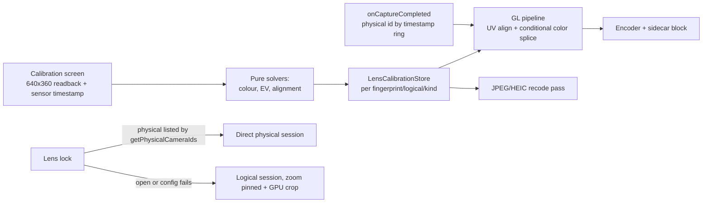

# OCC-PLAN-070: Per-lens software calibration and lens lock

## 1. Objective

Make the back lenses of a multi-camera device (Razr Fold: three) look the same when the user zooms, and offer a zoom that never changes lens. Two features:

- Per-physical-lens software calibration: a colour matrix with gains, an exposure offset and a geometric alignment, measured from a scene by the user, stored per device and logical camera, and applied in the GL preview and video pipeline and optionally to JPEG/HEIC.
- Lens lock: digital-only zoom on one lens, by opening a physical camera directly (ADR-0036), with an automatic fallback to a logical session with zoom pinned at the anchor and a GPU crop.

## 2. Why This Plan Exists

The original idea was to adjust the camera's hardware calibration. That is not viable for a third-party app:

- The Razr Fold factory dual calibration is `com.lenovo.moto.sensor.info.arcsoft_dual_calib_blob`, a static `byte[2048]` characteristic: read-only from Camera2.
- The Chromatix tuning (`com.qti.chi.ChromatixTuningTool`) needs system or root access.
- The HAL-published lens poses and distortion are placeholders (zeros, except the pose of the ultrawide), so geometry has to be measured from the image.

Compensation therefore happens in software at render time, per sensor. The Razr Fold dump (`~/.cache/claude-tmp/libremagic/razr/dumpsys-camera.txt`) is the evidence for the first two points. Today only `CONTROL_ZOOM_RATIO` goes to the logical camera and the HAL decides lens switches; nothing uses `setPhysicalCameraSettings`, and the only direct physical open (HFR) keeps the logical descriptor and must not be copied. ADR-0035 rejected opening a physical id directly; ADR-0036 supersedes that bullet for ids the logical camera reports.

## 3. Prerequisites

- OCC-PLAN-069 Done (public physical enumeration and routing).
- ADR-0036 accepted before slice 3 starts; gate G0 passed before slice 3 starts.
- Razr Fold over `adb` for gates G0 to G5. Ask the user to connect it before every device step; assume it is disconnected.

## 4. Required Reading

ADR-0006 and its 2026-10-19 vendor-tag amendment, ADR-0035, ADR-0036, ADR-0018 (colour paths), PLAN-015 (graph negotiation), PLAN-038 (GL pipeline and encoder output), PLAN-069, `docs/architecture.md` "Camera and stream graphs", `docs/device-validation.md`, `AGENTS.md` (Compose Driver loop).

## 5. Inputs

- Razr Fold camera dump (2026-10-04): logical "0" with `physicalIds = [3, 2, 5]`; "2" is the 6.57 mm main lens, "5" the 13.3 mm telephoto.
- `Camera2PreviewEngine.applyZoom`, `ZoomMath.deriveAnchors` and `sectorBounds`, the active-physical read in `onCaptureCompleted`, `OpenCineLogGpuPipeline.draw()` and its shader splice for the operator LUT, the sidecar `transformSha256`, `PhotoAspectBitmapProcessor` and `HeicAspectBitmapProcessor`, `CameraSettings`/`CameraSettingsStore` with `mergeLocal` (fpsLock precedent), `DeviceProfileCodec`, `RawZoomCrop`.

## 6. Deliverables

- Slice 0: `VendorKeyProbe` (debug), probe results in `docs/device-validation.md`, gate G0 verdict.
- Slice 1: `LensCorrection` and `CalibrationSet` models, strict versioned `LensCalibrationCodec`, `LensCalibrationStore`, `lensCorrectionSha256` identity.
- Slice 2: pure solvers in `camera/.../calibration/` (cell statistics, colour solver, phase correlation, geometry solver, validator, UV alignment matrix) with synthetic-image tests.
- Slice 3: lens lock by direct physical open (engine binding, zoom mapping, setting, anchor bar mode, quick toggle, Settings row).
- Slice 4: GPU-crop fallback and the matching still crops.
- Slice 5: GL correction in the pipeline, per-frame lens attribution, sidecar block.
- Slice 6: calibration screen and flow (logical and direct-physical modes), Compose Driver screens.
- Slice 7: JPEG/HEIC correction pass.

## 7. In Scope

Back-camera photo, video, time-lapse, LOG, HLG and HDR10 paths that go through the GL pipeline; JPEG/HEIC stills; the Settings page and toggles; one calibration set per device fingerprint, logical camera and session kind.

## 8. Out of Scope

Writing OTP/EEPROM, factory calibration blobs or tuning data; multi-illuminant calibration sets (v2); correcting direct high-speed sessions, which do not pass through the GPU (a warning is shown); DNG pixel changes (per-lens metadata only); front camera; reading or modifying any HAL calibration characteristic.

## 9. Architecture



Calibration stays outside the portable preset (`CameraPresetCodec`, no VERSION bump). Lens attribution uses a ring of 64 (timestamp, physical id) entries filled from capture results and looked up by `texture.timestamp`, retrying twice for 4 ms and then using the last known lens (counted in `lensFallbackFrames`). The geometry correction multiplies the texture matrix and does not touch the shader. The colour correction is spliced into the fragment shader only when active, like the LUT splice, so default shader bytes and the sidecar `transformSha256` do not change. The set is frozen when REC starts.

## 10. Implementation Steps

- S0 Probe on the Razr Fold (gate G0): request and session-parameter tests for `com.qti.chi.multicamerainfo.MasterCamera`, `org.quic.camera.forceFullFOV.ForceFullFOV`, `com.lenovo.moto.SATFallback.W2UW`, `com.qti.chi.transitionMode.TransitionMode` and `org.codeaurora.qcamera3.manualWB.*` (by name, through `resolveVendorKey`), recording whether `LOGICAL_MULTI_CAMERA_ACTIVE_PHYSICAL_ID` changes; direct opens of physicals 2, 3 and 5 with preview, recording, JPEG and zoom; diff of the physical descriptor against the logical one (10-bit, HLG, EIS, video sizes, ultrawide AF). Owner: `camera` (debug), `docs/device-validation.md`.
- S1 Model and store (`:core:model`, app): `LensCorrection(physicalId, colorMatrix[9] linear Rec.709 preserving neutral luminance, gains[3], evOffset, align similarity(tx, ty, scale, rotation), quality)`; `CalibrationSet(schema=1, fingerprint, logicalId, sessionKind LOGICAL|DIRECT_PHYSICAL, referencePhysicalId, sourcePath SDR|HLG, createdAt, illuminantHint, lenses)`; codec; store under `filesDir/lens-calibration/<sha256(fingerprint|logicalId|kind)>.json`.
- S2 Solvers (`camera/.../calibration/`): 12x8 cell statistics in linear RGB over the overlap; ridge least squares with Huber weighting (3 iterations) that falls back to diagonal gains below 16 valid cells or condition above 1e3, dropping clipped, dark and edge cells; the global gain goes to `evOffset = log2(Yref/Ylens)`; FFT radix-2 phase correlation with Hann window and sub-pixel peak; 6x4 patch robust similarity fit bounded to |t| < 3 %, scale 0.97 to 1.03, |rotation| < 1.5 degrees; quality score with flags `LOW_TEXTURE`, `LOW_CHROMA`, `CLIPPED`, `UNSTABLE_AE`, `PARALLAX_SUSPECT`; `LensAlignment.uvMatrix` with the minimum scale margin that never samples outside [0,1].
- S3 Lens lock (depends on S0, S1 not required): `LensLockBinding(logicalId, physicalId, anchorRatio)` in `Camera2CameraDescriptor`; `startPreview(..., lensLock)` builds the real physical descriptor but reports the logical id to the app; callback `onLensLock(physicalId, physicalZoomRange)`; quirks and vendor keys resolved with `lensLock?.logicalId ?: cameraId` at every resolve site; Instant AEC off in a locked session; `LensLockZoom.toPhysical/toUi` in `ZoomMath.kt` used by `setZoomRatio` and `reportEffectiveZoom`; nominal FOV from `RawZoomCrop.fovWidth`; local setting `lensLock` per logical camera (off or physical id, `mergeLocal`); `ZoomAnchorBar` locked mode and an `OperatorAction` quick toggle; no lens change during a take; Settings > Capture row and `SettingsCatalog` entry.
- S4 Fallback (depends on S3): on open or configuration failure, reopen the logical camera with `CONTROL_ZOOM_RATIO` fixed at the anchor ratio, crop by UV scale in the texture matrix, force the GPU viewfinder, recrop JPEG/HEIC in the recode hook and RAW with `DefaultCrop`; warn when the HAL switches lens anyway; excluded from direct high-speed and the night extension.
- S5 GL correction (depends on S1 and S2): `textureMatrix = texMatrix x alignUv(lens)` before the uniform upload; `lensCorrectedVariant` replaces the texture sample (after the YCbCr variant) with source-inverse decode (709 or HLG), `exp2(uLensEv) * uLensMatrix * (uLensGains * lin)` and re-encode, covering passthrough, SDR/HLG transform, HLG_SIGNAL, PQ_SIGNAL and the operator LUT; `pipeline.notePhysicalForTimestamp(ts, id)` from `onCaptureCompleted` and `onCaptureProgressed`; set frozen at REC start; sidecar block `lensCorrection {setSha256, splicedTransformSha256, perLensFrameCounts, fallbackFrames}`; GPU viewfinder forced in photo while correction is on; scope and calibration readbacks use identity uniforms; golden test that disabled correction leaves shader bytes identical.
- S6 Calibration screen (depends on S2 and S5): dedicated 640x360 RGBA readback with sensor timestamp, only while the page is open; LOGICAL mode sweeps zoom around each anchor to find the switch ratio in both directions (hysteresis), holds at `r_s - eps` and `r_s + eps` until AE and AWB are CONVERGED for 10 results with stable lens and zoom, averages 8 frames, runs 3 alternating cycles and keeps the median, leaves AE and AWB automatic and records exposure, ISO and `COLOR_CORRECTION_GAINS` as diagnostics and illuminant hint; DIRECT_PHYSICAL mode measures each opened physical with nominal `fovWidth` resampling; `SettingsPage.LENS_CALIBRATION` with scene guidance (static, textured, coloured, more than 2 m away), per-lens progress, before/after delta E and residual pixels, flags, save, discard and reset; separate toggles for preview and video, photos, and framing alignment; warning when the current illuminant differs from the calibration; Compose Driver screens `LensCalibration`, `LensCalibrationResult` and `CaptureLensLocked`.
- S7 Photos (depends on S5): matrix and gain pass in linear light inside `cropPhotoAspectJpeg/Heic` using the active lens of the photo result; forces recode when "apply to photos" is on; DNG gets per-lens metadata only.

Order: S0, S1 and S2 in parallel, then S3 (needs S0), S4, S5 (needs S1 and S2), S6, S7. Each slice is a separate implementation run with its own file ownership: S0/S3/S4 engine and zoom files, S1 model and store files, S2 the `calibration/` package, S5 the pipeline, S6 the Settings and calibration UI, S7 the photo processors.

## 11. State and Data

New persisted data: `lens-calibration/<hash>.json` in `filesDir`, schema 1, strict codec, never part of the portable preset. New local settings: `lensLock` per logical camera and the three correction toggles, all device-local (`mergeLocal`, not portable). In-memory: the lens-attribution ring, the frozen REC set, the lens-lock binding. The calibration is invalidated (recalibration requested) when the device fingerprint, logical id, session kind or source path (SDR/HLG) differs.

## 12. Failure Handling

A physical that cannot be opened or configured sends lens lock to the logical pinned-zoom plus GPU-crop fallback, with a user-visible notice. A degenerate scene (few valid cells, ill-conditioned fit, low texture) falls back to diagonal gains or a zero alignment and sets flags; a result below the quality threshold is not saved without confirmation. A missing timestamp entry retries and then uses the last known lens, counted in the sidecar. A corrupt or older-schema calibration file is ignored and offered for recalibration. Correction is skipped, with a warning, in direct high-speed sessions.

## 13. Tests

- `:core:model`: codec round trip, strict rejection of unknown schema and out-of-range values.
- `:camera`: solvers on synthetic images with known matrix, shift, scale, rotation and noise; degenerate scenes falling back; `LensLockZoom` mapping and clamps; `LensAlignment.uvMatrix` margins; golden shader bytes unchanged when correction is off; lens-attribution ring lookup and fallback counter.
- `:app`: settings round trip, `lensLock` not portable and merged by `mergeLocal` (as `FpsLockSettingsTest`), `SettingsCatalog` entry, store file naming and invalidation.
- Compose Driver: `LensCalibration`, `LensCalibrationResult` and `CaptureLensLocked` on `phone` and `inner`, semantic tree then one screenshot.
- Host Gradle runs one module at a time with parallelism off.

## 14. Documentation Updates

This plan, ADR-0036, the ADR-0035 supersession note, OCC-CAM-014 and OCC-COLOR-008 in `docs/requirements.md`, `docs/plans/manifest.yaml`, `docs/plans/README.md`, `docs/plans/TRACEABILITY.md`, `docs/device-validation.md` (G0 results and each later gate), `docs/plans/GOAL-PROGRESS.md` when a slice completes.

## 15. Commands to Run

```bash
export JAVA_HOME=/usr/lib/jvm/java-17-openjdk ANDROID_HOME=$HOME/Android/Sdk
flock ~/.cache/claude-tmp/opencinecam/gradle.lock ./gradlew --no-daemon -Dorg.gradle.parallel=false --max-workers=2 -Dorg.gradle.caching=false :core:model:test
flock ~/.cache/claude-tmp/opencinecam/gradle.lock ./gradlew --no-daemon -Dorg.gradle.parallel=false --max-workers=2 -Dorg.gradle.caching=false :camera:testDebugUnitTest
flock ~/.cache/claude-tmp/opencinecam/gradle.lock ./gradlew --no-daemon -Dorg.gradle.parallel=false --max-workers=2 -Dorg.gradle.caching=false :app:testDebugUnitTest :app:lintDebug
./tools/check_format.sh
python3 tools/validate_plan_system.py
tools/compose-driver.sh start LensCalibration
```

Device gates use the `.debug` package with `adb -s <razr-serial>` and `monkey -p`.

## 16. Acceptance Criteria

- [x] G0: the probe records, for each candidate vendor key and for direct opens of physicals 2, 3 and 5, whether it works on the Razr Fold, and the physical-versus-logical descriptor diff is in `docs/device-validation.md`.
- [ ] The solvers recover the known matrix, shift, scale and rotation of synthetic fixtures within the stated bounds and fall back on degenerate scenes.
- [ ] The calibration codec and store round-trip and are excluded from the portable preset.
- [x] G1: lens lock on each of 2, 3 and 5 records video, JPEG and DNG with zoom 1x to 8x and the active lens reported constant.
- [x] G2: a forced open or configuration failure falls back to the pinned-zoom GPU crop with the correct framing in preview, video and stills.
- [ ] With correction disabled, shader bytes and the sidecar `transformSha256` are identical to the previous build.
- [ ] G3: a recorded zoom sweep reviewed frame by frame shows reduced colour, exposure and framing jumps at lens switches, before versus after.
- [ ] G4: the calibration screen reports delta E and residual pixels before and after for each lens, and the saved set is applied in preview and video.
- [ ] G5: a JPEG/HEIC A/B shows the corrected stills match the corrected video; RAW and DNG pixels are untouched.
- [ ] Host suites for `:core:model`, `:camera` and `:app` pass; lint, format and `tools/validate_plan_system.py` are clean.

## 17. Evidence to Record

G0 probe log and descriptor diff, G1 per-lens capture metadata, G2 forced-failure log, G3 zoom-sweep frames before and after, G4 calibration screen results, G5 A/B images, Compose Driver trees and screenshots, and suite exit codes. Device evidence includes the exact fingerprint.

- Evidence: to be recorded in section 21 as each gate is run; no evidence exists yet.

## 18. Rollback and Recovery

Each slice is a separate commit and can be reverted independently. Lens lock and correction are off by default; with the settings off the pipeline and sessions are unchanged. The calibration file is local and can be deleted from the calibration page or by clearing app data; no portable schema or preset version changes.

## 19. Risks and Mitigations

- The HAL may reject or degrade direct physical sessions for third parties (no 10-bit, HLG or EIS): G0 gates slice 3 and the GPU-crop fallback covers failure (RISK-001, RISK-002).
- Parallax: alignment is valid for one subject distance, so it is bounded, has its own toggle and the `PARALLAX_SUSPECT` flag.
- Colour depends on the illuminant: v1 warns on a mismatch; multi-illuminant sets are v2.
- Switch frames may carry the wrong lens if the result arrives late: lookup retries, a last-known fallback and sidecar counters.
- Tone can differ between SDR and HLG: the source path is stored and a mismatch requests recalibration.
- Heavy host load can hang the emulator and exhaust memory: one Gradle module per run, memory checked before emulators.

## 20. Completion Update

Not complete. Revision 1 opened 2026-10-23 with the approved design, plan and ADR-0036 (Proposed); no slice has been implemented.

## 21. Execution Record

- 2026-10-23 G0 on the Razr Fold (`motorola/blanc_g/blanc:16/W3WB36.36-123-2/a0723-edb3f:user/release-keys`): physicals 2, 3 and 5 open directly with preview, 1080p `MediaRecorder` and full-size JPEG at 1x to 8x; 10-bit HLG/HDR10, EIS and AF kept; 3 and 5 lack constrained high speed. Automatic switches up 3->2 at 1.00x and 2->5 at 3.00x, down 5->2 at 2.95x and 2->3 at 0.95x. `MasterCamera` (request 0/1/2/3/5, session 0/1) has no effect. Slice 3 uses direct physical opens. Details in `docs/device-validation.md`; raw log and files kept outside the repository.
- Slices 1, 2, 3, 5, 6 and 7 are implemented on `feat/lens-calibration` with their host suites passing; slice 4 and the device gates G2 to G5 are pending (slice 4 since done, below).
- 2026-10-23 G1 on the same build: the lock opened physicals 2, 3 and 5 directly with no withdrawal. JPEG at the top of each range came from the locked lens (2: 4000x3000, 6.57 mm, 8x; 5: 4096x3072, 13.3 mm, 24x on the UI scale; 3: 3840x2880, 1.83 mm, 4.4x). A DNG on 2 at 3.3x kept the 4000x3000 frame with a 1217x912 DefaultCrop. Video on 2 at 1080p30 and on 5 at 4K30 mapped to the same profile; a take zoomed through 3x on 2 shows no jump (largest scene score 0.10). Details in `docs/device-validation.md`.
- 2026-10-23 Slice 4 is implemented on `feat/lens-calibration`. A failed physical open or configuration, or a physical that cannot serve the session (descriptor, HEIC or LOG), now sends the lock to the logical camera with its HAL zoom pinned at the anchor. Zoom is then a GPU crop: a texture-matrix `T x C` with no shader change, which also crops the scopes. Each failed lens is remembered per engine, so later starts go straight to the crop. The GPU viewfinder is forced in photo modes. JPEG is recropped with and without the aspect crop, HEIC only with it, and DNG through `DefaultCrop`. A switched-lens warning is debounced over 15 results. Host suites pass. G2 is pending; its procedure, using `debug.opencinecam.lenslock.forcecrop`, is in `docs/device-validation.md`.
- 2026-10-24 G2 passed on the Razr Fold for the wide and the tele (forced crop): pinned ratios, no restart loop, centred JPEG and 1080p crops matching the preview, and a correct DNG DefaultCrop. On this route the HAL serves the RAW from the wide sensor. HEIC, the aspect crop and the ultra-wide were not checked. Details are in `docs/device-validation.md`.
- 2026-10-24 G4, measuring part, on the Razr Fold. The first scenes exposed a solver defect: the colour fit always fell back to gains because it judged the full RGB condition, which luminance dominates, instead of the chroma system it inverts. That is fixed, and a minimum chroma energy guards grey scenes. After the fix, in a room at 1 to 3 m, the UW scored 0.55 (dE 3.0 to 2.3, alignment 12.2 to 0.16 px) and the tele 0.76 (dE 3.8 to 3.5, 3.1 to 0.51 px), both flagged for parallax. The failure card now lists each lens' numbers and flags. Applying the set in preview and video is still pending, with G3. Details are in `docs/device-validation.md`.
- 2026-10-24 G5 on the Razr Fold: failed as worded. Photo correction applies the saved offsets exactly (UW +0.18 EV, tele -0.21 EV) and leaves RAW and DNG untouched, but the HAL processes stills differently per lens from the preview, so the preview-measured set widens the still gap (tele -0.35 to -0.59 EV, UW chroma 1.6 to 2.5). User decision: document it, keep photo correction off by default and mark it experimental in Settings.
- 2026-10-27 G3 on the Razr Fold, under the FPS LOCK emulated hold, after df6ebd3 fixed the ISO carried across a lens switch: not demonstrated. Sweeps with correction off (A2) and on (B2) show the same -14.5 L* dip for about 180 ms at a switch, chroma steps of 3.3 and 2.8, and framing residuals of 3.5 % and 4.3 %. The calibration's corrections are smaller than the switch transients, which come from the cadence loop's remembered ISO ratios and the HAL zoom hold. A take with Smooth lens switch on as well (C) was no better on the scripted sweep, with a 5.1 % framing residual and a deeper first dip on a darker scene. The calibration card's overlaps on the cover screen are fixed in 6f98dc9 and in the cap on its height, both checked on the Razr. Details are in `docs/device-validation.md`.
