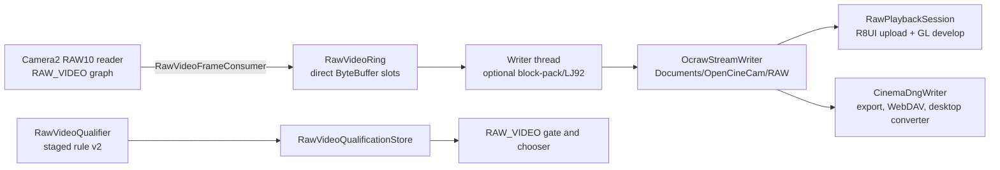

# OCC-PLAN-071: RAW video

## 1. Objective

Make `CaptureMode.RAW_VIDEO` real. A take records the public Camera2 RAW10 stream into an OpenCine RAW v1 (`.ocraw`) file. A RAM ring absorbs short storage stalls. The mode offers only configurations this device has qualified: camera, crop, frame rate and encoding. Phase 2 adds optional lossless compression, decided by measuring two codecs on the device.

## 2. Why This Plan Exists

RAW video could not be offered on assumptions. The HAL advertises less than it delivers, the S24 Ultra certification's 345 MB/s RAW throughput figure was an artefact of its own benchmark, and lossless compression had to be judged on real frames. The S24 Ultra probe below supplied the numbers the decisions in section 9 rest on; later Razr Fold runs, recorded in those decisions, refined the qualification rule.

### Evidence (Galaxy S24 Ultra, 2026-11-02, `RawVideoProbeDeviceTest`)

- **RAW10 is advertised only at full sensor size:** 4080x3060 on camera 0, 4000x3000 on cameras 1 and 2, 3392x2544 on camera 3.
- **The HAL delivers more than it advertises.** `minFrameDuration` claims 30 fps, yet the HAL delivers 60 fps at full size with zero drops. Asking for 120 fps clamps to about 59. Constrained high-speed sessions refuse RAW.
- **RAW10 also runs with the production graph.** RAW10 plus a 1080p preview plus a 640x480 YUV stream configures and runs at 30 and 60 fps.
- **Storage, with zero-copy `FileChannel` writes and a force every 256 MB:**

  | Target | Median | p01 |
  |---|---|---|
  | App dir | 1363 MB/s | 598 MB/s |
  | MediaStore Movies | 1807 MB/s | 595 MB/s |
  | MediaStore Documents | 1499 MB/s | 546 MB/s |

  The dips last single seconds. The certification's 345 MB/s came from `RawThroughputDeviceTest`'s own design: a per-frame heap copy on the camera thread, `RandomAccessFile`, a 64 MB ring and no force until the end.
- **Data rates at 1.25 B/px:**

  | Config | MB/s |
  |---|---|
  | 4080x3060 @15 | 234 |
  | 4080x3060 @24 | 375 |
  | 4080x3060 @30 | 468 |
  | 4080x3060 @60 | 936 |
  | 3840x2160 centre crop @30 | 311 |
  | 1920x1080 centre crop @30 | 78 |
- **Lossless ratio on real frames:**

  | Method | Ratio | ms per frame, one core |
  |---|---|---|
  | Deflate-1 | 1.38× | 275 |
  | Bayer same-colour delta block-pack, naive Kotlin | 1.72× | 340 |
  | Shannon bound of that predictor | 1.88× | — |

## 3. Prerequisites

- OCC-PLAN-040 (Camera2 RAW still and DNG), OCC-PLAN-041 (RAW10/RAW12 buffers, metadata and ring) and OCC-PLAN-042 (RAW throughput benchmark and device gate).
- The NDK enabled under ADR-0021 before slice G (Phase 2 is the first JNI consumer, decision 11).
- A phone that delivers RAW10 on the public Camera2 stream for the device acceptance: the Galaxy S24 Ultra and the Razr Fold were used.
- Ask the user to connect the device before every device step; assume it is disconnected.

## 4. Required Reading

ADR-0013 (MediaStore, SAF and throughput qualification), ADR-0019 (public RAW still and lossless RAW video buffering), ADR-0020 (OpenCine RAW append-only container), ADR-0021 (deferred native code), `docs/formats/opencine-raw-v1.md`, PLAN-040 to PLAN-042, `docs/device-validation.md`, `AGENTS.md` (Compose Driver screens `CaptureRawVideo*`, `RawQualification*`, `GalleryRaw*`, `GalleryCinemaDngExport*`, `NetworkDrive*`, `SettingsRawVideo*`).

## 5. Inputs

- The S24 Ultra probe results of section 2 (`RawVideoProbeDeviceTest`) and the codec measurements on real frames (`RawCodecComparisonDeviceTest`).
- The Razr Fold qualification runs cited in decisions 9 and 11 (SLC cliff, heat, unrested cache, LJ92 camera starvation, block-pack timings).
- The OCRAW v1 header and chunk header (ADR-0020), unchanged; `desktop-tools/ocraw_recovery.py` and `tools/validate_dng.py`.
- The existing pending-row and recovery-group lifecycle of `MediaStore.Files` outputs, and the old `RawThroughputDeviceTest` design whose limits section 2 explains.

## 6. Deliverables

- Capture (slices A to H): the OCRAW streaming writer and reader with a fast CRC32C, `RawVideoRing`, qualification rule v2 with staged qualification (`RawVideoQualifier`, `RawQualificationStaging`, `RawStorageCliff`, `RawStorageRest`), the engine's RAW10 stream and `RawVideoFrameConsumer`, the service output, recovery and `RawVideoQualificationStore`, the RAW_VIDEO gate and UI, the desktop DNG converter `desktop-tools/ocraw_to_dng.py`, and the Phase 2 native codecs (LJ92, Bayer block-pack) with their JNI wiring.
- Playback (slices P1 to P4): `OcrawStreamReader.indexFrames`, `OcrawFrameSource`, `RawDevelop`, `RawPlaybackRenderer`, `RawPlaybackSession` behind `PlaybackController`, the RAW playback setting, and RAW audio in the file (section 9, Phase 3 audio).
- Interchange (slices I1 to I3): CinemaDNG tags and naming in the converter, `CinemaDngWriter` and `OcrawWavWriter` in `:media`, the in-app CinemaDNG export and the read-only WebDAV network drive.
- Compose Driver screens and strings in six locales for each UI slice.

## 7. In Scope

`CaptureMode.RAW_VIDEO` on the back cameras: public Camera2 RAW10 at full sensor size and centre crops, at the configurations the device qualifies (camera, crop, frame rate, encoding); uncompressed RAW10 and the opt-in "Save space" compression; the RAM ring; recovery of interrupted takes; the in-app qualification and its store; in-app playback with audio; CinemaDNG through the desktop converter, the in-app export and the network drive.

## 8. Out of Scope

- RAW from constrained high-speed sessions; the device refuses it.
- RAW12 and RAW_SENSOR video.
- Orientation: `.ocraw` carries no orientation key, so playback shows the sensor's landscape frame, like the DNG converter (Orientation 1).

## 9. Architecture

Code comments cite this plan's earlier numbering: §7 is *Phase 3: in-app playback* below, §7.1 (and §7.1.N) its *Audio* part and its numbered items, and §8 *Interchange: CinemaDNG*. Decision numbers are unchanged.



### Decisions

1. **Uncompressed RAW10 is the qualified baseline.** The long runs and the camera checks judge the uncompressed configurations. Since protocol 3 an LJ92 configuration is judged on its own, so it can be ready when its uncompressed twin is only risky (the Razr's full@60). It needs all of these:
   - its twin's camera delivered (a pass, or a failure only the storage explains);
   - the encode benchmark that judges it keeps up with the pixel rate × 1.1225, and the camera held that benchmark's rate while it encoded (see decision 9, LJ92 benchmark);
   - a passing long run covers the compressed rate at a *conservative* ratio: the benchmark's worst single frame, rounded down to a tenth.

   Since 2026-11-03 the heaviest such twins (at most three) instead run a long run of their own with the encoder active and are judged from it (`compressed-long-run`, decision 9); the conditions above remain the fallback for the rest. The ratio falls with ISO and scene detail, so the aggregate of one scene is never counted on. The time-left estimate still assumes 1.8×.
2. **Frame dropping is forbidden (ADR-0019).** When the ring passes its high-water mark (90 %), the take stops cleanly: the file is finalised and a stable reason is shown. This holds in both Strict and Adaptive.
3. **The ring copies.** The camera callback copies each image's rows (stride padding removed, crop applied) into a preallocated direct `ByteBuffer` slot and closes the image at once. One writer thread drains the slots to a `FileChannel` with gather writes (chunk header plus payload, no further copies) and forces every 256 MB.
4. **The ring size is chosen at arm time** from `ActivityManager.MemoryInfo`: the default is 4 GiB on a device reporting at least 14 GiB of total RAM (16 GB phones), 2 GiB from 11 GiB (12 GB phones), otherwise min(1 GiB, 1/8 of total RAM), and it stays below `availMem` minus the low-memory threshold. The size used is part of each qualification record.
5. **A crop reduces only what is written.** The sensor still reads out full size, so a crop is a narrower field of view. It is labelled that way. OCC-PLAN-076 lets the operator size and place the crop; the fixed centre crops remain as the qualified sizes.
6. **Module boundaries** (`:media` depends on `:camera`):
   - `:camera` gets the RAW10 stream and a `RawVideoFrameConsumer` interface.
   - `:media` gets the ring, the streaming writer, the reader and recovery.
   - `:app` wires them together and owns output rows, the qualification store and the UI.
7. **Destination:** `Documents/OpenCineCam/RAW/<take>.ocraw` through `MediaStore.Files` with `application/octet-stream`, using the existing pending-row and recovery-group lifecycle. The probe measured it at a 1499 MB/s median.
8. **Format (ADR-0020):** the v1 header and chunk header stay unchanged. This plan pins down the RAW frame payload and adds one optional chunk, both in `docs/formats/opencine-raw-v1.md`:
   - `RAW_FRAME` (0x0010) payload: a 64-byte little-endian frame header, then the frame data. The header holds: frame header version, encoding (0 = RAW10 packed, as Android packs it, rows tight, no padding; 1 = LJ92 and 2 = Bayer block-pack, defined in the format document; the app writes 0, 1 or 2 (recordings use 2, block-pack, since 2026-11-03; takes recorded earlier hold 1), and a frame that does not compress smaller is stored as 0, so the encoding can change from frame to frame), width, height, row bytes, crop origin, sensor timestamp ns, frame number and reserved bytes.
   - `FRAME_METADATA` (0x0040), new and optional: a canonical CBOR text map for one frame, keyed by its sequence. It holds exposure ns, ISO, frame duration, neutral point, colour correction gains and the focus distance. It is written when the frame's `TotalCaptureResult` arrives. v1 readers skip it as an unknown chunk.
   - The first `METADATA` chunk holds the static camera data a DNG needs: CFA pattern, black and white levels, colour matrices 1/2, forward matrices, calibration illuminants, sensor size, active array, crop, fps, camera id, device model and app version.
9. **Qualification rule v2** (`RawThroughputBenchmark`): a configuration passes only when all of these hold:
   - **(a) storage sweep:** an unthrottled write of at least 60 s to the real destination (direct buffers, 8 MB writes, force every 256 MB), with a median of at least 1.1225× the stream rate (it was 1.25×; lowering it keeps every stored pass valid, so the protocol version did not change);
   - **(b) buffer simulation:** feed the stream rate against the sweep's per-second rates; the simulated backlog never exceeds 50 % of the ring;
   - **(c) live run:** the real camera, ring and writer at that configuration for at least 20 s, with zero lost frames (completed captures equal frames written), no overflow, and a peak ring occupancy of at most 50 %. The app's runs measure 40 s (80 s for a stream of 500 MB/s or more, where sustained writes slow down).

   A configuration that fails only for storage reasons (`sweep-median-margin-fail`, `buffer-backlog-exceeded`, `raw-frame-loss`, `ring-overflow`, `ring-peak-exceeded`) is *risky*: the app reads that from the stored reason codes, offers it by hand with a warning (it may stutter, lag or corrupt the take), and never picks it automatically. Any other reason (camera limit, heat, capture or writer faults, invalid sweep or live run) keeps it failed. Since 2026-11-16 a risky configuration must also hold at least a minute (`MIN_RISKY_BURST_SECONDS`, 60 s): a storage-only failure whose stored `burstSeconds` is known and shorter is *too slow*, left out as "storage too slow for this rate" (a USB drive at ~100 MB/s could not hold 4000×3000@30 for 9 s) and never offered; it stays a storage failure, not a camera one, so its compressed twin can still qualify. A record with no stored burst (older ones, or a sweep with no cliff) is judged on an estimate from its own figures, the RAW ring at the judged rate over the shortfall of the sweep median against the judged stream (`effectiveBurstSeconds`), which is never stored; only when that cannot be computed (no median, or a median that keeps up and only missed the margin) does it stay risky.

   A frame-rate shortfall is a *camera limit* (`camera-fps-limit`, shown as "Camera limit") only when the camera's declared minimum frame duration explains it. A run that sent the vendor frame-rate override (`qtiFrameRateOverride`, the Razr's `QTI_RAW_FRAME_RATE_OVERRIDE` quirk) asked past that declaration on purpose, so its shortfall stays an ordinary failure with `fps-not-reached`: on the Razr, 1920×1080@60 delivered 50–57 fps while UHD@60 and 4000×3000@60 delivered 59–60 on the same stream, which is not a limit of the camera.

   *Reduced-rate pass (2026-11-03).* A run, check or benchmark whose only camera problem is `fps-not-reached`, with a thermal peak of at most MODERATE (status 2), some frames delivered, no capture failure and no lost buffer, is not failed for it: `fps-not-reached` becomes the informational `fps-reduced`, and the configuration passes (or stays risky for its storage reasons alone). `camera-fps-limit`, `camera-no-frames`, capture failures, lost buffers and heat at SEVERE are never relaxed, and at status 3 a shortfall stays `fps-not-reached`. Every record stores the rate the camera achieved, `achievedFps`, to one decimal (from the RAM camera check when one ran, since the storage load can slow a long run; a compressed twin extrapolated from its benchmark takes its twin's). The field is optional, so older records load without it. A run reaches its target at 87.5 % of it or more (`FPS_TOLERANCE`, 95 % until 2026-11-04: up to a 12.5 % shortfall is accepted). Below 87.5 % of the target the record is a *reduced-rate* configuration: the sustained rule, the burst estimate and the encode benchmark's camera-held check use the stream at the achieved rate; rule v2's sweep margin, the encoder margin and the chooser's MB/s and minutes stay at the target rate, the conservative side. Automatic never picks a reduced-rate configuration; it is offered by hand. The qualification results show each ready row's rate ("59.9 fps") or, below target, "Reaches 51.9 fps"; the RES/FPS chooser and the Settings pills show the rate only below target ("full@60 · reaches 51.9 fps").

   *Runtime risk:* the RAM ring armed for a take can be smaller than the one the configuration was qualified with (the budget follows the free memory at arm time). Each time the ring is (re)armed, the service compares it with the configuration's newest current record (`rawVideoRingTooSmall`): it is risky when the larger of the live run's `peakRingBytes` and the simulated `maxBacklogBytes` passes 50 % of the armed ring, the same rule as (b) and (c); a record without either figure falls back to "armed ring smaller than the qualified one". A runtime-risky configuration shows exactly like a risky one (the capture notice while it is active, the tile and pill warning) for as long as that ring stays armed, but Automatic keeps choosing among the passed configurations.

   Each live run's report also carries `frameDiagnostics`, evidence that never changes a verdict: the inter-frame gap histogram against 1/fps (`upTo1_25x`, `upTo2_25x`, `upTo3_25x`, `larger`), `lateGaps` (past 1.5×) with the first 20 (`index`, `atMs`, `gapMs`) and their count per quarter of the measured window, the capture results' exposure, sensitivity and reported frame duration (min/median/max) with `exposureOverFrame`, the crop copy's p50/p99 and the reader thread's CPU cores.

   The old rule (p01 at least 1.25× the stream, no ring) stays available as `qualifyWithoutBuffer` for comparison and evidence.

   *Staged qualification (protocol 3, `RawQualificationStaging`).* Rule v2 runs where it says the most. Since 2026-11-04 the stages run in this order: the ring, the camera checks (3), the encode benchmarks (5), a 2 min storage rest, the storage sweep (1), the long runs (2) and the compressed twins' long runs; see *The camera measured cool* below.
   1. **Storage sweep**, as in (a).
   2. **Long runs** (rule v2 in full), on the uncompressed configurations only, heaviest stream first. The first pass stops the descent and covers every lighter rate. A failure only the storage explains makes that configuration risky; any other failure fails it, and the descent goes on. A configuration whose camera check proved the camera cannot deliver it gets no long run. Since 2026-11-12 neither does one the sweep alone rules out (`RawQualificationStaging.sweepRuledOut`): its median under 1.1225× its target stream, or fewer than 60 windows. A long run merges those sweep reasons into its own, so it could never pass; it only cost 40–80 s, cool-downs and heat (on a 91 MB/s USB drive, 7 of 8 uncompressed long runs were of that kind, and the one configuration that fit then failed for heat). The descent starts at the heaviest configuration the sweep allows, and none runs when the sweep allows none. A configuration the sweep decided takes its camera check's verdict when that failed or is missing; with a passing check it fails with the sweep's reasons (`method: extrapolated`), so a median shortfall alone makes it risky, with the check's achieved rate and evidence and its `burstSeconds`. `buffer-backlog-exceeded` depends on the ring, so it rules nothing out.
   3. **Camera check**, for every uncompressed configuration (until 2026-11-04, only those no long run judged): the camera and the RAM ring with no disk writes. The window is 8 s after a 2 s warm-up by default. It checks fps, gaps, capture failures, frames that never arrive and frame loss, with the same `cameraReasons`, QTI exemption and `frameDiagnostics` as the long runs. Such a configuration is ready only when its check passed *and* a passing long run of the same or a higher rate covers it (`method: extrapolated`, `coveredBy`). Its stored record runs rule v2 on the sweep at its own rate with no live run, minus `live-run-missing`, so the backlog simulation behind `rawVideoRingTooSmall` stays meaningful. A sweep too slow for the rate still fails it.
   4. **Heat:** SEVERE (`PowerManager` thermal status ≥ 3), sampled every second during a run, check or benchmark, fails it with `thermal-limit`, shown as "Too hot", except a compressed twin's own long run that fails for heat alone, which since 2026-11-05 takes the extrapolated verdict (see *A compressed run cut short by heat*); since 2026-11-20 a twin whose run would start at MODERATE or hotter takes it without running (see *A shorter run*).
   5. **LJ92 benchmark.** One session per configured thread count encodes every frame from the RAM ring, first on the heaviest configuration whose camera delivered. The defaults are the production 4 threads and 8 strips; the device test takes `rawLj92Threads` and `rawLj92Strips` to compare others. The sustained rate is the slowest quarter's mean encode time. Each session reports:
      - encode ms (mean, p95, max, per quarter);
      - sustained fps and pixels/s;
      - the aggregate and worst-frame ratios;
      - process CPU cores;
      - the thermal status and battery temperature;
      - dropped frames.

      Verdicts use the 4-thread entry when it was measured. LJ92 configurations follow decision 1 (`method: lj92-extrapolated`).

      *The camera must hold under the encode load.* On the Razr (camera 0, 4000×3000) the camera slows down while the encoder runs: the full@60 benchmark delivered 55.9 fps with 4 threads (encode 20.6 ms per frame, 47 fps sustained) and 43 fps with 8 threads (16.2 ms), yet the encoder figures alone would have passed UHD@60 (498 Mpx/s × 1.1225 = 559 < 567 measured) without anyone checking that the camera holds 60 there. So each benchmark session also records `cameraHeld` (the camera check's frame-rate and frame-loss criteria on its measured window, less the ring overflow, which there is the encoder falling behind) and adds `lj92-camera-starved` when it did not hold. When the camera was judged (the long or camera stage ran), the benchmark descends over the LJ92 configurations whose twin's camera delivered, heaviest first: a benchmark that holds the camera and keeps up with its own configuration stops the descent and judges it and every lighter one; one that does not fails its configuration (`lj92-camera-starved` and/or `lj92-encode-too-slow`) and every candidate its encoder is too slow for, and the descent benchmarks the next heaviest undecided one. A benchmark spoiled for another reason, or that measured nothing, stops it and judges the rest. At most three configurations are benchmarked; anything still undecided stays UNKNOWN with `lj92-bench-missing`. The estimate still plans one benchmark configuration and grows when the descent adds one. Each LJ92 record's `bench` evidence is the benchmark that judged it; the report lists every benchmark session.

      *Heat during the descent (2026-11-03).* On the Razr the full@60 benchmark heated the phone to thermal status 3; its `thermal-limit` stopped the descent and failed every lighter candidate as too hot, so no compressed twin got a long run. Two changes. A benchmark whose only reason is `thermal-limit` now fails only its own configuration and the descent goes on to the next heaviest undecided candidate, within the same three-configuration cap; when the cap ends the descent right after such a benchmark, the candidates still undecided take its figures and stay "Too hot" rather than `bench-missing`. And every encode benchmark session and every long run (uncompressed or a compressed twin's; since 2026-11-04) first cools down: it waits, showing the thermal-wait progress, until the status is below MODERATE (none or light), for at most 180 s (`COOL_WAIT_MS`), then runs anyway under the usual SEVERE rule. Since 2026-11-20 that wait also ends once the phone stops cooling, and a compressed twin's run no longer waits at all (see *A shorter run*). The first long run, right after the sweep, keeps the old rule so nothing lets the write cache recover; camera checks still wait up to 60 s for headroom below SEVERE. Each session's JSON records `thermalWaitMs` beside `thermalBefore`. The compressed long runs still go heaviest first.

      *Heat in the long runs (2026-11-04).* The next Razr run sent the descent's raw10 runs to SEVERE one after another: 3840×2160@60, full@30, full@24 and 3840×2160@30 failed with `thermal-limit`, so their twins' camera evidence was not `cameraOk` and none of their compressed twins was benchmarked or got a long run; and the sweep (96 GB, no cliff) took its long-run fallback rate, 354 MB/s, from the SEVERE-degraded 3840×2160@60, so full@30 and full@24 also got `sustained-rate-exceeded` although they kept up. Two changes. A run whose reasons are `thermal-limit` plus only storage or informational ones kept its rate (`RawStageResult.cameraDelivered`): that makes its compressed twin a benchmark candidate and eligible for a long run of its own, whose own thermal peak then judges its heat (a twin's `thermal-limit` never reaches the compressed run's verdict, and a storage-load shortfall is weighed against the twin's camera, heat aside); the uncompressed configuration's own verdict stays the thermal failure. And the long-run fallback ignores a run that fell behind at SEVERE (the heat may have slowed its writer), and never goes below a floor: the highest storage rate (`storageBytesPerSecond`, the stream at the achieved rate or a compressed run's measured rate) of a run after the first counted one that kept up. The sweep's `sustained` object lists each run's `thermalPeak` and `storageBytesPerSecond` and, with `long-runs`, adds `derivedFloorBytesPerSecond` and `floorFrom`. With that run's numbers the rate is 615 MB/s from full@60 (floor 450 MB/s from full@30), so full@30 and full@24 lose `sustained-rate-exceeded`.

      *An unrested write cache (2026-11-04).* A second Razr qualification 28 minutes after a full one (96 GB of sweep plus every long run) measured a sweep median of 198 MB/s against 1.16 GB/s rested: its first 30 windows swung between 15 and 675 MB/s, then it settled at the post-cache 270–300 MB/s. The SLC cache had not flushed, so every storage verdict after it would have been wrong and pessimistic, and the long runs only add heat and wear. Right after the burst windows the sweep now checks them (`RawStorageRest.judge`): they are unrested when their spread (median absolute deviation over the median) is above 0.15 (`erratic`; rested Razr sweeps 0.015 and 0.017, unrested 0.40; a first rule on p01 below 0.2× the median stopped a rested sweep for one slow window, p01 / median 0.18; with a cliff inside the burst windows each side of it is judged on its own, so a clean step is not noise), or when a rested reference exists and the median is below 0.6× it (`below-reference`). The reference is the best burst median a sweep judged rested measured on this build and destination, kept beside the records (`raw-storage-rest.tsv`) and only ever raised. An unrested sweep stops there (`stopReason: not-rested`, no sustained phase), and the qualification ends at once (before the ring until 2026-11-04; since then after the camera checks and benchmarks, whose rows stay in the report) with status UNKNOWN and `storage-not-rested`; it stores nothing, so the records in force stay. The sweep's `rest` object (`rested`, `rule`, `medianBytesPerSecond`, `p01BytesPerSecond`, `referenceBytesPerSecond`, `cliffWindow`, `worstSpread`, `ignored`) is written for every sweep. The step shows "Storage needs to rest" with the advice to leave the phone idle for about an hour, and says the previous qualification is kept when there is one. The device test takes `rawIgnoreRest true` to run on regardless and `rawRestReference` to set the reference (default: the app's stored one).

      *The rest rule no longer stops the run (2026-11-20).* On a cool Razr with no recent recording the rule ended a qualification ("Storage needs to rest"), and the advice to wait an hour could not help when the cause was the `below-reference` rule: the reference only rises, so a storage that has become slower than its best (fuller, older) fails it every time. A qualification must qualify what works at that moment, not fail whole. The app now runs on after an unrested sweep: the sweep and the long runs judge each configuration as measured, and the `rest` object stays in the report. The `StorageBusyStage` screen is reachable only from a report of the device test's `stopOnUnrestedStorage`.

      *The camera measured cool (2026-11-04).* The long runs heated the Razr before the camera checks ran, so the camera was judged on a hot phone, and the sweep ran first on whatever rest the phone had had. The order is now inverted: the ring; a camera check of every uncompressed configuration, heaviest first, while the phone is cool (cool-downs and thermal waits between sessions as before, none before the first); the encode benchmarks, whose candidates come from those checks; a storage rest of 120 s (`STORAGE_REST_MS`, cancellable, shown as "Resting before the storage test") when a camera session ran and a sweep follows; the sweep, with no thermal wait after the rest; the long-run descent, heaviest first, stopping at the first pass and skipping a configuration whose check failed for the camera (`RawQualificationStaging.skipLongRun`: a FAIL that is not `cameraDelivered`; a passing, reduced-rate, skipped or heat-only check keeps the run); then the compressed twins' long runs, unchanged. The first long run still follows the sweep with no cool-down and no cool wait. The camera evidence of a configuration (`cameraEvidence`, which the benchmarks, the compressed long runs and the compressed verdicts read) is now its camera check when that judged it, else its long run; its achieved rate is the check's, which a hotter long run never overwrites. A configuration with a long run keeps that run's verdict (`method: long-run`), the storage-load reclassification weighing it against its earlier check without a new session; the others take their check's verdict, ready when a passing long run covers them. A long run that fails with `thermal-limit` or `fps-not-reached` while its cool check passed keeps the existing rules (risky only through the storage-load reclassification; no new pass rule). With several cameras, every camera's checks and benchmarks run first, then one rest and one sweep, then each camera's long runs. The estimate counts every check, the benchmarks, the rest, the sweep and every long run of the descent; the ring keeps its step count through the rest and the sweep. A sweep judged unrested now ends the run after the camera work: those rows stay in the report and nothing is stored.

      *Compressed twins get a long run of their own (2026-11-03).* After the benchmarks, a compressed configuration whose uncompressed twin's camera delivered (a pass, a reduced rate or a storage-only risk) and whose benchmark keeps up (no heat, the camera held, the encoder within its margin) runs a real long run with the encoder active: the qualifier's long-run session compresses each frame on the writer thread before writing it, as the recorder does, with the codec's default threads and strips, and writes an ordinary OCRAW stream. It is judged from its own evidence like any long run (`method: compressed-long-run`): rule v2 at the run's conservative ratio (its worst frame's, floored), its own camera reasons (a shortfall can be a reduced rate), the writer, the scan and the sustained rule at the bytes per second it stored. A shortfall under a ring overflow is weighed against the twin's camera evidence instead of a new RAM check. A twin the sweep rules out at its benchmark's conservative ratio gets no long run either (since 2026-11-12), and the configurations the sweep decided count as storage failures for an uncovered twin's extrapolation (never as a cover), so such a twin stays risky rather than `storage-not-covered`; the sweep's own reasons for the twin join its reasons. At most three twins run, heaviest stream first (`MAX_COMPRESSED_LONG_RUNS`, counted after that filter); the step count and the time estimate grow when they do. The others, and any twin whose run was skipped (no space, no codec), keep the extrapolation (`compressed-extrapolated`). Since 2026-11-05 so does a twin whose own long run failed for heat alone (`thermal-limit`, with at most informational reasons; `RawQualificationStaging.compressedHeatOnly`): the verdict is `compressedVerdict` from its twin's camera evidence and its benchmark, with no extra pass rule, so it can still fail (encoder too slow, no covering run). The failed run's row stays in the report with `supersededByVerdict: true` and no longer counts toward the overall status; its record is dropped, and the extrapolated verdict's record (its evidence's `heatFallback`) and row (`infoCodes: ["compressed-heat-fallback"]`, `heatFallback`) replace them. `heatFallback` holds the run's status, reasons, `achievedFps`, `thermalBefore` and `thermalPeak`. The info code is never a failing reason, so a pass reads Ready. Heat with frame loss or any other reason stays the run's failure; uncompressed long runs are unchanged.

      *A compressed run cut short by heat (2026-11-05).* On the Razr, full@30+bp's own long run, the last session and so the hottest, failed with only `thermal-limit`, although its twin's cool camera check delivered 30.0 fps and its benchmark kept up. A compressed run the heat alone cuts short falls back to its twin and bench, since it runs last and hottest.

      *A shorter run (2026-11-20).* A full qualification spent much of its time on work whose outcome was already known. Four changes make it shorter without changing what a verdict means. First, a long run (a compressed twin's too) whose RAM ring overflows can never pass, since rule v2 fails it with `ring-overflow`, so its measured window now ends at the overflow instead of running its 40 or 80 s. The boundary is the first frame the reader finds no free slot for: from there the reader freezes the measurement (the frame counters, the window's last timestamp and the wall clock), counts the frames that still arrive as `framesAfterOverflow`, and the window and `measuredSeconds` end at it (`RawQualificationStaging.measuredWindowMs`), not at the run thread's next 100 ms poll; the stop, the drain and the verdict follow as before, and camera checks and encode benchmarks always run their whole window. Every check reads the window the run actually measured: the delivered rate and the frame counts come from the frames of that window, and the run's row says `stoppedEarly: ring-overflow` with its `measuredSeconds` (a different field from `endedEarlyNoFrames`, a window skipped because no frame came). Rule v2's `live-run-too-short` is dropped from such a run (`RawQualificationStaging.earlyStopQualification`), because the window was cut short on purpose and the full one would have met the 20 s minimum; its overflow, frame loss and ring peak stand, so it stays the storage failure it would have been. Second, the read-back of a long run, a scan with a CRC check of tens of gigabytes, is skipped when the run has already failed: the ring overflowed, frames were lost or the writer failed (`skipReadBack`). Such a run gets no `ocraw-scan-mismatch`, and its `scan` says `skipped: run-already-failed`; any other run is read back as before. Third, a compressed twin never waits for the heat. Just before its long run, after the cool-down between sessions so that the status read is the one the session would start at, the qualifier reads the thermal status once, and at MODERATE or hotter (`compressedHeatSkip`) the twin gets no run and takes the extrapolated verdict directly, as a twin without a long run does: its verdict row carries the info code `compressed-heat-fallback` and, with its record's evidence, a `heatFallback` of `reasonCode`, `skipped: true` and `thermalBefore` (a run that did go ahead and failed for heat alone now says `skipped: false`). Such a run would have waited up to 180 s and then most likely failed for heat alone, which the extrapolation judges anyway. Below MODERATE the run goes ahead as before, and the step count and the time estimate shrink for each twin left out. Fourth, the cool wait before a heavy session ends once the phone stops cooling (`RawThermalTrend`). After a heavy run the Razr rarely got below MODERATE within 180 s, so the wait lasted its whole length and the session then ran anyway. Each 2 s poll now samples the thermal headroom (`PowerManager.getThermalHeadroom(0)` on API 30 and later, called at most once per poll and ignored when it returns NaN), or the battery temperature when the headroom has no current window: its latest finite sample is more than 5 s old, or none reaches back 20 s (`RawThermalTrend.currentWindow`). A current headroom window that still shows cooling keeps the wait going, whatever the battery says. After at least 20 s, if that signal fell by less than 0.02 of headroom (or 0.3 °C) over the last 20 s, the phone counts as no longer cooling and the session starts, but only below SEVERE (`RawThermalTrend.endsWait`): a phone that stopped cooling at SEVERE keeps waiting. With no usable signal the wait is as before, and the wait for headroom below SEVERE (60 s) does not change. Each session's JSON adds `thermalWaitEnded` (`below-threshold`, `not-cooling` or `timeout`) beside `thermalWaitMs`. These thresholds are provisional until they are measured on the Razr.

      *Reused camera checks and benchmarks (2026-11-20).* A camera check and an encode benchmark judge only the camera and the CPU, never the storage, so a later run can reuse what an earlier one measured. Each such session is kept, as soon as it finishes, in its own versioned file beside the records (`raw-qualification-evidence.json`, `RawQualificationEvidenceStore`, `schema: 1`). An entry counts only on the build that measured it (the build fingerprint and the app's version code), under the same protocol, and for 30 days. Its key holds everything else the result depends on (`RawQualificationEvidenceRules`): the camera, the sensor and crop, the rate and the encoding, the ring's slot size and the session's warm-up and measured seconds, and for a benchmark the codec, its threads and strips and the rate the camera is asked to hold (a reduced rate's, to a tenth). The destination is not in it, because neither session writes to storage. Only conclusive results the heat did not touch are kept: a camera check that passed (a reduced rate included), and a benchmark that passed or failed only because the camera did not hold the rate under the encode load (`compressed-camera-starved`). A thermal skip or limit, an encoder error, an exception, a run with no ring or a poisoned one, and a cancelled session are never stored. A check is reused only when the ring now has at least as many slots as it had. A reused step adds its stored row to the report with `reused: true` and the time it was measured (`measuredAtEpochMs`), and its evidence feeds the verdicts as a new session's would. It is no step: the ring count, the time estimate and the meter leave it out. The estimate leaves out the checks it expects to reuse and each codec's benchmark sessions when its first benchmark configuration's check is reused too (`RawQualificationSpaceEstimate.reuse`); the run corrects the count when it finds otherwise. The 2 min storage rest lets the storage recover from the camera sessions run just before the sweep, so when every check and benchmark is reused no session has run and there is no rest; the sweep's own rest rule (`storage-not-rested`) still catches a cache flushing from earlier writes. A reused benchmark still decides whether the encoder keeps up, which compressed twins get a long run of their own and in what order, but its compression ratio proves no storage, because it was measured on another scene: a compressed twin with no long run of its own whose benchmark was reused is judged at ratio 1.0 (`RawQualificationStaging.storageJudgingBench`, `extrapolatedStorageRatio`), for the long run that covers it, the sweep reasons and, in a camera-only run, the record's required median, and its verdict row and its record's evidence say `ratioBound: "uncompressed"`. A benchmark measured in the same run judges at its conservative ratio as before. The evidence file is read defensively: a malformed file, root, schema or entry list reads as empty, and the next kept session rewrites it. Only the app's plan reuses (`RawQualificationPlan.reusesEvidence`): the device test's explicit plans and any partial set of stages always measure. Nothing in the records' format changes, so the protocol stays at 3.

      *Skipping predicted long runs (2026-11-20, opt-in).* With `RawQualificationOptions.skipPredictedLongRuns`, once the sweep has measured the write cache's cliff, a configuration whose stream at the rate its camera check achieved exceeds the sustained rate past the cliff gets no long run (`RawQualificationStaging.predictedLongRunSkip`). Such a run could at best be risky, so the sweep decides it as it decides the configurations it rules out (`sweepDecided`, with `sustained-rate-exceeded` from `sustainedRateReasons`), and the descent starts at the heaviest configuration the sustained rate allows. A compressed twin follows the same rule at its benchmark's conservative ratio. The prediction needs a camera check that passed (a reduced rate included), and for a twin its twin's check: a failed, inconclusive or missing check leaves that configuration's descent as without the option. The verdict is the one the sustained rule would have given after the run: risky with its `burstSeconds`, or too slow under the burst floor. Its row and its record's evidence say `predicted: true`. With no cliff the option changes nothing, and the estimate stays an upper bound, since the cliff is only known after the sweep; the count and the meter shrink when runs are left out. It is off by default.

      *Camera only (2026-11-20, opt-in).* With `RawQualificationOptions.cameraOnly` a run measures only the camera checks and the encode benchmarks (reusing as above). There is no storage rest, sweep or long run, and it needs no free space: its estimate's configurations all fit with `neededBytes` 0. A configuration whose camera check passes, or a compressed one whose twin's camera passes and whose encoder keeps up, is stored as a failure with the new storage reason `storage-not-tested` (`RawQualificationRisk.STORAGE_REASONS`; `method: camera-only`), with its informational codes and with no sweep figures (`sweepWindows: 0`, a null median) and no `burstSeconds`. So it reads as risky: choosable by hand with a warning, never picked automatically, and its storage left untested. A configuration whose camera fails gets its camera verdict. Such a record never replaces one whose storage was tested (`RawQualificationRecords.cameraOnlyMerge`): it fills a configuration with no record or an earlier camera-only one (told by its `method`, not its reason), and replaces another only when the camera or the encoder now fails conclusively (`RawQualificationRecords.conclusiveCameraFailure`: `fps-not-reached`, the camera's RAW limit, no frames, `compressed-camera-starved` or `compressed-encode-too-slow`, with no `thermal-limit`). A failure of the heat, or an inconclusive one such as a lost frame or a copy error, leaves the storage-tested record standing. The run counts as complete: its plan asked for every stage, and the option leaves the storage ones out on purpose. When both options are set, camera only wins. It is off by default.

      *Where the options are shown (2026-11-20).* The qualification step's ready screen, the same one onboarding, the mode selector and Settings' *Qualify again* open, holds both options as switches in a card after the checklist (`raw-qualification-options`): *Skip runs the storage test decides* (`raw-qualification-option-predict`) and *Camera test only* (`raw-qualification-option-camera-only`), each with a one-line explanation. They are per run: off each time the step opens, never persisted, kept across a rotation (`rememberSaveable` in `RawQualificationStepHost`). The estimate is asked again with the options set (`rawVideoQualificationEstimate(options)`), so the duration and the run count follow them, and Start passes them on (`rawQualificationStartOptions`, which drops the predict choice under camera only). With camera only on, the predict switch is disabled and reads off (its choice comes back when camera only is turned off), and the screen hides which storage would be tested, the space section and the free-space line, since no storage is written and free space never blocks Start (`rawQualificationReadyLayout`). When the estimate expects to reuse camera checks or benchmarks (`RawQualificationSpaceEstimate.reuse`) a line says so (`raw-qualification-reuse`). A camera-only run opens on the ring phase, so no storage-test text shows before its first report.

      *Untested copy (2026-11-20).* A `storage-not-tested` configuration is risky everywhere a risk is shown, but its wording never claims a slow storage or a burst (`rawRiskWording`, where "not tested" wins over a burst). On the done screen its row reads "storage not tested", and the risky card's body says the storage was not tested at their rate (with a mixed body when the card also holds storage-tested risky rows; `rawRiskKinds`). In capture the notice under the zoom reads "Storage not tested: frames may drop" (`raw-video-risky-notice`), a chooser tile's content description "…, storage not tested", and the chooser's and Settings' risk hints have an untested and a mixed wording. `RawVideoConfigOption.storageUntested` carries the flag, set from the newest record for the configuration and destination (`rawVideoUntestedConfigs`). The left-out lists need nothing: a risky configuration is usable, so it is never left out. Because a camera-only run never replaces a storage-tested record, its own row may not be the verdict in force: when the run finishes, the service rereads the records and replaces each untested row whose newest record for the run's destination was storage-tested by that record's verdict, burst and rate (`rawQualificationItemsInForceOnFinish`, from `rawQualificationInForceOf` and `rawQualificationItemsInForce`). The done screen's rows then agree with its qualified count, which already came from the records.

   *The SLC write cache (sweep sustained phase, `RawStorageCliff`).* Flash storage writes fast until its SLC cache is full, then falls to its sustained rate. On the Razr Fold (1 TB UFS, MediaStore Documents) the sweep wrote about 1.2 GB/s for about 56 s (about 66 GB), then its 1 s windows fell to 270–880 MB/s. The long runs follow the sweep immediately, so they wrote past the cache. Even full@30 (450 MB/s) then lost frames to ring overflow (fsync 250–300 ms), while full@24 (360 MB/s) passed. The day before, on a rested phone, full@60 wrote 900 MB/s. The outcome depended on how long the phone had idled and on whether the sweep happened to exhaust the cache. The sweep now always reaches the post-cache regime. After its 60 burst windows, which are the only ones rule v2 reads (median, p01, backlog), it keeps writing 1 s windows until two things are measured: the cliff, and 15 windows after it (`SUSTAINED_TAIL_WINDOWS`). It stops anyway after 90 extra seconds (`SUSTAINED_MAX_EXTRA_SECONDS`). On the Razr, where the cliff falls inside the first 60 windows, that is about 15 s more. The whole sweep, burst windows included, writes at most 96 GB (`SUSTAINED_MAX_TOTAL_BYTES`, `stopReason: max-bytes`; the burst windows always complete), so fast flash with a very large cache does not wear for nothing; with no cliff by then the sustained rate stays unknown from the sweep and `cacheBytesAtLeast` is what was written. On the Razr the capped sweep stopped twice that way (about 95 GB at 1.05 GB/s), yet the long runs right after it fell behind (3840×2160@60 lost 1671 frames writing about 578 MB/s, full@60 lost 687 at about 733 MB/s). So when the sweep found no cliff, a final pass after every long run (the compressed twins' included) takes the sustained rate from the long runs that fell behind the storage (`ring-overflow` or `ring-peak-exceeded`): the slowest rate a writer achieved among them (bytes written over the writer's write and force time, `writerBytesPerSecond` in each run's row), with the sweep's `cacheBytesAtLeast` as the cache, a lower bound (`RawStorageCliff.withLongRunFallback`). Every record is then judged again against it, the sustained rule and `burstSeconds` included (`rejudgeWithLongRunSustained`), and its row emitted again with `sustainedSource: long-runs`; a verdict judged with a real cliff never changes. The sweep's `sustained` object says `source: sweep` or `long-runs`, lists each long run's writer rate and whether it fell behind (`longRuns`), and with `long-runs` adds `derivedFrom`, `derivedSustainedBytesPerSecond` and `derivedCacheBytes`. If no run fell behind, nothing changes. Since 2026-11-12 the configurations the sweep rules out get no long run, and they are the ones most likely to fall behind, so on a drive whose sweep finds no cliff the fallback may have no run to take a rate from; their risky records then keep a null `burstSeconds`. An unbounded sweep ends the phase early (`stopReason: free-space`) rather than leave less than the 1 GiB reserve free. A rewinding sweep stays within its 4 GiB, so the disk estimate does not grow; the duration estimate adds the full 90 s. The cliff is found on the burst median: it is the first window from which the rolling 5-window median stays under 0.75× that median until the end. A single slow window is never a cliff. `cacheBytes` is what was written before the cliff, and the sustained rate is the median of the windows after it (at least 10 are needed, otherwise unknown). Without a cliff, `cacheBytesAtLeast` is everything written. The sweep JSON reports all of it in `sustained`, with every extra window in its `samples`. Nothing waits between the sweep and the first long run (no cool-down; until 2026-11-04 the ring allocation sat between them), so every long run is judged past the cache, as a long take would be. A risky record also stores `burstSeconds`: how long a take lasts on a rested phone before it drops frames. For a stream S above the sustained rate it is `cacheBytes / S + ring / (S − sustained)`, floored. For LJ92, S is the compressed rate at the conservative ratio, and the ring, which holds RAW10 frames, counts ring / ratio. It is null with no cliff or an unknown sustained rate. For the Razr's full@60 (936 MB/s, about 66 GB of cache) that is about 70 s plus the ring term. The risky card and the capture notice add "frames may drop after about 1 min (with a rested phone)". The field is optional, so older records still load without it. Two more rules follow. The sustained rule applies the same way to every verdict, raw or compressed, long run or extrapolated (2026-11-03): when the sweep detected a cliff and measured a sustained rate, a configuration whose storage rate exceeds it gets `sustained-rate-exceeded`, a storage reason, so it is risky with its `burstSeconds` rather than ready. The storage rate is the raw stream at the achieved rate, the bytes per second a compressed long run stored (its burst estimate uses the ratio it measured), or, for an extrapolated twin, the stream over the benchmark's conservative ratio. An unknown sustained rate adds nothing. So on the Razr (233 MB/s past the cache) raw full@24 at about 375 MB/s is risky even though its long run kept up for its whole length. Such a long run still stops the descent and covers lighter rates, each of which the rule judges again at its own rate. And a long run that overflowed its ring with `fps-not-reached` as its only camera reason is weighed against a RAM-only camera check of the same configuration (since 2026-11-04 the cool check that ran before it; until then a check right after it): if the camera holds there, `fps-not-reached` becomes the informational `fps-dropped-under-storage-load` (the camera slowed only under the storage load, in no failure set), so the verdict is risky with `burstSeconds`; if not, it stays FAIL. The long run's JSON keeps the check in `storageLoadCheck` (status, reasons, evidence, whether it reclassified).

   Each record stores `method`, `coveredBy` and the evidence JSON. The disk estimate covers only the sweep and the long runs. The device test's `rawStages` (`sweep,long,camera,lj92`) can run a subset, e.g. `camera` alone for a long RAM-only check (`rawCameraCheckSeconds`). A subset stores no records.
10. **The qualification store** is a JSON file in app storage, keyed by `Build.FINGERPRINT`, protocol version, destination volume and configuration. It is invalidated when the fingerprint or protocol version changes. The RAW_VIDEO gate is AVAILABLE only when the current camera has at least one qualified or risky configuration. Otherwise the gate is CANDIDATE. Choosing the mode then asks whether to qualify the device now; declining keeps the previous mode, and accepting runs the qualification in the app (`rawvideo/RawVideoQualifier`, which `RawThroughputDeviceTest` now only wraps) and enters RAW_VIDEO only when at least one configuration passes. Its default plan covers full sensor at 15/24/30/60 fps and UHD and 1080p crops at 30/60 fps on the app's RAW_VIDEO graph (viewfinder plus RAW10). It runs them as the stages of decision 9, and judges the LJ92 twin of each when the native codec is available. Long runs measure 40 s, or 80 s from 500 MB/s up, because a UHD60 take on the S24 filled the ring after about 30 s. Every judged configuration, PASS or FAIL, is stored, so a later failure revokes an earlier pass. An LJ92 configuration is offered on its own record unless its twin's newest record failed for the camera. Protocol 3 invalidated the records of protocol 2.
11. **Phase 2 compares two lossless codecs in native NEON code** and picks the better one on S24 evidence:
    - **LJ92**, lossless JPEG with predictor 1, which DNG stores natively (Compression 7), so export needs no re-encoding;
    - **Bayer block-pack:** same-colour delta, blocks of 16 samples sized by their largest residual.

    Measured per codec: ratio, ms per frame, cores needed at 30 and 60 fps, and the skin temperature over 10 minutes. The NDK is enabled under ADR-0021, because this is the first JNI consumer.

    **Outcome (S24 Ultra, 2026-11-02):** LJ92 ships as "Save space": 2.0–2.2× on real frames, encode p95 15–23 ms per 4080×3060 frame with 4 threads and 8 strips, about 2.4 process cores at 30 fps, and zero loss at full@30 and UHD@60. Block-pack measured 1.85× at 0.3 cores but needed its own converter path, so it first stayed defined and unshipped. Compression is never counted on for throughput; the time-left estimate assumes 1.8×.

    **Decision (Razr Fold, 2026-11-03): block-pack replaces LJ92 as the recording codec.** On the Razr, LJ92 takes about 20 ms per frame on 4 threads, and that encode load is what slows the camera (decision 9, the camera must hold), while block-pack takes 6.6 ms on 1 thread and 3.5 ms on 2. The ratio it gives up is small: 2.67 against LJ92's 2.89 in daylight, 1.48 against 1.57 in the dark (ISO 14000). So "Save space" now records encoding 2 (`+bp` configurations, 2 threads, 8 strips; the default plan's twins are `+bp`), and the converter path exists (the desktop converter decodes it, the app's CinemaDNG export decodes it and, with the LJ92 option, re-encodes it to LJ92 like RAW10). LJ92 stays for CinemaDNG export, and `+lj92` specs and records from earlier runs stay valid: an LJ92 record is still offered unless a block-pack record of the same geometry is usable, since both read "Compressed". The benchmark reasons and the record method became codec-neutral (`compressed-camera-starved`, `compressed-encode-too-slow`, `compressed-bench-missing`, `compressed-twin-missing`, `compressed-extrapolated`); the old `lj92-…` names are still read. The stage `encode` keeps `lj92` as an alias, and the device test reads `rawEncodeThreads`, `rawEncodeStrips` and `rawEncodeBenchSeconds` (the `rawLj92…` names still work).

### Phase 3: in-app playback

RAW takes open in the review player instead of offering only Share. Two modes share one session.

- **Real time (default).** Frames play at the take's `fps`, timed by the sensor timestamps. The reader picks the frame due at the current clock rather than reading every frame in turn, so a slow device drops frames instead of falling behind. Dropped frames are counted.
- **Frame viewer.** No motion: show one frame at full resolution, step ±1, scrub to any frame. It is used when real time can't keep up, chosen automatically or by the operator.

Decisions:

1. **Opening a take never reads the whole file.** `OcrawStreamReader.indexFrames()` walks the chunk headers, reads only each 64-byte frame header and seeks past the payload. It decodes the metadata chunks (static and per frame) and stops at the first torn or invalid chunk header. `scan()` stays the integrity check. Playback reads frames with `readRawFrame` and its CRC check, which runs on the native ARMv8 CRC32C. A frame whose CRC fails shows as missing; the take still opens.
2. **The frame contract** between the source and the GL stage is a direct `ByteBuffer` of tight packed RAW10 rows (`width*5/4` bytes per row) plus its `OcrawFrameHeader` and the frame's develop parameters. LJ92 frames decode to the same packed RAW10 through `NativeRawCodec` (`decode`). Encoding is chosen per frame, so a mixed take plays. If the codec isn't available, LJ92 frames show as missing. A small pool (3 slots, about 47 MB for 4080×3060) bounds memory.
3. **The GPU stage uploads the packed bytes as an `R8UI` texture** (width `rowBytes`) and unpacks RAW10 in the shader, so nothing is widened to 16 bits on the CPU. Real time debayers each 2×2 CFA quad to one RGB pixel (half resolution, 2040×1530 from full sensor). The frame viewer debayers bilinearly at full resolution. The stage owns its EGL ES3 thread and window surface, after `LogPlaybackRenderer`, and draws to the dialog's existing `SurfaceView`.
   *Orientation (2026-11-08).* Takes were stored in sensor orientation with no record of how the phone was held, so a portrait take on the Razr (back sensor at 90°) showed turned in the review, the CinemaDNG export and the desktop converter. Samples stay in sensor orientation; the static metadata gains `orientation` (`0`, `90`, `180` or `270`, the clockwise turn that shows the frames upright), the value ordinary video gives MediaRecorder as its orientation hint (`jpegOrientation`), taken by the engine at take start and passed through `RawVideoFrameConsumer.onRawTakeStarted`. The review's blit turns each developed frame by it (the develop passes stay in sensor orientation) and the session reports the upright size, so the stage, the zoom and the resolution chip use the turned aspect. `CinemaDngWriter` and `ocraw_to_dng.py` map it to the TIFF `Orientation` tag (1, 6, 3, 8). An absent or invalid key reads as `0`, so older takes and the golden DNGs are unchanged. The qualification's test takes do not write it.
4. **Develop, as the DNG converter does** (`ocraw_to_dng.py`):
   - Per CFA site: (raw − black) / (white − black). The per-frame `dynamicBlackLevel`/`whiteLevel` override the static values.
   - White balance from the per-frame `neutral` (the as-shot neutral). Until the first neutral arrives, use the nearest frame's neutral, else no gain.
   - Camera to XYZ D50 through `forwardMatrix1`, else through the inverted `colorMatrix1`. Then Bradford to linear Rec.709 and the sRGB transfer, with a gentle highlight shoulder.
   - The matrix maths is Kotlin, unit-tested, and passed as uniforms. MONO and a missing `cfa` follow the converter's defaults (MONO shows grey).
5. **Automatic fallback.** During the first 2 s of real-time playback, the session times each frame's read, decode and upload against 1/fps. It switches to the frame viewer when the median exceeds the interval, or when more than a quarter of the frames are dropped. Then a notice appears with a "Try real time" action. A per-device playback setting, *RAW playback: Automatic / Frame viewer*, never in presets, skips real time entirely. The decision rule is a pure, tested function.
6. **Seam.** The dialog talks to a `PlaybackController` interface. `MediaPlaybackSession` (MediaPlayer/MediaCodec) and the new `RawPlaybackSession` implement it, and both emit `PlaybackObservation`. RAW takes have no audio, no filmstrip from `MediaMetadataRetriever` and no `ClipMetadataProbe`. Their chips come from the `.ocraw` metadata: resolution, fps, RAW10/LJ92, frame count.
7. **Gallery.** `opensInApp()` admits RAW. RAW cards get Play, and the inspector text says that the player develops a preview, while the full-quality path stays the desktop DNG converter. Rename and delete stay disabled (unchanged).

#### Audio

RAW takes record sound when the operator has audio on, and the player plays it.

1. **In the file, not beside it.** Audio goes into the `.ocraw` as PCM16 chunks (`0x0020`, interleaved little-endian), so a take stays one file and Share sends everything. A chunk carries about 100 ms of audio. Its `timestampTicks` is the capture time of its first sample, in the same time base as the RAW frame chunks, so sync needs no separate epoch. The static metadata gains `audioSampleRate`, `audioChannels` and `audioSource`. A take without these keys is silent.
2. **Recording.** The capture uses the same audio settings and input route as ordinary video: mic on or off, the input device, and the permission check. PCM16 only. AudioRecord timestamps (`TIMEBASE_BOOTTIME`) map to the sensor clock, which reports `REALTIME` (boot time) on the S24; a sensor on another timestamp source maps through the measured offset. Audio blocks reach the single writer thread through a small queue beside the frame ring. A full queue drops audio and records the gap in metadata; it never stops the take. Audio costs about 192 KB/s, which is negligible next to the frames.
3. **Playback.** In real time, when the take has audio and playback isn't muted, an `AudioTrack` plays the PCM and its playback position is the master clock: video picks the frame due at the audio time. Seeking restarts the audio at the new position. The frame viewer is silent.
4. **Desktop.** `ocraw_to_dng.py` can also export the take's audio as a WAV.

### Interchange: CinemaDNG

`.ocraw` remains the capture format: one streaming file, qualified, and recoverable. For editing, a take becomes **CinemaDNG**: one folder per take, one DNG per frame (`<take>_000000.dng` …) and `<take>.wav` beside them. DaVinci Resolve reads that natively and links the WAV. There are three routes, and all produce the same files.

1. **Desktop converter** (`ocraw_to_dng.py`).
   - Each DNG gains the CinemaDNG tags: FrameRate (51044, from `fps`), TimeCodes (51043, SMPTE from the frame's offset to the take start at that rate), CameraLabel (51105) and ReelName (51081, the take name), and UniqueCameraModel/Make/Model from `model`.
   - The default names follow the folder convention above, and `--cinemadng DIR` writes the frames and the WAV together.
2. **In-app export.** From the gallery or the inspector, *Export CinemaDNG*.
   - The destination is `Documents/OpenCineCam/CinemaDNG/<take>/` through MediaStore, or a folder the operator picks with the storage access framework, such as a USB SSD over OTG. The folder holds a `.nomedia`, so thousands of frames never reach the gallery.
   - The export runs in a foreground service with progress, cancel and a space check up front. It never needs the camera.
   - Frames are written like the converter's: RAW10 and block-pack become uncompressed 16-bit, and LJ92 passes through only when its strips are already full tiles. An option re-encodes the other frames to LJ92 when the native codec is available, which roughly halves the size against uncompressed DNG.
     *Full tiles (2026-11-15).* Resolve shows a DNG as "Media Offline" when its last tile is shorter than `TileLength` or `TileLength` is not a multiple of 16. Every LJ92 DNG therefore has tiles of T rows, T a multiple of 16, each SOF3 declaring T lines: the export encoder runs with `lj92FullTiles`, which pads the last strip to T rows. A recorded LJ92 frame passes through only when all its strips have the same row count, a multiple of 16; otherwise it is decoded, then re-encoded with the option on, or written uncompressed. The converter does the same without re-encoding.
3. **Network drive.** *Share over network* starts a read-only WebDAV server in a foreground service.
   - Each take shows as a folder: the CinemaDNG frames, generated on the fly when read, plus the WAV, plus the original `.ocraw`.
     *Original hidden by default (2026-11-05).* The original `.ocraw` is listed only when *Show original .ocraw files* is on in the Network drive page (a share-owned preference, off by default, read on every request). Windows' WebDAV client cannot copy a file over 4 GB (its `FileSizeLimitInBytes` is a DWORD; error 0x800700DF), a RAW take's original is far larger (14 GB for 32 s), and the DNG frames and the WAV are all an editor needs. Hidden, it is a 404; the page points to USB or WinSCP, Cyberduck or rclone.
   - Sizes are exact before any byte is generated: uncompressed DNG sizes follow from the dimensions, and pass-through LJ92 sizes from the index, so PROPFIND and Range work. Windows, macOS and Linux mount it with their built-in WebDAV clients. The guidance is to copy the folder to a disk before editing.
   - **Security:**
     - It is off by default.
     - It binds only to private interfaces: Wi-Fi LAN and the USB tethering or hotspot address, never cellular.
     - Every request needs a random per-session password over HTTP Digest (MD5, qop=auth: Windows' WebDAV client refuses Basic over plain HTTP), user `occ`, shown with the URL on screen; repeated failures lock the client IP out for 30 s.
     - It is read-only: PROPFIND, GET, HEAD and OPTIONS. Anything else gets 405, and the paths are confined to the virtual tree.
     - It stops when the operator closes it, after 15 idle minutes, or when the phone leaves the network.
     - It never runs while recording.

**One DNG builder in `:media`** (`CinemaDngWriter`) serves routes 2 and 3. It computes the size, then streams the bytes. Its output for a fixture take is byte-identical to the converter's, and a golden test checks this. The WAV builder shares the gap-fill rules of `ocraw_to_dng.py --wav`.

## 10. Implementation Steps

Each slice is a separate implementation run with its own file ownership; the "Depends on" column gives the order.

### Capture slices

| Slice | Owner files | Depends on |
|---|---|---|
| A. OCRAW streaming core | `media/.../ocraw/*` (new `OcrawStreamWriter`, `OcrawStreamReader`, fast `Crc32c`), `media/.../raw/RawVideoRing.kt`, their tests, `docs/formats/opencine-raw-v1.md`, `desktop-tools/ocraw_recovery.py` | — |
| C. Qualification rule v2 and storage sinks | `camera/.../RawThroughput.kt` and its test; `core/model/.../StorageBenchmark.kt` and the app benchmark destinations: a `FileChannel` sink with direct buffers and forced syncs | — |
| B. Benchmark rewrite and S24 re-run | `app/src/androidTest/.../RawThroughputDeviceTest.kt` (camera, `RawVideoRing`, `OcrawStreamWriter`, rule v2, several configurations including 60 fps); the certification report | A, C |
| H. Desktop DNG converter | `desktop-tools/ocraw_to_dng.py`, `tools/tests/` | A (fixtures) |
| D. Engine RAW10 stream | `Camera2PreviewEngine.kt`, `GraphNegotiation.kt`: a RAW10 reader beside the GPU input in RAW_VIDEO sessions, a fixed fps range, `startRawVideo`/`stopRawVideo`, `RawVideoFrameConsumer` | A (interface shape) |
| E. Service, output, recovery and qualification store | `CaptureService.kt`, `storage/RawVideoOutput.kt`, recovery classes, `RawVideoQualificationStore.kt`, gate computation | A, C, D |
| F. UI | settings rows (qualified configuration chooser, Qualify action, capacity in minutes), preset version bump, mode sheet, gallery listing and badge, `DriverScreens.kt`, `AGENTS.md`, `SettingsHelp` in 6 locales | C, E |
| G. Phase 2 codecs | `native-pipeline/` codecs and ctest, Gradle NDK and JNI wiring, a codec comparison device test, encoding 1/2 in the writer and in the converter | A, B |

### Phase 3 slices

| Slice | Owner files | Depends on |
|---|---|---|
| P1. Index and frame source | `media/.../ocraw/OcrawStreamReader.kt` (`indexFrames`), new `media/.../ocraw/OcrawFrameSource.kt` (pool, per-frame decode), their tests; decode timing in `RawCodecComparisonDeviceTest` | — |
| P2. GPU develop stage | new `app/.../playback/RawDevelop.kt` (matrices, black/white, WB; pure), new `app/.../playback/RawPlaybackRenderer.kt` (EGL thread, R8UI upload, quad and bilinear debayer shaders), tests for `RawDevelop` | contract only |
| P3. RAW session | `PlaybackController` interface, new `RawPlaybackSession.kt`, the fallback rule, `PlaybackSettings` (RAW playback mode) and its persistence and settings row, tests | P1, P2 |
| P4. Integration | `MediaPlaybackDialog.kt`, `MediaGrid.kt`, `MediaCatalogScreen.kt`, `MediaInspector.kt` and strings in 6 locales, `LocalMediaCatalog.kt` KDoc, `DriverScreens.kt`, `AGENTS.md` | P3 |

### Interchange slices

| Slice | Owner files | Depends on |
|---|---|---|
| I1. CinemaDNG builder | `ocraw_to_dng.py` (tags, naming, `--cinemadng`), `tools/tests/`, new `media/.../ocraw/CinemaDngWriter.kt` and `OcrawWavWriter.kt`, golden fixtures and tests | — |
| I2. In-app export | new `export/` package in `:app` (foreground service, MediaStore and SAF destinations, progress), gallery and inspector actions, `cinemadng_export_strings.xml` in 6 locales, driver screen | I1 |
| I3. Network drive | new `share/` package in `:app` (WebDAV server, virtual tree, auth, interface binding, foreground service), its screen and entry point, `network_share_strings.xml` in 6 locales, driver screen | I1 |

## 11. State and Data

- Takes: `Documents/OpenCineCam/RAW/<take>.ocraw` through `MediaStore.Files` (decision 7), with the existing pending-row and recovery-group lifecycle.
- Qualification store: a JSON file in app storage keyed by `Build.FINGERPRINT`, protocol version, destination volume and configuration, invalidated when the fingerprint or protocol version changes (decision 10). Records carry `method`, `coveredBy`, the evidence JSON and the optional `achievedFps` and `burstSeconds`; older records load without them.
- The rested storage reference `raw-storage-rest.tsv`, kept beside the records and only ever raised (decision 9).
- Device-local settings, never in presets: *RAW playback: Automatic / Frame viewer* (Phase 3 decision 5) and the network drive's *Show original .ocraw files*; the preset version moves with slice F.
- In memory: the RAM ring sized at arm time (decision 4), the playback frame pool (3 slots), the audio queue beside the frame ring.

## 12. Failure Handling

- The ring passes its 90 % high-water mark: the take stops cleanly, the file is finalised and a stable reason is shown; frames are never dropped (decision 2).
- A process killed mid-take: recovery keeps every complete frame (`ocraw_recovery.py`, the recovery group).
- A frame that does not compress smaller is stored as encoding 0 (decision 8); a full audio queue drops audio and records the gap, never stopping the take (Phase 3 audio decision 2).
- An unrested write cache no longer ends the qualification (2026-11-20): the run goes on and a storage that is slow at that moment leaves out only the configurations it cannot hold; the sweep's `rest` object records what it found. Only the device test can still ask for the stop (`storage-not-rested`, decision 9).
- Declining or failing the qualification keeps the previous mode (decision 10).
- Playback: a torn or invalid chunk header ends the index, a frame whose CRC fails shows as missing, and LJ92 frames show as missing when the codec is unavailable (Phase 3 decisions 1 and 2); real time falls back to the frame viewer (decision 5).
- The CinemaDNG export checks space up front and can be cancelled; the network drive stops after 15 idle minutes, when the phone leaves the network, and never runs while recording.

## 13. Tests

- `:media`: `OcrawStreamTest`, `OcrawJournalTest`, `OcrawInteropTest`, `OcrawDesktopTest`, `OcrawAudioChunkTest`, `OcrawFrameSourceTest`, `OpenCineRawTest`, `Crc32cTest`, `RawVideoRingTest`, `NativeRawCodecTest`, `RawQuantisationTest`, `CinemaDngGoldenTest` (byte-identical to the converter), `CinemaDngOrientationTest`, `CinemaDngInheritedColourTest`, `CinemaDngQuantisedTest`.
- `:camera`: `RawThroughputTest`, `RawStorageCliffTest`, `RawStorageRestTest`.
- `:app`: `RawVideoQualifierTest`, `RawQualificationStagingTest`, `RawVideoQualificationPlanTest`, `RawQualificationLiveRateTest`, `RawFrameDiagnosticsTest`, `RawNoiseProfilesTest`, `RawVideoRecorderTest`, `RawVideoAudioTest`, `RawAudioCaptureTest`, `RawVideoMetadataTest`, `RawVideoQualificationStoreTest`, `RawVideoRecoveryTest`, `RawVideoCatalogTest`, `RawVideoGateTest`, `RawVideoUiTest`, `RawVideoQualificationFlowTest`, `RawDevelopTest`, `RawPlaybackSessionTest`, `RawPlaybackSettingsTest`, `CinemaDngExporterTest`, `CinemaDngExportStatesTest`, `CinemaDngExportLeaseTest`, `WebDavProtocolTest`, `WebDavServerEndToEndTest`.
- Native: the host ctest in `native-pipeline/` (`raw_codecs_test`, `crc32c_test`).
- Desktop: `tools/tests/test_ocraw_recovery.py`, `test_ocraw_to_dng.py`, `test_validate_dng.py`.
- Instrumented, on a device: `RawVideoProbeDeviceTest`, `RawThroughputDeviceTest` (wraps `RawVideoQualifier`), `RawCodecComparisonDeviceTest`.
- Compose Driver: the `CaptureRawVideo*`, `RawQualification*`, `OnboardingRawQuestion`, `SettingsRawVideo*`, `GalleryRaw*`, `GalleryCinemaDngExport*` and `NetworkDrive*` screens in `AGENTS.md`.

## 14. Documentation Updates

This plan, `docs/formats/opencine-raw-v1.md` (frame payload, `FRAME_METADATA`, encodings 1 and 2, audio and orientation keys), ADR-0019 to ADR-0021 where decisions change, `docs/device-validation.md`, the S24 Ultra certification report (re-run benchmark), `AGENTS.md` (screens), `SettingsHelp` in six locales, `docs/plans/manifest.yaml` and `docs/plans/README.md`.

## 15. Commands to Run

```bash
export JAVA_HOME=/usr/lib/jvm/java-17-openjdk ANDROID_HOME=$HOME/Android/Sdk
flock ~/.cache/claude-tmp/opencinecam/gradle.lock ./gradlew --no-daemon -Dorg.gradle.parallel=false --max-workers=2 -Dorg.gradle.caching=false :media:testDebugUnitTest
flock ~/.cache/claude-tmp/opencinecam/gradle.lock ./gradlew --no-daemon -Dorg.gradle.parallel=false --max-workers=2 -Dorg.gradle.caching=false :camera:testDebugUnitTest
flock ~/.cache/claude-tmp/opencinecam/gradle.lock ./gradlew --no-daemon -Dorg.gradle.parallel=false --max-workers=2 -Dorg.gradle.caching=false :app:testDebugUnitTest :app:lintDebug
cmake -S native-pipeline -B build/native-host && cmake --build build/native-host && ctest --test-dir build/native-host
python3 -m pytest -q tools/tests/test_ocraw_recovery.py tools/tests/test_ocraw_to_dng.py tools/tests/test_validate_dng.py
./tools/check_format.sh
python3 tools/validate_plan_system.py
tools/compose-driver.sh start CaptureRawVideoConfig
tools/compose-driver.sh reset RawQualificationDone
tools/compose-driver.sh reset GalleryRaw
```

Host Gradle runs one module at a time with parallelism off. Device runs use `RawThroughputDeviceTest` and `RawCodecComparisonDeviceTest` with the instrumentation arguments named in decision 9 (`rawStages`, `rawCameraCheckSeconds`, `rawEncodeThreads`, `rawEncodeStrips`, `rawEncodeBenchSeconds`, `rawIgnoreRest`, `rawRestReference`).

## 16. Acceptance Criteria

- [ ] Host tests pass for every slice.
- [ ] An `.ocraw` take from the S24 passes `ocraw_recovery.py verify`.
- [ ] A take killed mid-write recovers every complete frame.
- [ ] `ocraw_to_dng.py` turns frames into DNGs that pass `tools/validate_dng.py` and open in a raw developer.
- [ ] Only qualified configurations are selectable.
- [ ] The re-run benchmark replaces the 345 MB/s figure in the S24 certification report.
- [x] Phase 2 ships one codec, chosen from the comparison numbers, behind an opt-in "Save space" switch, qualified separately (decision 11: LJ92 on the S24 Ultra 2026-11-02, replaced by block-pack on the Razr Fold evidence 2026-11-03).
- [ ] Phase 3: a full@30 RAW10 take and an LJ92 take play on the S24 Ultra, with the drop count shown.
- [ ] Phase 3: forcing the frame viewer steps and scrubs, and the frame number in the header matches.
- [ ] Phase 3: a torn-tail take opens with its valid frames.
- [ ] Phase 3: a take on a slow device falls back on its own.

## 17. Evidence to Record

Probe and qualification JSON per device (with the fingerprint, ring size and protocol version), the codec comparison numbers, `ocraw_recovery.py verify` output for a device take and a killed take, `tools/validate_dng.py` output for converted frames, playback drop counts, Compose Driver trees and screenshots, and suite exit codes.

- Evidence: the device figures cited in sections 2 and 9 are the recorded evidence; their raw files are kept outside the repository.

## 18. Rollback and Recovery

Each slice is a separate commit and can be reverted on its own. RAW_VIDEO stays CANDIDATE until a configuration qualifies, so a device without qualification never records RAW. Compression is opt-in ("Save space"). Qualification records are invalidated by a fingerprint or protocol change and can be replaced by qualifying again. A completed qualification stores every judged configuration, PASS or FAIL, so it can replace an earlier pass with a failure (decision 10); only a run that ends with `storage-not-rested` stores nothing and keeps the records in force (decision 9). The OCRAW v1 header and chunk header are unchanged, and older takes (no audio, no orientation, encoding 1) still read.

## 19. Risks and Mitigations

- Storage that writes fast only until its SLC cache fills (RISK-004): the sweep measures past the cliff, the sustained rule and `burstSeconds` mark risky configurations, and Automatic never picks them.
- Heat during qualification and long takes (RISK-009): cool-downs, thermal waits, the camera checks measured cool, and `thermal-limit` verdicts.
- Device and HAL behaviour differs from what is advertised (RISK-001): every configuration is qualified on the device; the Razr's `QTI_RAW_FRAME_RATE_OVERRIDE` quirk is handled explicitly.
- The compression ratio falls with ISO and scene detail: it is never counted on for throughput; a conservative worst-frame ratio judges compressed configurations.
- Memory: the ring is sized from `ActivityManager.MemoryInfo` at arm time, and a smaller armed ring is flagged at runtime (`rawVideoRingTooSmall`).

## 20. Completion Update

Not complete (status InProgress). The plan's work merged to main via PR #4 (b8456498, 2026-11-12), with follow-ups in PRs #7, #22 and #23, and shipped in OpenCineCam 2.0.0 (Google Play production, 2026-11-19). Phase 2 shipped "Save space" (block-pack recording since 2026-11-03). The unchecked device acceptance in section 16 remains open.

## 21. Execution Record

- 2026-11-02 S24 Ultra probe (`RawVideoProbeDeviceTest`): section 2.
- 2026-11-02 Phase 2 outcome on the S24 Ultra: LJ92 ships as "Save space" (decision 11).
- 2026-11-03 Razr Fold: block-pack replaces LJ92 as the recording codec; reduced-rate passes, heat during the descent and compressed twins' own long runs (decisions 9 and 11).
- 2026-11-04 Razr Fold: heat in the long runs, the unrested write cache rule, the camera measured cool (inverted stage order), `FPS_TOLERANCE` lowered to 87.5 % (decision 9).
- 2026-11-05 A compressed run cut short by heat falls back to its twin and benchmark (decision 9); the network drive hides the original `.ocraw` by default (section 9, Interchange).
- 2026-11-08 Orientation key added to the static metadata (Phase 3 decision 3).
- 2026-11-12 Merged to main via PR #4 (b8456498). The sweep alone rules out configurations (`sweepRuledOut`, decision 9).
- 2026-11-15 Full LJ92 tiles for DaVinci Resolve (section 9, Interchange).
- 2026-11-16 `MIN_RISKY_BURST_SECONDS` (decision 9).
- 2026-11-19 Shipped in OpenCineCam 2.0.0 (Google Play production).
