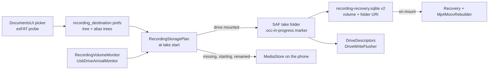

# OCC-PLAN-072: Record to an external USB-C drive

## 1. Objective

Every take is written to MediaStore on `VOLUME_EXTERNAL_PRIMARY`, the phone's internal memory. RAW video fills it in minutes: full-sensor RAW10 at 60 fps is 936 MB/s, about 14 GB in 32 s. Long MP4 takes add up too. The operator should be able to record straight to a drive on USB-C, the way a cinema camera records to its media.

## 2. Why This Plan Exists

Internal memory runs out in minutes with RAW video, and a cinema camera records to removable media. Before this plan, a missing recording volume also failed the whole recovery pass. The operator's decisions and the Razr Fold probe below fixed the scope and the mechanism.

### Operator decisions (2026-11-08)

- Every take type can go to the drive: video, RAW video, audio sidecars and stills.
- If the drive is missing when a take starts, the take goes to the phone and the HUD says so. A take is never lost. A hard disk needs tens of seconds to spin up after Android announces it, so for 45 s after a USB storage device attaches (`UsbDriveArrivalMonitor`) a missing drive reads "USB drive starting" instead of "not connected"; takes still go to the phone meanwhile. The window is per device, because a hub's card reader stays attached with no volume. When a mount is cut short (a hub dropping while vold mounts), the Razr's vold mounts the same drive from then on under a stable name with a suffix (`FFF1-7571` becomes `FFF1-7571-01`), which the stored tree and its permission no longer match. A mounted volume with the same identity (`driveIdentityOf`: the id without one trailing `-NN`) reads "Choose USB folder again", and Settings asks for the folder again. The store keeps the tree picked under the other name as an alias, with its permission, and switches back to it when that name mounts again, so the operator picks each name once. The drive's speed and RAW qualification are keyed by the identity and survive the rename.
- If the drive drops out mid-take, the behaviour is a setting. The default is **Stop and save**: the take ends and keeps what reached the drive. The alternative is **Continue on the phone**.
- The gallery lists the drive's takes while it is connected, with a location badge.

### Evidence (Razr Fold, Android 16, 2026-11-08, throwaway probe app)

Earlier revisions numbered this evidence §3, as some code comments still cite it.

The drive was a WD Elements Desktop (self-powered, exFAT) on the USB 3 bus, first through a plain OTG adapter, then through a powered hub.

- A SAF descriptor from `com.android.externalstorage.documents` resolves to `/storage/<UUID>/…`, the FUSE path. Through it, writes ran at 96 MB/s on average (1 s windows from 44 to 181 MB/s), the same as `dd` from the shell, so the disk was the limit, not SAF.
- On that descriptor all of these worked:
  - `ftruncate` to 6 × 10⁹ bytes, in 64 ms;
  - `MediaMuxer` writing 3 s of 1080p H.264, then read back by `MediaExtractor` (1 track, 3.04 s);
  - `pread` of `ftyp`, `pwrite` with read-back, and `fsync`;
  - `DocumentsContract.renameDocument`.
- The provider appends an extension from the MIME type: `probe.mp4.part` created as `video/mp4` became `probe.mp4.part.mp4`.
- A MediaStore insert on the USB volume worked on this device (the volume was `VISIBLE_FOR_WRITE`). AOSP does not promise that for USB drives, so it is not used.
- On unplug, `FileChannel.force` threw `IOException: No such device` (ENODEV), sometimes before any volume event arrived. The events came in this order: `StorageVolumeCallback` state `ejecting`, `MEDIA_EJECT`, `MEDIA_UNMOUNTED`, `MEDIA_BAD_REMOVAL`. On replug they were `mounted` and `MEDIA_MOUNTED`.
- On replug, SystemUI's `UsbResolverActivity` put an "open with" chooser over the running app.
- `ACTION_OPEN_DOCUMENT_TREE` was answered by an installed third-party file manager instead of the system DocumentsUI.
- The drive dropped every 3 to 20 s on the OTG adapter even though it has its own 12 V supply; the kernel logged a type-C "Disconnect received". A powered hub mostly cured it.

## 3. Prerequisites

- OCC-PLAN-071 (RAW video) before Delivery 3.
- ADR-0037 records the decisions (it was written with Delivery 1).
- An exFAT USB drive, preferably self-powered and on a powered hub (section 2), and the Razr Fold for the device cases. Ask the user to connect the device before every device step; assume it is disconnected.

## 4. Required Reading

ADR-0011 (single-owner muxer and file finalisation), ADR-0013 (MediaStore, SAF and throughput qualification), ADR-0037 (recording to a removable drive through SAF), PLAN-071, `docs/device-validation.md` (the drive cases), `AGENTS.md` (Compose Driver screens `CaptureDestination*`, `CaptureRawVideoSsd*`, `SettingsRecordingDestination*`, `GalleryDrive*`, `RawQualificationReadyDrive*`).

## 5. Inputs

- The Razr Fold probe of section 2 (SAF descriptors, `ftruncate`, `MediaMuxer`, `pread`/`pwrite`, rename, unplug events, USB chooser, picker resolution).
- The existing MediaStore take lifecycle (`RecordingCaptureRecovery`, `recording-recovery.sqlite`), the CinemaDNG export folder store (`SafCinemaDngDestination`), the WebDAV outbox and the RAW qualification store (`DESTINATION_MEDIASTORE_DOCUMENTS`).

## 6. Deliverables

- Delivery 1: the destination model and store, tree validation, the exFAT probe, the volume monitor, the picker contract, the SAF take backend with the in-progress marker and journal v2, stills on the drive, service wiring with fallback and stop and save, the settings rows and HUD chip, and the per-drive MP4 benchmark (slices A to F).
- Delivery 2: the gallery's SAF source, the network drive's and the WebDAV outbox's SAF sources, proxies and CinemaDNG export reading from SAF.
- Delivery 3: RAW video on the drive (`SafRawVideoOutput`) and per-drive RAW qualification.
- Delivery 4: *Continue on the phone* for MP4 and RAW.
- Pull durability: `DriveWriteFlusher`, the side index (`TakeSampleIndex`) and `Mp4MoovRebuilder`.

## 7. In Scope

Every take type (video, RAW video, audio sidecars and stills) to one operator-picked SAF folder on a USB-C drive; the fallback to the phone when the drive is missing, starting or renamed; the behaviour when the drive drops mid-take; recovery of drive takes when the volume mounts again; the gallery, network drive, WebDAV outbox, proxies and CinemaDNG export reading drive takes; per-drive speed measurement and RAW qualification; keeping a pulled MP4 take playable.

## 8. Out of Scope

- NTFS and other filesystems that some OEMs mount: they may work, but there is no promise.
- More than one recording drive at a time.
- Writing proxies or CinemaDNG exports to the recording drive automatically.
- Telling apart a take folder duplicated on the drive outside the app (e.g. copied on a computer): both copies carry the same bundle id, which is the take's key (`take:<bundleId>`, also used by the recovery journal, proxies and the network drive), so the gallery lists one of them. Nothing is lost; the copy stays on the drive. Decided 2026-11-13 to keep the key as it is.

## 9. Architecture



### Decisions

- **SAF is the only mechanism.** The operator picks one folder on the drive. SAF works with every drive Android mounts, and its descriptors are seekable files, which MediaMuxer, `Os.pread`/`pwrite` (`ProjectMp4Descriptor`) and the WAV and FLAC header rewrites need.
- **The picker is the system DocumentsUI.** The picker contract targets `com.google.android.documentsui`, then `com.android.documentsui`. An adopted tree must come from `com.android.externalstorage.documents` and must not be the phone's own storage.
- **exFAT is required.** At adoption, a probe extends a scratch file past 4 GiB with `ftruncate`, then deletes it. If that fails, the drive is rejected with "Format the drive as exFAT", because FAT32 caps a file at 4 GB, which breaks long MP4 takes and every RAW take.
- **The destination lives outside presets.** It is stored in its own SharedPreferences (`recording_destination`) with the persisted URI permission, like the CinemaDNG export folder. Presets never hold paths.
- **Layout on the drive.** Each take gets its own folder, `<picked>/OpenCineCam/<stem>/`, with the video, WAV/FLAC and JSON sidecars together. Stills go in `<picked>/OpenCineCam/Stills/<stem>/`.
- **Final names from the start, with an in-progress marker.** Every file is created under its final name. A hidden `.occ-in-progress` document (`application/octet-stream`) in the take folder is the drive's equivalent of `IS_PENDING`: it is deleted at commit, or when recovery publishes the take as incomplete. Document URIs therefore never change. The approved plan renamed `.part` files instead, but a rename changes the document ID, and with it every URI already recorded in prepared artifacts and sidecars. The extension finding above made that scheme worse still.
- **Journal.** `recording-recovery.sqlite` records each take's destination: the volume and the take folder's document URI. Recovery skips takes whose volume is not mounted and keeps them for later; today a missing volume fails the whole pass with "Recording volume unavailable". Recovery runs again when that volume is mounted.
- **Disconnects.** Either an ENODEV write failure or a volume `ejecting` event ends the take through the existing early-stop path, under the default Stop and save. What reached the drive is recovered as an incomplete take when the drive returns.
- **Losing focus is tolerated.** The camera must survive the USB chooser on replug; it is an ordinary loss of focus.
- **The chooser can be answered once.** No app can hide another app's USB chooser, so while a USB folder is the destination the app enables `.UsbDriveAttachAlias`, an activity with no display for `USB_DEVICE_ATTACHED` on mass storage (class 8) that finishes at once (it opens the camera only when the app has no task; an alias of `MainActivity` stacked a new instance over the settings or the picker on every attach). The operator picks OpenCineCam with Always, and Android then brings the app to the front on attach with no chooser (per USB device). It is off otherwise: as the only candidate the app would make Android confirm every attach. See ADR-0037 decision 9.
- **Transfers.** Delivery 1 does not enrol drive takes in the WebDAV outbox; it waits for Delivery 2.

## 10. Implementation Steps

### Delivery 1: video, audio and stills on the drive

Status (2026-11-08): slices A to F are implemented on `feat/external-ssd-recording`, with 2353 host tests passing. The device cases in `docs/device-validation.md` are pending. ADR-0037 records the decisions.

| Slice | Owner files | Depends on |
|---|---|---|
| A. Destination model, store, tree validation, exFAT probe, volume monitor, picker contract, shared `safFreeBytes` | `storage/RecordingDestination*.kt`, `storage/RecordingVolumeMonitor.kt`, `storage/SafStorage.kt`, `storage/RecordingDriveProbe.kt`, `export/SafCinemaDngDestination.kt` | — |
| B. Take storage backend: MediaStore or SAF behind `RecordingCaptureRecovery`, the marker, journal v2, recovery that skips absent volumes | `storage/RecordingCaptureRecovery.kt`, `VideoOutput.kt`, `WavAudioSidecarRecorder.kt`, `FlacAudioSidecarRecorder.kt`, `IncompleteTakeRecovery.kt` | A |
| C. Stills on the drive | `storage/StillImageSaver.kt`, `StillCaptureRecovery.kt`, `StillPublication.kt` | A |
| D. Service wiring: resolve the destination at take start, fall back with a reason, free space from the destination, stop and save on ENODEV or eject, recover on mount | `service/CaptureService.kt`, `service/RecordingStoragePlan.kt`, `CameraUiState` | B, C |
| E. UI: the Recording destination and If the drive disconnects settings rows, HUD destination chip and fallback notice, strings in six locales, driver screens | settings, HUD, `DriverScreens.kt`, `AGENTS.md` | D |
| F. Per-drive MP4 benchmark at adoption, stored by volume | `storage/ContentResolverBenchmarkDestination.kt` or a SAF twin | A |

### Delivery 2: gallery, network drive and export

- The gallery adds a SAF source that walks the tree while the volume is mounted. It merges with MediaStore by date and shows the badge `gallery-location-ssd`.
- Thumbnails come from `MediaMetadataRetriever`. Rename and delete use `DocumentsContract`.
- The network drive gets a SAF `ShareTakeSource`, and the WebDAV outbox gets a SAF artifact source.
- Proxies and the CinemaDNG export read from SAF; their outputs stay where they go today.

### Delivery 3: RAW video on the drive

Status (2026-11-09): implemented on `feat/external-ssd-recording`, with host tests passing; the device cases in `docs/device-validation.md` are pending. ADR-0037 decision 7 records it. A drive qualification is a full run (camera checks are not reused from the phone's); the journal stays at schema v2.

- `SafRawVideoOutput` implements `RawVideoTakeOutput`, with recovery entries in the SAF journal.
- Qualification is per drive, with `destinationId = "saf:<volumeId>"` replacing the hard-coded `DESTINATION_MEDIASTORE_DOCUMENTS`.
- A drive's qualification ignores the storage rest rule (`storage-not-rested`): a USB drive writes unevenly when rested too, so the rule would end every run on a hard disk. The sweep's `rest` object still records the verdict, marked `ignored`.
- The storage sweep and RAW admission use the drive's free space.

### Delivery 4: continue on the phone

Status (2026-11-09): implemented on `feat/external-ssd-recording`, with host tests passing; the device cases in `docs/device-validation.md` are pending. ADR-0037 decision 6 records it. RAW uses the same restart as MP4 instead of switching the writer's channel: the drive part is stopped and kept, and a new `.ocraw` take `<stem>_cont1` starts on the phone with `continuation*` keys in its static metadata. The gap is about 1–2 s rather than 1 s. Time-lapse and high-speed takes stop and save.

- **MP4:** the take closes on the drive and a continuation take, `<stem>_cont1`, starts on the phone, linked in the clip sidecar. The gap is about 1 s.
- **RAW:** the take stops on the drive and keeps what reached it, and a new `.ocraw` take, `<stem>_cont1`, starts on the phone with `continuation*` keys in its static metadata. The gap is about 1–2 s. This is allowed only if the configuration is qualified for the phone.

### Pull durability

A drive pulled mid-take used to leave an MP4 with its `mdat` and no `moov`, which no player opens. Two pieces keep the take:

- **Periodic fsync.** `DriveWriteFlusher` syncs a duplicate of each drive output's descriptor about once a second (registered with `DriveDescriptors`, ADR-0037), so what the drive acknowledged is on the medium. A pull loses about the last second of data.
- **Side index and moov rebuild.** A GPU-pipeline video take on the drive writes `filesDir/take-index/<takeId>.ocix` (`TakeSampleIndexWriter`), fed by the pipeline's `EncodedSampleListener` with the track formats (codec configuration) and every sample the muxer is given, and flushed about once a second. At recovery, before the take is published as incomplete, `Mp4MoovRebuilder` appends a `moov` built from the index and fixes the `mdat` size. The file then plays, up to about the last second, and its sidecar carries `moovRebuilt` and the sample counts. A sized `mdat` followed by a torn box (the muxer's own `moov` cut by the pull) gets that box turned into a `free` before the new `moov` goes after it. A rebuild leaves a receipt, `<takeId>.ocix.rebuilt`, with the sample counts: when publishing fails after the rebuild, the retry finds the `moov` in place and still records `moovRebuilt` from it. The index and its receipt are deleted when the journal entry is committed, discarded or published, kept while it is deferred or fails, and orphans older than 24 h are swept on each recovery pass.
- **Not covered.** Takes on the `MediaRecorder` path (direct high-speed, slow motion) get no index and are published as before. A rebuild that fails before writing leaves the file unchanged. An append or sync that fails after bytes reached the drive never overwrites sample bytes, but can leave the container metadata incomplete; when the drive went away, the take is retried on its next mount.

## 11. State and Data

- `recording_destination` SharedPreferences: the picked tree, its persisted URI permission and the alias trees picked under another volume name (decision *The destination lives outside presets*; section 2). Presets never hold paths.
- The *If the drive disconnects* setting (Stop and save, the default, or Continue on the phone).
- `recording-recovery.sqlite` journal v2: each take's volume and take-folder document URI; schema v2 also covers RAW (Delivery 3).
- On the drive: `<picked>/OpenCineCam/<stem>/` and `<picked>/OpenCineCam/Stills/<stem>/`, each with a hidden `.occ-in-progress` marker until commit.
- Per-drive MP4 speed measurement, stored by volume; RAW qualification records keyed by `destinationId = "saf:<volumeId>"`; both keyed by the drive identity, so they survive a vold rename.
- `filesDir/take-index/<takeId>.ocix` and its `<takeId>.ocix.rebuilt` receipt, deleted when the journal entry resolves, orphans swept after 24 h.
- `.UsbDriveAttachAlias` component state: enabled only while a USB folder is the destination.

## 12. Failure Handling

- Drive missing at take start: the take goes to the phone and the HUD says so; within 45 s of a USB storage attach it reads "USB drive starting"; a drive mounted under another name reads "Choose USB folder again" (section 2).
- Drive lost mid-take (ENODEV or `ejecting`): Stop and save ends the take through the early-stop path; Continue on the phone restarts as `<stem>_cont1` (Delivery 4). What reached the drive is recovered as an incomplete take when the drive returns.
- Recovery skips takes whose volume is not mounted and keeps them for the next mount.
- A FAT32 drive is rejected at adoption ("Format the drive as exFAT").
- A pulled MP4 loses about the last second; its `moov` is rebuilt from the side index (section 10, Pull durability). `MediaRecorder` takes get no index and are published as before.
- vold kills any process that still holds a descriptor on a removed volume, so every write descriptor on the drive is registered with `DriveDescriptors` and closed when the drive leaves (ADR-0037).

## 13. Tests

- `:app` host tests: `RecordingDestinationTest`, `RecordingDestinationStoreTest`, `RecordingDriveProbeTest`, `RecordingDriveBenchmarkTest`, `RecordingSafRecoveryTest`, `StillSafRecoveryTest`, `SafStorageTest`, `SafDocumentsTest`, `RecordingDestinationWiringTest`, `RecordingDestinationUiTest`, `DriveArrivalTrackerTest`, `DriveDescriptorsTest`, `DriveMediaCatalogTest`, `DriveMediaSafTest`, `SafShareTakesTest`, `SafPreparedArtifactProbeTest`, `RawVideoQualificationStoreTest`, `DriveWriteFlusherTest`, `TakeSampleIndexTest`, `Mp4MoovRebuilderTest`.
- Compose Driver: `CaptureDestination*`, `CaptureRawVideoSsd*`, `CaptureRawVideoDriveFallback`, `CaptureRawVideoQualifyPromptDrive`, `RawQualificationReadyDrive*`, `RawQualificationDoneSlowDrive`, `SettingsRecordingDestination*`, `GalleryDrive*` on `phone`, `inner` and `landscape`.
- Device cases in `docs/device-validation.md` (section 16).

## 14. Documentation Updates

This plan, ADR-0037, `docs/device-validation.md` (drive cases), `AGENTS.md` (screens), strings in six locales, `docs/plans/manifest.yaml` and `docs/plans/README.md`.

## 15. Commands to Run

```bash
export JAVA_HOME=/usr/lib/jvm/java-17-openjdk ANDROID_HOME=$HOME/Android/Sdk
flock ~/.cache/claude-tmp/opencinecam/gradle.lock ./gradlew --no-daemon -Dorg.gradle.parallel=false --max-workers=2 -Dorg.gradle.caching=false :app:testDebugUnitTest :app:lintDebug
./tools/check_format.sh
python3 tools/validate_plan_system.py
tools/compose-driver.sh start CaptureDestinationSsd
tools/compose-driver.sh reset SettingsRecordingDestination
tools/compose-driver.sh reset GalleryDrive
```

Host Gradle runs one module at a time with parallelism off. Device cases use the Razr Fold with the drive on a powered hub.

## 16. Acceptance Criteria

- [ ] Host tests cover the destination resolver and its fallbacks.
- [ ] Host tests cover tree validation.
- [ ] Host tests cover the exFAT probe decision.
- [ ] Host tests cover the journal with SAF entries and with an absent volume (its takes are kept, not discarded).
- [ ] Host tests cover the merged gallery cursor.
- [ ] Host tests cover the RAW store keyed by `destinationId`.
- [ ] Compose Driver renders the new settings rows and HUD states on `phone`, `inner` and `landscape`.
- [ ] On the devices: a 10 min 4K MP4 + WAV take to the drive, and a still.
- [ ] On the devices: starting with no drive (fallback plus warning).
- [ ] On the devices: pulling the drive mid-take in both modes, then replugging (recovery).
- [ ] On the devices: qualifying a drive for RAW and recording a full-sensor 30 fps RAW take.
- [ ] On the devices: the gallery with the drive on and off.

## 17. Evidence to Record

Host suite exit codes, Compose Driver trees and screenshots, and for each device case the device fingerprint, the drive model and filesystem, logcat around the volume events, and the recovered take's sidecar (including `moovRebuilt` and its sample counts after a pull).

- Evidence: device results are recorded in `docs/device-validation.md`; raw logs are kept outside the repository.

## 18. Rollback and Recovery

The destination defaults to the phone; choosing Phone clears the drive and disables `.UsbDriveAttachAlias`, which returns every take to MediaStore. Each delivery is separate and can be reverted on its own. Drive takes already recorded stay on the drive as ordinary files; the journal keeps unrecovered entries until their volume mounts.

## 19. Risks and Mitigations

- USB drives drop out (the OTG adapter dropped the drive every 3 to 20 s) and write unevenly (RISK-004): fallback to the phone, stop and save or continue, pull durability, a powered hub recommended, per-drive speed measurement and RAW qualification with the rest rule ignored.
- The provider appends extensions and renames change document IDs: final names from the start with an in-progress marker.
- A third-party file manager answering the tree picker: the picker targets the system DocumentsUI and the tree's authority is checked.
- vold renaming a drive after a cut-short mount: identity without the `-NN` suffix and alias trees.
- The USB chooser over the running app: losing focus is tolerated, and `.UsbDriveAttachAlias` lets the operator answer it once.

## 20. Completion Update

Not complete (status InProgress). Deliveries 1 to 4 merged to main via PR #5 (8d22ed12, 2026-11-13); the Razr end-to-end findings were fixed in PR #13; pull durability merged via PR #26 (95899215, 2026-11-19), recorded as ADR-0037 decision 10. All of it shipped in OpenCineCam 2.0.0 (Google Play production, 2026-11-19). The device cases of section 16 remain open.

## 21. Execution Record

- 2026-11-08 Operator decisions and the Razr Fold probe (section 2). Delivery 1 slices A to F implemented on `feat/external-ssd-recording` with 2353 host tests passing.
- 2026-11-09 Deliveries 3 and 4 implemented with host tests passing (ADR-0037 decisions 6 and 7).
- 2026-11-13 Merged to main via PR #5 (8d22ed12). Decided to keep `take:<bundleId>` as the take key (section 8).
- Razr end-to-end findings fixed in PR #13.
- 2026-11-19 Pull durability merged via PR #26 (95899215; ADR-0037 decision 10).
- 2026-11-19 Shipped in OpenCineCam 2.0.0 (Google Play production).
